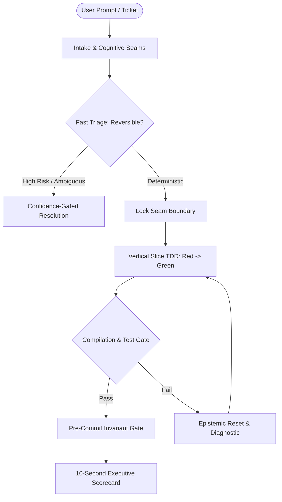

# ⚡ Universal Agent Skills & Autonomous Engineering Brain

[](https://opensource.org/licenses/MIT)
[](https://github.com/methastrategy/universal-agent-skills/actions/workflows/verify.yml)
[](https://antigravity.google.com)
[](https://anthropic.com)
[](https://cursor.com)
[](https://codeium.com/windsurf)

A production-grade collection of **22 modular skills**, deterministic cognitive invariants, and structured engineering workflows for AI coding assistants and autonomous multi-agent pipelines.

Designed to turn AI assistants into senior, high-velocity engineering partners that eliminate pleasantries, prevent hallucinations, self-heal errors, and write minimal production-ready code without drip-feeding.

---

## 🧭 System Architecture & Cognitive Flow



---

## 🗂️ The 22 Modular Skills Catalog

| Skill | Category | Trigger / Command | Core Responsibility & Protocol |
| :--- | :---: | :---: | :--- |
| **`architect`** | Architecture | `/architect` | Deep modules, clean backend, ADR tradeoffs, and schema design |
| **`advice`** | Decision | `/advice` | Multi-perspective advisory board & decision cockpit |
| **`analyze`** | Diagnostics | `/analyze` | Deep systems architecture audit & 4-Stage Root-Cause diagnostics |
| **`jev`** | Decision | `/jev` | Ultra-fast atomic decision triaging & confidence-gated execution |
| **`optimize`** | Optimization | `/optimize` | 5-Stage Unified Evolution Engine & prompt optimization |
| **`build`** | Execution | `/build` | Granular implementation, TDD at seams, React 19 actions, build verification |
| **`refactor`** | Refactoring | `/refactor` | Zero-regression refactoring, modular extraction, cyclomatic reduction |
| **`debug`** | Diagnostics | `/debug` | Systematic defect isolation, root-cause investigation, and regression prevention |
| **`review`** | QA & Security | `/review` | OWASP top-10 security audit, UI accessibility, and architecture review |
| **`merea`** | Reverse Eng | `/merea` | Universal reverse engineering, binary deconstruction, backward causality |
| **`quant`** | Finance | `/quant` | Quantitative financial intelligence, multi-agent debate, data pipelines |
| **`mql5-ea`** | Algorithmic Trading | `/mql5-ea` | MetaTrader 5 Expert Advisor lifecycle, CLI compilation, backtest loop |
| **`medesign`** | UI/UX & Design | `/medesign` | Curated UI/UX design suite, design tokens, slides, banners, and logos |
| **`genflow`** | Media | `/genflow` | Autonomous AI director, code-to-video, and 3D motion graphics |
| **`continue`** | Session | `/continue` | Seamless session recovery, context restoration, and execution resumption |
| **`handoff`** | Session | `/handoff` | Session compacting, state compression, and model handoff |
| **`summarize`** | Knowledge | `/summarize` | Dual-Partition Confession Box protocol & high-compression summarization |
| **`research`** | Knowledge | `/research` | Hybrid deep research, engineering standards, and official documentation |
| **`explain`** | Education | `/explain` | High-density technical explanation & algorithm code analogies |
| **`tokens`** | Telemetry | `/tokens` | Live token telemetry, cache hit rate, and context window budgeting |
| **`tomd`** | Tooling | `/tomd` | Full-fidelity folder to Markdown batch extraction |
| **`wait-what`** | Circuit Breaker | `/wait-what` | Cognitive circuit breaker to reset loops and question assumptions |

---

## ⚡ 1-Click Multi-Agent Installation (v2.0)

Install all 22 skills and cognitive rules into your agent environment in seconds:

### Supported AI Agent Platforms
| Target | CLI Flag | Destination / Setup |
| :--- | :--- | :--- |
| **Google Antigravity 2.0** | `antigravity` (default) | `~/.gemini/config/skills/` + global rules |
| **Claude Code** | `claude` | `.claude/skills/` + `CLAUDE.md` |
| **OpenAI Codex / o3 / GPT** | `codex` | `.codex/skills/` + `AGENTS.md` |
| **Cursor IDE** | `cursor` | `.cursor/skills/` + `.cursorrules` |
| **Windsurf IDE** | `windsurf` | `.windsurf/skills/` + `.windsurfrules` |
| **OpenClaw / Generic Agent** | `openclaw` | `.agents/skills/` + `.agents/rules/AGENTS.md` |
| **All Platforms** | `all` | Configures all environments simultaneously |

### Windows (PowerShell)
```powershell
# Default: Installs into Google Antigravity (~/.gemini/config/skills)
.\install.ps1

# Install for specific agents
.\install.ps1 -Target claude
.\install.ps1 -Target codex
.\install.ps1 -Target cursor
.\install.ps1 -Target windsurf
.\install.ps1 -Target openclaw
.\install.ps1 -Target all

# Preview installation without modifying files
.\install.ps1 -Target all -DryRun
```

### macOS / Linux (Bash)
```bash
# Default: Installs into Google Antigravity (~/.gemini/config/skills)
chmod +x install.sh && ./install.sh

# Install for specific agents
./install.sh claude
./install.sh codex
./install.sh cursor
./install.sh windsurf
./install.sh openclaw
./install.sh all

# Preview installation
./install.sh all --dry-run
```

### Antigravity Native Plugin Support
This repository includes a root `plugin.json` manifest. You can link or copy this entire repository as an Antigravity Plugin into `~/.gemini/config/plugins/universal-agent-skills/` or use `/plugin` to manage it directly.

### Manual Directory Placement
- **Google Antigravity 2.0:** Copy `skills/` to `~/.gemini/config/skills/` and `rules/AGENTS.md` to `~/.gemini/AGENTS.md`.
- **Claude Code:** Copy `skills/` to `.claude/skills/` and reference `rules/CLAUDE.md`.
- **OpenAI Codex / o3:** Copy `skills/` to `.codex/skills/` and copy `rules/CODEX.md` to project root as `AGENTS.md`.
- **Cursor / Windsurf:** Copy `skills/` to `.cursor/skills/` or `.windsurf/skills/` and copy directives to `.cursorrules` / `.windsurfrules`.
- **LangGraph / n8n / AutoGen Orchestrators:** See [`docs/FLOWS_AND_WORKFLOWS.md`](docs/FLOWS_AND_WORKFLOWS.md) for treating each skill as a specialized subagent prompt.

---

## 📜 Key Architectural Invariants

- **Internal Rigor vs External Output Invariant:** Analytical heuristics (Causal Chaining, Root-Cause Diagnostics) operate strictly as internal thinking engines. Outputs strictly use standard, elite engineering sections (Symptom, Root Cause, Target State, Remediation Plan) without theological or religious jargon.
- **Top-to-Bottom 3-Zone Eyeline Flow:**
  - **Zone 1:** Lead with verified facts / status in 1-2 lines.
  - **Zone 2:** Clean bullet points and 5-10 lines of verbatim diff/log evidence.
  - **Zone 3:** Executive Summary + Copy-ready action box (plain text for advice; copy-ready code box only when actionable commands exist).
- **Ponytail Minimal-Change Hierarchy:** Prefer standard library and existing helpers over adding unsolicited third-party packages or abstractions.
- **Compaction-Resilient Modular Structure:** Skill files adhere to clean ceilings with deep knowledge separated into `references/*.md`.

---

## 📄 License

Distributed under the MIT License. See `LICENSE` for more information.
