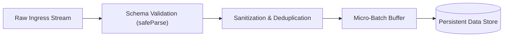
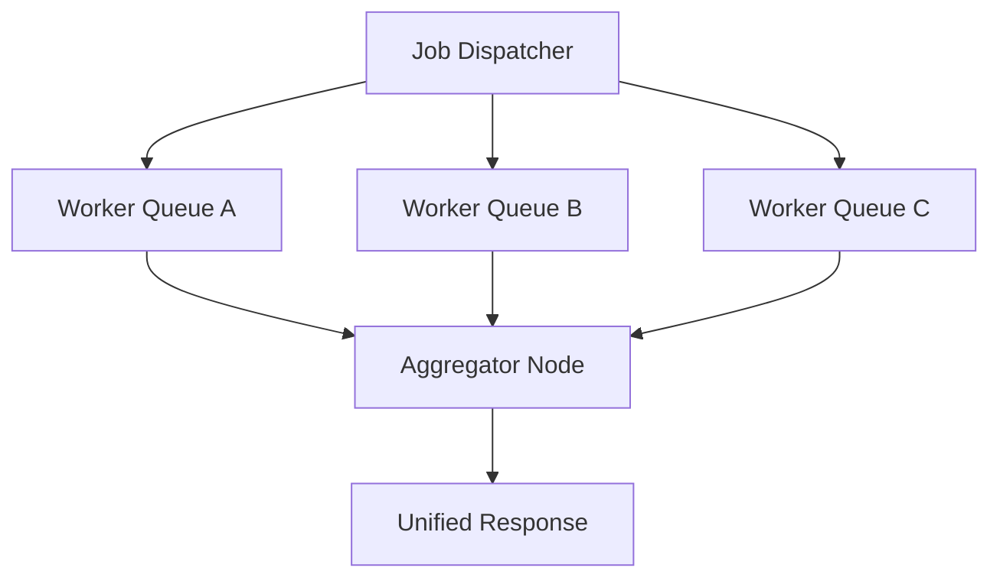
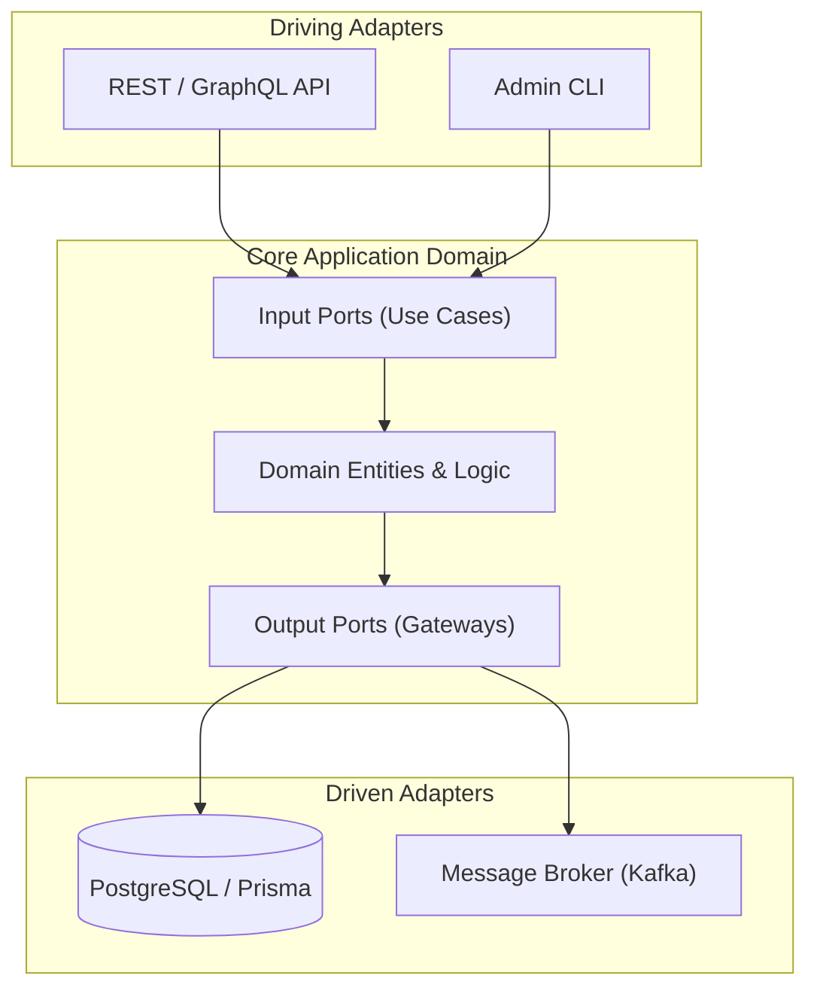
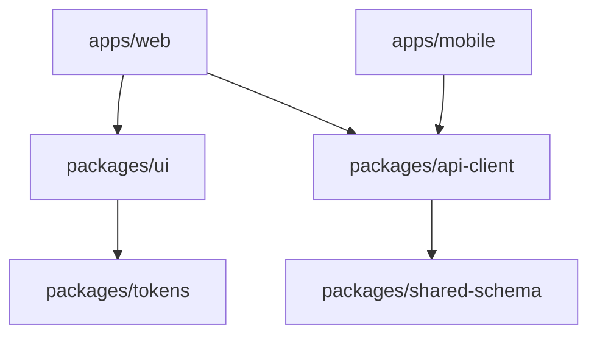
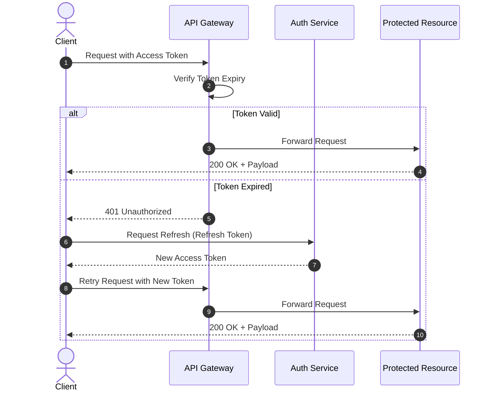
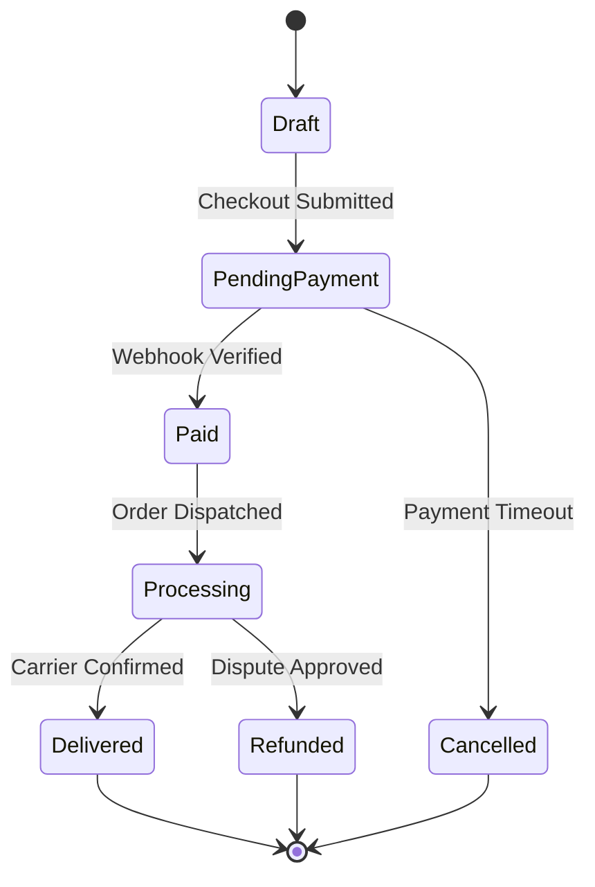
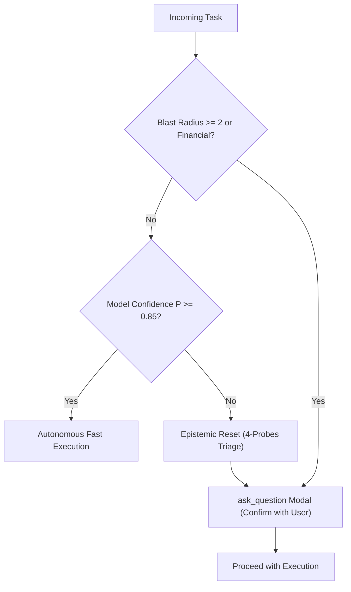
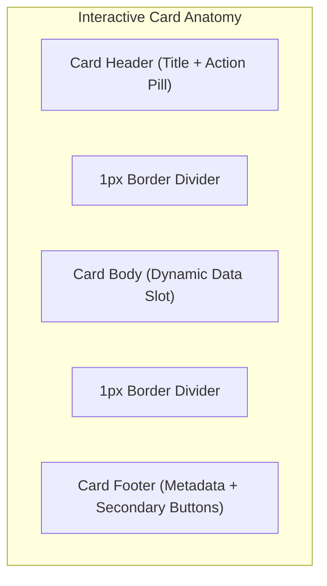

# Architectural Diagram Catalog (44 Archetypes Framework)

แค็ตตาล็อกรูปแบบไดอะแกรมสถาปัตยกรรม (อ้างอิงจาก `diagram-design` archetypes) สังเคราะห์และคัดกรองให้เหมาะสมกับการวิเคราะห์ระบบและสื่อสารทางเทคนิคของ Coding Agent

---

## 1. Flow & Pipeline Archetypes (การไหลของข้อมูลและขั้นตอนประมวลผล)

ใช้เมื่อต้องการอธิบาย Data Pipelines, Event Streaming, ETL หรือ Background Task Execution

### 1.1 Sequential Ingestion Pipeline

### 1.2 Fan-Out / Fan-In Parallel Worker Pipeline

---

## 2. Structural & Topology Archetypes (ผังสถาปัตยกรรมและโครงสร้างโมดูล)

ใช้เมื่อวิเคราะห์ขอบเขตของ Deep Modules, Package Dependencies หรือ Network Topology

### 2.1 Hexagonal Architecture (Ports & Adapters)

### 2.2 Monorepo Boundary & Dependency Flow

---

## 3. Sequence & Protocol Handshake Archetypes (ลำดับการสื่อสาร)

ใช้เมื่ออธิบาย OAuth flows, API Authentication, Handshake หรือ Real-time WebSockets

### 3.1 Gated Auth & Token Refresh Sequence

---

## 4. State Machine & Lifecycle Archetypes (สถานะและวงจรชีวิต)

ใช้เมื่อระบุวงจรชีวิตของ Entity (Orders, Connection pools, Job status)

### 4.1 Order & Payment Finite State Machine

---

## 5. Decision & Risk Triage Trees (การตัดสินใจและการประเมินความเสี่ยง)

ใช้เมื่อออกแบบทางแยกตรรกะ, Confidence Gating, หรือ TDD Seam triage

### 5.1 System 1 vs System 2 Execution Gating

---

## 6. Component Anatomy Archetypes (โครงสร้างส่วนประกอบ UI)

ใช้เมื่ออธิบายสัดส่วนของ Component, Slot compositions, และ Visual Seams

---

## 7. กฎการเลือกใช้ไดอะแกรม (Selection Heuristics)
1. **ลำดับเวลา / ขั้นตอน:** ใช้ Flowchart หรือ Sequence Diagram
2. **ขอบเขตโมดูล / ความสัมพันธ์:** ใช้ Hexagonal หรือ Package Dependency Flowchart
3. **การเปลี่ยนสถานะ:** ใช้ State Diagram เสมอ (ห้ามใช้ Flowchart สับสน)
4. **การประเมินความเสี่ยง:** ใช้ Decision Tree ชี้แจงทางแยกเงื่อนไข
