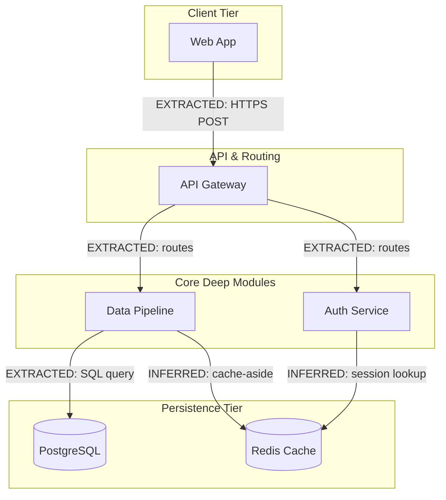

# Graph Edge Classification & Diagram Layout Rules

คู่มือการจำแนกประเภทเส้นความสัมพันธ์ (Edge Typing) และการจัดผังไดอะแกรมสถาปัตยกรรม (Archify Layout Heuristics) สกัดจากแนวคิดของ **Graphify** (`Graphify-Labs/graphify`) และ **Archify** (`tt-a1i/archify`)

---

## 1. การจำแนกประเภทเส้น (Graphify Edge Classification)

ทุกความสัมพันธ์ใน Architectural Diagram หรือ System Blueprint ต้องระบุสถานะของเส้นเพื่อความโปร่งใสทางวิศวกรรม:

| ประเภทเส้น | ความหมาย | ที่มาของข้อมูล | ตัวอย่างการใช้งาน |
| :--- | :--- | :--- | :--- |
| **`EXTRACTED`** | ความสัมพันธ์ที่อ่านได้ตรงๆ จากโค้ดต้นฉบับ 100% | AST, Imports, Direct Function Calls, Foreign Keys | `Component --"EXTRACTED: calls"--> Service` |
| **`INFERRED`** | ความสัมพันธ์ที่ Agent อนุมานเชื่อมโยงข้ามไฟล์หรือบริบท | เอกสารคู่มือ, Schema mapping, Runtime observation | `API --"INFERRED: consumes"--> Queue` |

### กฎการกำกับเส้น (Edge Labeling Invariant)
- หากความสัมพันธ์เกิดจากการ `import` หรือ `call` ในโค้ดจริง ให้ใช้ `EXTRACTED`
- หากเป็นความสัมพันธ์ข้ามระบบ (เช่น UI ยิงผ่าน HTTP Endpoint ไปหา Backend Service ที่ไม่มี Type Link โดยตรง) หรืออนุมานจาก Docs/SQL ให้ใช้ `INFERRED`
- การแยกประเภทนี้ช่วยป้องกัน **Hallucinated Connections** และทำให้ผู้ตรวจทาน (Judge/Reviewer) สามารถแยกข้อเท็จจริงออกจากสมมติฐานได้ทันที

---

## 2. กฎการจัดวางผังไดอะแกรม (Archify Diagram Layout Heuristics)

1. **Hierarchy First (จัดลำดับชั้นก่อนลากเส้น):**
   - จัดทิศทางการไหลหลักให้ชัดเจน (เลือกระหว่าง Top-Down `flowchart TD` หรือ Left-Right `flowchart LR`)
   - ชั้นบนสุดคือ Ingress/Entry point (UI / CLI / Webhook) และชั้นล่างสุดคือ Sink/Storage (DB / Disk / External API)
2. **No Arrow Pile-Up (ห้ามลูกศรทับกันเป็นกระจุก):**
   - หลีกเลี่ยงการลากลูกศรหลายสายพุ่งเข้าหา Node เดียวที่กึ่งกลางจนบังตัวอักษร
   - หากมี Hub กลาง ให้ใช้ Intermediate Router, Gateway, หรือจัดกลุ่ม Subgraph ช่วยกระจายเส้น
3. **Emphasis by Centrality (ให้ความสำคัญกับ Core Entity):**
   - Node ที่มี In-degree/Out-degree สูงสุด (เช่น Orchestrator หรือ Core Database) ต้องวางไว้ตำแหน่งที่มองเห็นง่ายที่สุด
4. **Deterministic Spread (กระจายจุดเชื่อมอย่างคงที่):**
   - เส้นที่แยกจาก Node เดียวกันไปยังหลายปลายทาง ให้จัดเรียงลำดับตามขั้นตอนการทำงาน (Chronological) หรือตามระดับความสำคัญ
5. **Label Every Non-Obvious Edge:**
   - เส้นเชื่อมที่ไม่ชัดเจนจากชื่อ Node ต้องมีคำอธิบายสั้นๆ กำกับเสมอ เช่น `--"EXTRACTED: JWT auth"-->`

---

## 3. ตัวอย่างการสร้าง Mermaid Diagram

