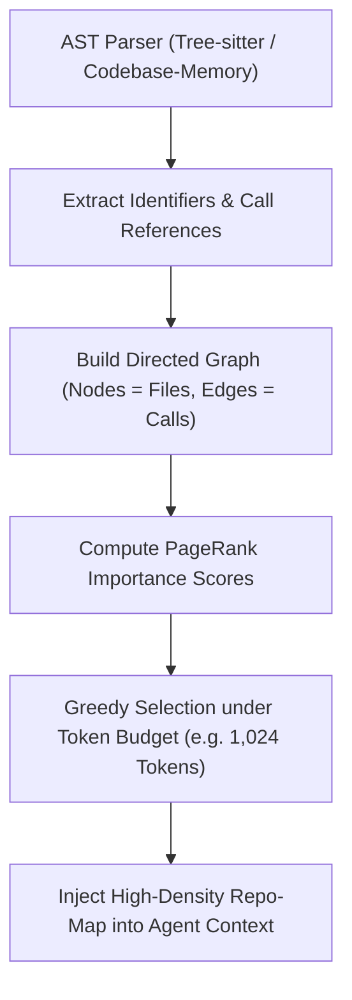

# Repository Map Protocol (AST Context Architecture)

สถาปัตยกรรมการสร้างและใช้งาน **Repository Map** (ดัดแปลงจากโมเดลของ `Aider` และ `OpenHands`) เพื่อให้ AI Agent สามารถมองเห็นโครงสร้าง ภาพรวม และจุดเชื่อมต่อของ Codebase ขนาดใหญ่ (100+ ไฟล์) ได้อย่างแม่นยำ โดยใช้ Token เพียง 10–15% เมื่อเทียบกับการอ่านโค้ดเต็มไฟล์

---

## 1. ปัญหาของ Context Bloat ใน Codebase ขนาดใหญ่

เมื่อต้องทำงานกับโปรเจกต์ขนาดกลางถึงใหญ่ การพยายามอ่านไฟล์ทั้งหมดเข้าสู่ Prompt ก่อให้เกิดปัญหา:
1. **Context Window Saturation:** เปลือง Token มหาศาลและเพิ่ม Latency ของรอบสนทนา
2. **Lost in the Middle:** โมเดลมองข้ามรายละเอียดสำคัญที่อยู่ตรงกลาง Prompt
3. **Stale Mental Model:** ความเข้าใจโครงสร้างคลาดเคลื่อนหากไม่มีการอัปเดตกราฟสัญลักษณ์

---

## 2. องค์ประกอบของ AST Repository Map

Repo-Map ไม่ใช่แค่ Tree ไดเรกทอรี (`ls -R`) แต่คือ **แผนผังความสัมพันธ์ของสัญลักษณ์ (Symbol & Call Hierarchy)** ที่สกัดจาก Abstract Syntax Tree (AST):

```text
src/
├── core/
│   ├── engine.py
│   │   ├── class ExecutionEngine
│   │   │   ├── def __init__(self, config: EngineConfig)
│   │   │   ├── def execute_trade(self, order: TradeOrder) -> ExecutionResult
│   │   │   └── def shutdown(self) -> None
│   │   └── def calculate_slippage(price: float, volume: float) -> float
│   └── gates/
│       └── jev_gate.py
│           └── class JevExecutionGate
│               └── def verify(self, signal: StrategySignal) -> GateDecision
└── adapters/
    └── mt5_connector.py
        └── class MT5Connector
            └── def send_order(self, order_dict: dict) -> bool
```

### ข้อมูลที่ต้องคงไว้ใน Repo-Map:
- **Class / Struct Definitions**: ชื่อคลาส และ Interfaces/Base Classes
- **Public Methods & Functions**: ชื่อฟังก์ชัน, พารามิเตอร์หลัก, Type Annotations, และ Return Type
- **Exports & Public Seams**: สัญลักษณ์ที่ถูกเปิดให้โมดูลอื่นเรียกใช้งาน (`__all__`, `export default`, `public:`)
- **Key References / Cross-Module Imports**: โมดูลต้นทางที่คลาสนั้นพึ่งพา

### ข้อมูลที่ต้องตัดทิ้ง (Pruned):
- Body โค้ดภายในฟังก์ชันทั้งหมด (`pass`, `{ ... }`)
- Local Variables และ Private Helper ย่อยที่ไม่ได้ถูกเรียกข้ามไฟล์
- Comments ฟุ่มเฟือยและ Docstrings ขนาดยาว (คงไว้เฉพาะ 1 บรรทัดสรุปสั้น)

---

## 3. อัลกอริทึมการคำนวณความสำคัญของสัญลักษณ์ (Symbol Ranking)

ตามแนวทางของ Aider การจัดสรรงบประมาณ Token ให้กับ Repo-Map จะใช้อัลกอริทึม **Graph-based Importance (PageRank)**:



1. **สร้าง Directed Dependency Graph**: ทุกไฟล์คือ Node และทุกจุดที่ฟังก์ชัน A เรียกใช้ฟังก์ชัน B คือ Directed Edge
2. **คำนวณ Centrality**: ไฟล์หรือคลาสที่มีผู้เรียกใช้มากที่สุด (เช่น Core Interfaces, Database Models) จะได้รับน้ำหนักคะแนนความสำคัญสูงสุด
3. **Token-Budgeted Truncation**: สกัดเฉพาะกิ่งก้านที่สำคัญที่สุดให้อยู่ในงบประมาณ Token ที่ตั้งไว้ (เช่น ไม่เกิน 1,500 Tokens ต่อเซสชัน)

---

## 4. แนวปฏิบัติสำหรับ Agent เมื่อวิเคราะห์โปรเจกต์

1. **สำรวจภาพรวมด้วย Map ก่อนเจาะลึก**: เรียกดูโครงสร้าง Symbol Map ก่อนสั่งอ่านไฟล์ตัวเต็ม
2. **เจาะจงเฉพาะ Seams ที่เกี่ยวข้อง**: เมื่อพบว่าฟังก์ชันเป้าหมายอยู่ใน `engine.py:execute_trade` ให้อ่านเฉพาะไฟล์และบรรทัดที่เกี่ยวข้องโดยตรง
3. **ใช้ MCP `codebase-memory` เมื่อมี**: ดึงข้อมูล Knowledge Graph (`search_graph`, `trace_path`) แทนการ Dump ไฟล์ลง Context
