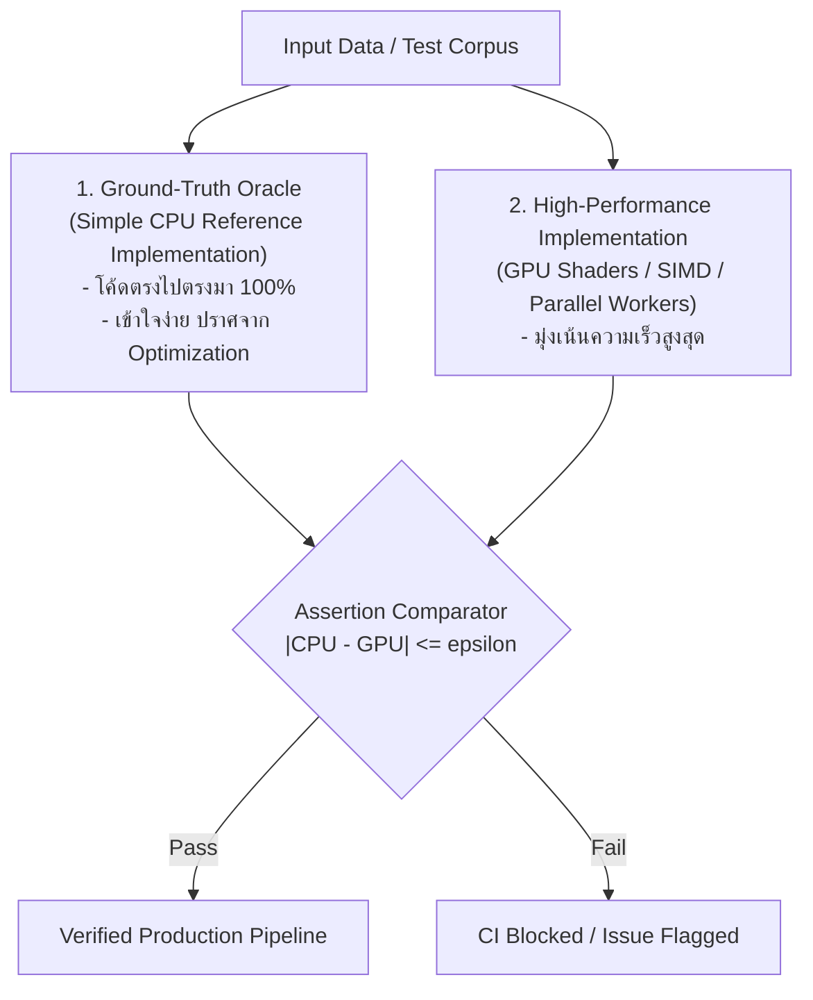

# Clean-Room Parity Engineering & Agent-Drivable Architecture

แนวปฏิบัติการออกแบบสถาปัตยกรรมซอฟต์แวร์สำหรับการสร้างระบบทดแทนซอฟต์แวร์ขนาดใหญ่ (เช่น Adobe Creative Suite, CAD, GIS) และการประสานงาน AI Agents ในระดับสเกลสูง (ถอดบทเรียนจากกรณีศึกษา `storytold/photocraft` และ ArtCraft)

---

## 1. Clean-Room Specification Mapping (การสร้างเลียนแบบโดยไม่ละเมิดลิขสิทธิ์)

การพัฒนาซอฟต์แวร์ทดแทนระบบเชิงพาณิชย์ที่มีความซับซ้อนสูง ต้องปฏิบัติตามหลักวิศวกรรมย้อนรอยแบบห้องสะอาด (Clean-Room Protocol):

1. **ห้าม Decompile ไบนารีเชิงพาณิชย์:** ป้องกันการปนเปื้อนของโค้ดต้นฉบับที่มีลิขสิทธิ์และสิทธิบัตรทางการค้า
2. **อาศัย Public File Format Specifications:**
   - ศึกษาโครงสร้างไฟล์จากเอกสารทางการที่เผยแพร่สู่สาธารณะ (เช่น Adobe Photoshop Specification, OpenDesign DXF, OGC GeoTIFF, W3C OpenType)
   - สร้างโมดูลถอดรหัส (Codecs) เป็น Standalone Library ชั้นล่าง (Layer 0/1) ที่ไม่มี Dependency ผูกกับตัวแอปพลิเคชันหลัก
3. **Behavioral Black-Box Inventory:**
   - รวบรวมฟังก์ชันการทำงานทั้งหมดผ่านการสังเกตภายนอก: รายการเมนู, คีย์ลัด, ค่าพารามิเตอร์เริ่มต้น, และการตอบสนองต่อ Input ของผู้ใช้
   - จัดทำสารบัญเมนูและฟังก์ชันแยกออกมาเป็นข้อมูลดิบ (เช่น `menu_catalog.rs` หรือ JSON) ก่อนเริ่มลงมือเขียนฟังก์ชัน

---

## 2. Dual-Implementation Oracle Pattern (การตรวจสอบความถูกต้องคู่ขนาน)

สำหรับอัลกอริทึมที่ซับซ้อน (เช่น การผสมสี Blending Math, การแปลงพิกัด GIS, Shader บน GPU หรือการคำนวณทางการเงิน):

- **กฎความคลาดเคลื่อน:** กำหนดค่า $\epsilon$ ที่ยอมรับได้ชัดเจน (เช่น ใน PhotoCraft กำหนดความคลาดเคลื่อนสีของ GPU ต้องต่างจาก CPU ไม่เกิน $\le 1/255$)
- **Test Corpus:** สร้างชุดไฟล์ทดสอบของจริง (Real-World Test Corpora) เพื่อใช้เป็นตัววัดผลอัตโนมัติในการทดสอบทุกรอบ

---

## 3. Parity Checklist Decomposition (กลยุทธ์การซอยย่อยงานขนาดใหญ่)

เมื่อต้องสร้างระบบขนาดใหญ่ที่มีฟังก์ชันนับพัน การสั่ง AI ด้วยเป้าหมายกว้างๆ ("สร้างโปรแกรมเหมือน Photoshop/AutoCAD") จะล้มเหลวเสมอ ต้องซอยย่อยงานตามหลัก Parity Decomposition:

1. **Enumeration (แจกแจงทุกจุดเชื่อมต่อ):**
   - รวบรวมทุกปุ่ม เมนู และ Action ออกมาเป็นตาราง Checklist (เช่น รายการเมนู 628 รายการใน `docs/parity-checklist.md`)
2. **Binary State Tracking:**
   - กำกับสถานะของแต่ละ Seam: `[Implemented: true/false]`, `[Needs Document]`, `[Shortcut]`, `[ID: TOOL-xxx]`
3. **Discrete Assignment for Agents:**
   - จ่ายงานให้ AI ทีละ 1-2 รายการ (เช่น "Implement TOOL-214-3: Color Range exact match") พร้อมชุดทดสอบเฉพาะจุด
   - ป้องกันการที่ AI Agent หลายตัวแก้โค้ดชนกันหรือหลุดขอบเขตงาน

---

## 4. Agent-Drivable Interface Standard (การออกแบบแอปให้ Agent ควบคุมได้)

ซอฟต์แวร์ยุคใหม่ต้องไม่ได้ถูกออกแบบมาเพื่อให้มนุษย์ใช้งานผ่านหน้าจอ GUI เพียงอย่างเดียว แต่ต้องเปิดช่องทางให้ AI Agent สั่งการและตรวจสอบได้แบบ Headless:

1. **Local Loopback Control Protocol:**
   - เปิดพอร์ต TCP ภายในเครื่อง (เช่น `127.0.0.1:7878`) ที่ต้องยืนยันตัวตนด้วย Random Token (`.private/control.token`)
   - ส่งคำสั่งและรับผลลัพธ์ผ่าน JSON-Lines Stream
2. **Headless MCP Server Integration:**
   - พัฒนา CLI รองรับโหมด `mcp` โดยตรง (เช่น `photocraft-cli mcp`)
   - ให้บริการเครื่องมือมาตรฐาน:
     - `ui_inspect`: ตรวจสอบสถานะ Element บนหน้าจอ, เมนูที่เปิดอยู่, สถานะเลเยอร์
     - `ui_screenshot`: แคปภาพหน้าจอปัจจุบันคืนค่าเป็น Base64/PNG ให้ Agent ตรวจสอบ Visual Regression
     - `command_run`: สั่งเรียกฟังก์ชันภายในของแอปโดยตรงผ่าน Command ID
     - `command_batch`: ส่งชุดคำสั่งแบบลำดับขั้นตอนเพื่อทดสอบการทำงานต่อเนื่อง
3. **ประโยชน์:** Agent สามารถพัฒนาฟีเจอร์ รันแอป สั่งทดสอบคลิก และตรวจรับงานได้เองแบบปิดลูป (Autonomous Closed-Loop Verification)

---

## 5. Byte-Exact Passthrough Protocol (การคงสภาพไฟล์เพื่อป้องกันความเสียหาย)

บทเรียนจาก Issue #2374: เมื่อ AI เพิ่มฟีเจอร์ในไฟล์โครงสร้างซับซ้อน (PSD, DXF, LandXML, DB):

- **ห้ามสร้าง Container ใหม่จากอากาศ (No Rebuilding from Stubs):**
  - หากไม่มีการแก้ไขส่วนนั้น ต้องเขียนข้อมูลเดิมกลับไปแบบ Byte-for-byte 100%
  - เมื่อมีการแก้ไขเฉพาะจุด (Surgical Edit) ให้อัปเดตเฉพาะ Sub-field ที่เกี่ยวข้องเท่านั้น โดยคงคีย์ย่อย รหัสสตริง และค่าทศนิยมเดิมไว้ครบถ้วน
- **Corpus Round-Trip Test:**
  - สร้างการทดสอบ `test_resave_unmodified_file_is_byte_identical`: เปิดไฟล์ตัวอย่าง $\to$ สั่ง Save ทันทีโดยไม่แก้ $\to$ ตรวจสอบว่า Hash SHA-256 ของไฟล์ผลลัพธ์ต้องตรงกับไฟล์ต้นฉบับ 100%
