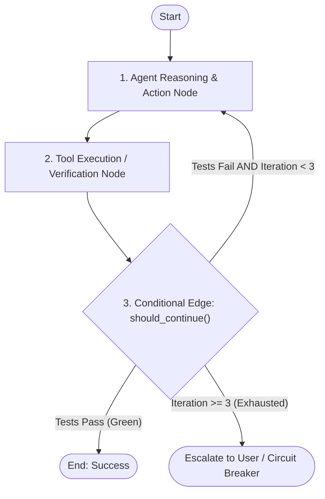

# Cyclic Agent State Machines & Conditional Edge Gating

สถาปัตยกรรมการออกแบบวงจรกระบวนการคิดและการทำงานของ AI Agent ในรูปแบบ **State Machine แบบมีวงรอบ (Cyclic Graph)** (ดัดแปลงจากโมเดลของ `LangGraph` และ `AutoGen`) เพื่อรองรับการทำงานที่ต้องวนรอบปรับปรุงตัวเอง (Feedback Loop, Self-Correction, Multi-Turn Validation) โดยไม่เกิดปัญหา Infinite Loop หรือ Context Drifting

---

## 1. ข้อจำกัดของ Linear DAG vs พลังของ Cyclic Graph

ในระบบ Agent ดั้งเดิม กระบวนการมักถูกเขียนเป็นเส้นตรง (Direct Acyclic Graph - DAG):
`Input -> Plan -> Execute -> Output`
แต่ในงานวิศวกรรมจริง งานส่วนใหญ่ต้องการ **วงจรสะท้อนกลับ (Feedback Cycles)**:
`Draft -> Compile/Test -> Fail -> Analyze Error -> Patch -> Retest (Loop)`



---

## 2. องค์ประกอบสำคัญของ Cyclic State Machine

### 1. Centralized State Schema (Typed State)
ทุกโหนดในกราฟต้องอ่านและอัปเดต State ผ่าน Data Contract ชุดเดียวกัน:
```python
from typing import TypedDict, List, Annotated
import operator

class AgentGraphState(TypedDict):
    task_description: str
    target_files: List[str]
    iteration_count: int
    test_results: dict
    error_trace: str
    status: str  # 'PLANNING' | 'EXECUTING' | 'VERIFYING' | 'DONE' | 'BLOCKED'
```

### 2. State Checkpointing & Time Travel
- ในทุกๆ รอบของการวนลูป ให้บันทึก State Snapshot ลง Checkpoint Store
- หาก Agent เดินทางผิดพลาด (เช่น แก้โค้ดแล้วแย่ลงกว่าเดิม) ระบบสามารถ Rollback ย้อนเวลากลับไปยัง Checkpoint ก่อนหน้าได้ทันที

### 3. Conditional Edge Gating (`should_continue`)
กฎการแตกกิ่ง (Branching Logic) ต้องเป็น Deterministic Code ที่ประเมินจาก State:
```python
def should_continue(state: AgentGraphState) -> str:
    if state["test_results"].get("all_passed"):
        return "SUCCESS"
    if state["iteration_count"] >= 3:
        return "CIRCUIT_BREAKER_ESCALATE"
    return "REPAIR_LOOP"
```

---

## 3. กฎเหล็กป้องกัน Infinite Loop (The 3 Termination Invariants)

1. **Hard Iteration Budget**: ทุก Cyclic Flow ต้องกำหนดเพดานรอบการวนสูงสุด (Default: 3 รอบสำหรับงานทั่วไป, สูงสุดไม่เกิน 5 รอบ)
2. **Divergence Guard**: หากสังเกตเห็นว่า Error Trace ในรอบที่ $N+1$ ซ้ำเดิมกับรอบที่ $N$ ห้ามรันซ้ำรอบที่ 3 ให้หยุดและทำ Epistemic Reset
3. **External Interrupt Support (Human-in-the-Loop)**: ออกแบบให้มีจุดพัก (Breakpoint) เมื่อต้องแตะต้องส่วนที่อันตราย (Irreversible Actions) เช่น การลบข้อมูล การรัน Migration หรือการยิงคำสั่งซื้อขายจริง
