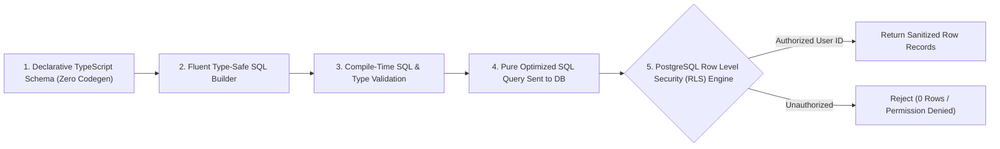

# Edge-Ready Type-Safe SQL & Row Level Security (RLS) Architecture

สถาปัตยกรรมการออกแบบฐานข้อมูลและเลเยอร์เข้าถึงข้อมูลยุคใหม่ (ดัดแปลงจากโมเดลของ `Drizzle ORM`, `Kysely`, และ `Supabase`) เพื่อให้ระบบมีประสิทธิภาพสูงสุดระดับ Edge/Serverless ปราศจากความเทอะทะของ ORM แบบเดิม (Zero Overhead) และควบคุมความปลอดภัยถึงระดับแถวข้อมูลด้วย Row Level Security (RLS)

---

## 1. การก้าวข้ามข้อจำกัดของ Heavy ORM

ORM ยุคเก่า (เช่น TypeORM, Prisma ยุคแรก) มักมีปัญหา:
1. **Cold Start & Heavy Runtime**: มี Binary Engine หรือ Reflection หนักหน่วง ไม่เหมาะกับ Cloudflare Workers หรือ Serverless Functions
2. **N+1 Query & Hidden SQL**: ซ่อนคำสั่ง SQL ที่แท้จริง ทำให้ยากต่อการจูน Index และ Optimize Query
3. **Type Incompleteness**: บางครั้งคืนค่าเป็น `any` หรือสูญเสีย Type เมื่อเขียน Subquery ซับซ้อน

---

## 2. เสาหลักของ Edge Type-Safe SQL (Drizzle & Kysely Pattern)



### 1. Code-First Declarative Schema
กำหนดโครงสร้างตารางด้วย TypeScript ล้วนโดยตรง:
```typescript
import { pgTable, serial, text, timestamp, uuid } from 'drizzle-orm/pg-core';

export const userProfiles = pgTable('user_profiles', {
  id: uuid('id').primaryKey().defaultRandom(),
  email: text('email').notNull().unique(),
  fullName: text('full_name').notNull(),
  createdAt: timestamp('created_at').defaultNow().notNull(),
});
```

### 2. Zero-Overhead Query Execution
คำสั่ง Query แมปตรงกับ SQL จริง 1:1 ทำให้ได้ประสิทธิภาพสูงสุดและไม่มี Overhead ซ่อนเร้น:
```typescript
const result = await db
  .select({ id: userProfiles.id, fullName: userProfiles.fullName })
  .from(userProfiles)
  .where(eq(userProfiles.email, 'user@example.com'));
```

---

## 3. การรักษาความปลอดภัยด้วย Row Level Security (RLS)

การป้องกันข้อมูลรั่วไหล (IDOR / BOLA) ต้องทำที่ระดับ Database เสมอ ไม่ใช่แค่ในโค้ด API Application:
```sql
-- เปิดใช้งาน RLS บนตาราง
ALTER TABLE orders ENABLE ROW LEVEL SECURITY;

-- นโยบาย: ผู้ใช้สามารถเข้าถึงได้เฉพาะ Order ของตัวเองเท่านั้น
CREATE POLICY user_orders_isolation ON orders
  FOR ALL
  USING (auth.uid() = user_id)
  WITH CHECK (auth.uid() = user_id);
```

### กฎการออกแบบสำหรับสถาปนิกซอฟต์แวร์:
1. **Enable RLS on Every Table**: ตารางทั้งหมดที่มีความสัมพันธ์กับ User ต้องเปิด RLS เป็นค่าเริ่มต้น
2. **Explicit Indexes on RLS Keys**: คอลัมน์ที่ใช้ในเงื่อนไข RLS (เช่น `user_id`, `tenant_id`) ต้องมี B-Tree Index เสมอเพื่อรักษาความเร็วในการ Query
3. **Prepared Statements by Default**: คำสั่ง SQL ทุกคำสั่งต้องส่งผ่าน Parameterized Query เสมอเพื่อตัดปัญหา SQL Injection 100%
