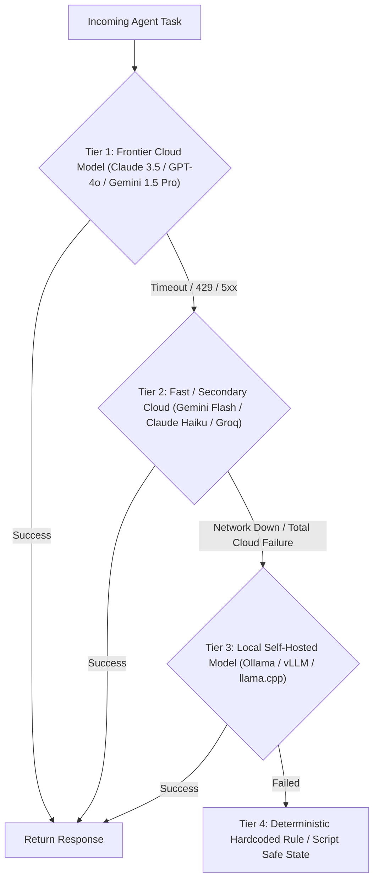

# Model Fallback Cascade & Local Inference Routing

สถาปัตยกรรมการกระจายโหลดและป้องกันความล้มเหลวในการเรียกใช้งานโมเดลภาษา (ดัดแปลงจากโมเดลของ `LiteLLM`, `vLLM`, และ `llama.cpp`) เพื่อให้ระบบ AI Agent มีความทนทานต่อ Rate Limits, เครือข่ายขัดข้อง, หรือผู้ให้บริการภายนอกล่ม โดยสลับไปใช้โมเดลสำรองหรือ Local Inference ได้อย่างไร้รอยต่อ

---

## 1. ปัญหาของ Single-Provider Dependency

การผูกระบบไว้กับ API ภายนอกเพียงรายเดียวมีความเสี่ยงสูง:
1. **HTTP 429 (Rate Limit Exceeded)**: ถูกระงับการใช้งานชั่วคราวระหว่างงานสำคัญ
2. **Provider Outages**: บริการคลาวด์ภายนอกล่ม ทำให้ Agent หยุดทำงานกลางคัน
3. **Cost & Latency Spikes**: งานบางประเภท (เช่น การสกัด Keyword หรือ Text Parsing ง่ายๆ) ไม่จำเป็นต้องจ่ายเงินหรือเสียเวลาเรียกโมเดลเรือธงขนาดใหญ่

---

## 2. ลำดับชั้นการสลับโหมด 3 ระดับ (The 3-Tier Model Cascade)

### รายละเอียดแต่ละ Tier:
1. **Tier 1 — Frontier Thinking Engines**:
   - ใช้สำหรับงานสถาปัตยกรรมซับซ้อน, การวิเคราะห์ Root Cause, และการผ่าตัดโค้ดขนาดใหญ่
   - เน้นความลึกและเหตุผลเชิงตรรกะสูงสุด
2. **Tier 2 — High-Velocity Reflex Engines**:
   - ใช้สำหรับงานตรวจสอบความถูกต้องเบื้องต้น, การจัดรูปแบบข้อมูล, หรือการสรุปข้อความสั้น
   - ตอบสนองรวดเร็วในระดับไม่กี่ร้อยมิลลิวินาที ประหยัด Token
3. **Tier 3 — Air-Gapped Local Inference (Ollama / llama.cpp GGUF)**:
   - รันในเครื่อง Local 100% ปลอดภัยสำหรับข้อมูลความลับสูงและใช้งานได้แม้ไม่มีอินเทอร์เน็ต
   - สื่อสารผ่าน REST/OpenAI-compatible endpoint (`http://localhost:11434/v1`)
4. **Tier 4 — Deterministic Fail-Safe**:
   - หากโมเดลล่มทั้งหมด ระบบต้องไม่ Crash แต่ต้องคืนค่า Default หรือส่งคำสั่งแจ้งเตือนความปลอดภัย

---

## 3. กฎการออกแบบ Circuit Breaker & Error Budget

1. **Exponential Backoff with Jitter**: เมื่อติด Rate Limit ห้ามยิงซ้ำทันที ให้หน่วงเวลา $t = 2^n + \text{rand}(0, 1)$ วินาที
2. **Budget & Token Tracking**: ติดตามการบริโภค Token สะสมในแต่ละ Session หากเกินงบประมาณที่กำหนด ให้ตัดสลับเข้าโหมดสรุปย่อหรือขอความเห็นชอบจากผู้ใช้
3. **Graceful Degradation**: ออกแบบให้ระบบสามารถลดทอนฟีเจอร์ลงได้บางส่วนโดยที่ฟังก์ชันหลักยังทำงานต่อได้
