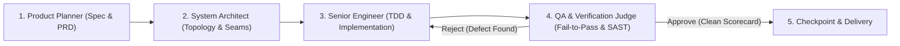

# Multi-Agent SOP Orchestration & Swarm Consensus

สถาปัตยกรรมการประสานงานระหว่าง AI Agents หลายตัวโดยใช้ **Standard Operating Procedures (SOPs)** (ดัดแปลงจากโมเดลของ `MetaGPT` และ `CrewAI`) เพื่อยกระดับความแม่นยำในการพัฒนาซอฟต์แวร์ ลดการโต้เถียงที่ไร้ทิศทาง และทำให้ผลลัพธ์มีความคงเส้นคงวาในระดับองค์กร

---

## 1. ปัญหาของ Free-Form Multi-Agent Chat

เมื่อปล่อยให้ Agent คุยกันอย่างอิสระโดยไม่มีระเบียบการ (Free-form Chat):
1. **Hallucination Cascades:** ข้อผิดพลาดจาก Agent ตัวแรกจะถูกขยายผลโดย Agent ตัวถัดไป
2. **Infinite Conversational Loops:** คุยเกริ่นและสุภาพเกินความจำเป็น สิ้นเปลือง Token มหาศาล
3. **Lack of Clear Accountability:** ไม่มีใครรับผิดชอบขั้นตอนสุดท้าย ทำให้งานหลุด Seams

---

## 2. โครงสร้าง Standard Operating Procedures (SOP Primitives)

MetaGPT พิสูจน์แล้วว่าการใส่ SOP ของมนุษย์เข้าไปในระบบ Agent จะช่วยเพิ่มความสำเร็จของงานขึ้นหลายเท่า:

### 1. กฎการส่งมอบงานระหว่างบทบาท (Contract-Driven Handoff)
- แต่ละ Agent ต้องสร้าง Deliverable ที่เป็นทางการ (Structured Document เช่น Markdown PRD, Schema Type, หรือ Unit Test)
- Agent ปลายทางต้องปฏิเสธงานทันทีหากข้อมูลตั้งต้น (Inputs) ไม่ตรงตาม Schema Contract

### 2. รูปแบบการจัดกระบวนทัพ (Orchestration Topologies)
1. **Sequential Pipeline (สายพานการผลิต)**:
   - เหมาะกับงานที่มีลำดับแน่นอน: `Plan -> Build -> Test -> Review`
   - รวดเร็ว ประหยัด Token และตรวจสอบย้อนกลับได้ง่าย
2. **Hierarchical Crew with Supervisor (หัวหน้างานคุมทีม)**:
   - มี **Supervisor Agent** คอยกระจายงานและตรวจสอบความคืบหน้าของลูกทีม
   - ลูกทีมรายงานผลกลับมาที่ Supervisor เท่านั้น ไม่คุยข้ามกันเองโดยไม่จำเป็น
3. **Adversarial Debate with Arbiter (การถกเถียงคานอำนาจ)**:
   - มีฝ่ายเสนอ (Advocate) และฝ่ายค้าน (Skeptic)
   - มี **Judge / Arbiter** ที่เป็นกลางตัดสินด้วยหลักเกณฑ์ตัวเลขเชิงปริมาณ

---

## 3. กลไกฉันทามติ (Consensus Voting Protocol)

เมื่อต้องตัดสินใจในประเด็นสำคัญทางสถาปัตยกรรม (เช่น การเลือกฐานข้อมูล หรือการอนุมัติการแก้ไขขนาดใหญ่):
- **Majority Voting ($> 50\%$)**: สำหรับการตัดสินใจระดับทั่วไป
- **Supermajority ($> 66\%$)**: สำหรับการเปลี่ยนแปลงโครงสร้าง API หรือ Schema
- **Unanimous Gate (100% Pass)**: สำหรับมิติด้านความปลอดภัย (Security Gate) — หากมี Security Agent โหวตคัดค้านแม้แต่เสียงเดียว ระบบต้อง Halt และแก้ไขทันที
