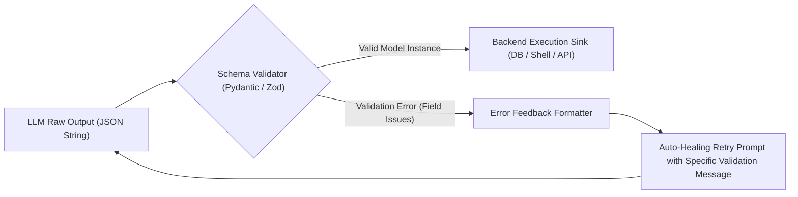

# Typed Agent Boundaries & Schema Contracts

สถาปัตยกรรมการออกแบบจุดเชื่อมต่อของระบบที่มี AI Agent เข้ามาเกี่ยวข้อง (ดัดแปลงจากหลักการของ `PydanticAI`, `Instructor`, และ `Zod`) เพื่อป้องกันปัญหาโมเดลตอบกลับด้วยข้อความอิสระ (Unstructured Free-Text), ขจัดความเสี่ยง Type Coercion Error, และบังคับใช้ Validation Retry Loop อัตโนมัติที่ระดับ Schema

---

## 1. วิกฤตของ Untyped Agent Seams

เมื่อนำ LLM หรือ AI Agent มาเชื่อมต่อกับ Backend หรือฐานข้อมูล การส่งผ่านข้อมูลด้วย String ธรรมดาก่อให้เกิดความเสี่ยงสูง:
1. **Hallucinated Attributes:** โมเดลประดิษฐ์ฟิลด์ที่ไม่มีอยู่ในระบบ (เช่น ส่ง `account_id` แทน `user_id`)
2. **Type Poisoning:** โมเดลส่ง `"true"` (string) แทน `true` (boolean) หรือส่ง `"1,500"` แทนตัวเลข `1500.0`
3. **Downstream Pipeline Crashes:** การเกิด Unhandled Exception ใน Worker ที่นำข้อมูลไปประมวลผลต่อ

---

## 2. เสาหลักของ Typed Agent Architecture



### 1. Strongly-Typed Tool Signatures
ทุก Tool ที่ส่งให้ AI Agent ต้องมี JSON Schema ที่กำกับชนิดข้อมูลอย่างเข้มงวด:
```python
from pydantic import BaseModel, Field

class OrderExecutionParams(BaseModel):
    symbol: str = Field(description="Ticker symbol, e.g. XAUUSD", min_length=3, max_length=10)
    lot_size: float = Field(description="Trading volume", gt=0.0, le=10.0)
    stop_loss: float = Field(description="Absolute price level for SL", gt=0.0)
    take_profit: float = Field(description="Absolute price level for TP", gt=0.0)
    magic_number: int = Field(default=10101, description="EA Identifier")
```

### 2. Automated Self-Healing Validation Loop
หากโมเดลส่งพารามิเตอร์ผิดพลาด Validator จะดักจับ `ValidationError` และส่งข้อความแสดงข้อผิดพลาดกลับไปให้โมเดลแก้ไขตัวเองทันที (สูงสุด 3 รอบ) โดยไม่ปล่อยให้ข้อผิดพลาดหลุดไปถึง Execution Layer:
```python
# ตัวอย่าง Prompt ตอบกลับเมื่อติด Schema Error:
"""
Validation failed on field 'lot_size':
Input was -0.5, but value must be greater than 0.0.
Please correct this field and re-submit the function call.
"""
```

### 3. Discriminated Unions for Agent Responses
เมื่อ Agent ต้องคืนค่าการตัดสินใจ ให้ใช้ Discriminated Union เพื่อบังคับให้มีสถานะความสำเร็จหรือล้มเหลวที่แยกจากกันเด็ดขาด:
```typescript
type AgentResult = 
  | { success: true; data: AnalysisReport; executionTimeMs: number }
  | { success: false; error: string; recoverable: boolean; retryAfterMs?: number };
```

---

## 3. กฎการออกแบบ Seam สำหรับสถาปนิกซอฟต์แวร์

1. **Zero Raw Parsing at Sinks**: ห้ามเขียนฟังก์ชันรับค่าจาก LLM ด้วย `json.loads()` แล้วดึงคีย์ตรงๆ โดยไม่มี Pydantic / Zod Model มารองรับ
2. **Strict Range Constraints**: ตัวเลขที่เป็นอัตราส่วน, % ความมั่นใจ, หรือเงิน ต้องมี Boundary Constraints กำกับเสมอ (`ge=0.0`, `le=1.0`)
3. **Fail-Closed on Unknown Fields**: กำหนดค่าคอนฟิกของ Model ให้ปฏิเสธฟิลด์แปลกปลอม (`extra = 'forbid'`) เพื่อป้องกันการแอบแฝงของข้อมูลที่ไม่พึงประสงค์
