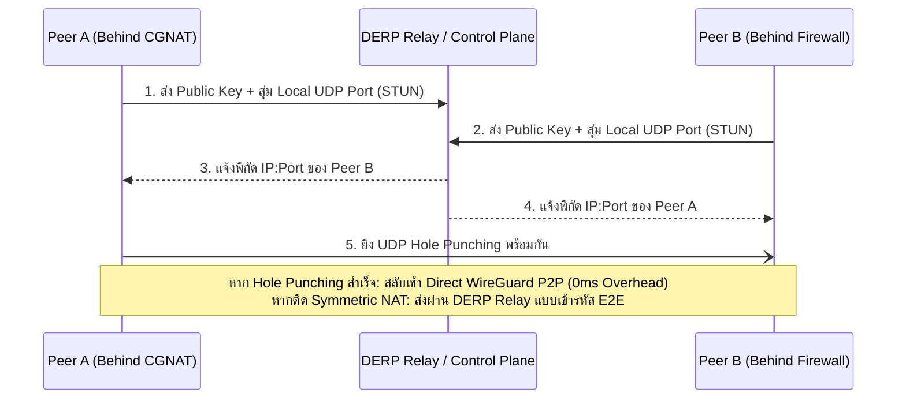

# Zero-Trust Network Tunnels & Encrypted WireGuard Mesh

> [!NOTE]
> สถาปัตยกรรมระดับสูงสำหรับการเชื่อมต่อเครือข่ายความปลอดภัยสูงแบบไร้ศูนย์กลาง (Zero-Trust Cryptographic Mesh) และการเผยแพร่เซอร์วิสสู่โลกภายนอกโดยไม่ต้องเปิดพอร์ตไฟร์วอลล์ (Inboundless Tunnels) ถอดแบบองค์ความรู้จาก **Tailscale**, **Cloudflare Tunnels (cloudflared)**, และ **Libsodium / WireGuard**

---

## 1. จุดจบของการเปิดพอร์ตไฟร์วอลล์ (The Inboundless Paradigm)

สถาปัตยกรรมแบบดั้งเดิมที่ต้องเปิดพอร์ต 80/443 หรือเปิด Port Forwarding บนเราเตอร์มีจุดอ่อนรุนแรง:
- **Port Scanning & Zero-Day Scanners:** บอทบนอินเทอร์เน็ตจะสแกนเจอพอร์ตที่เปิดอยู่ภายในไม่กี่นาที
- **DDoS Attack Surface:** เครื่องเซิร์ฟเวอร์ต้องรับภาระทราฟฟิกโจมตีตรงๆ
- **CGNAT Nightmare:** ปัญหาที่พบมากในเน็ตบ้านหรือเครือข่าย 4G/5G ที่ไม่มี Public IP แท้จริง

**สถาปัตยกรรม Zero-Trust Inboundless Tunnels:**
เซิร์ฟเวอร์ภายในเครื่องจะเปิดเฉพาะ **Outbound Connection** (ฝั่งขาออก) ไปเกาะกับเครือข่าย Edge หรือ Control Plane ทำให้ไฟร์วอลล์บล็อกพอร์ตขาเข้าได้ 100%:

```
[Local App / MT5 Server] ──(Outbound-Only TLS/QUIC)──► [Edge Relay / Cloudflare] ◄── [Authenticated User]
  (Zero Inbound Ports)                                     (DDoS Protected)
```

---

## 2. WireGuard Cryptographic Mesh Architecture

แทนที่จะรวมศูนย์ทราฟฟิกไว้ที่ VPN Gateway กลาง (Hub-and-Spoke) ซึ่งสร้างคอขวด WireGuard Mesh อนุญาตให้โหนดเชื่อมต่อกันแบบ P2P ตรง (Peer-to-Peer):

### องค์ประกอบความปลอดภัยสมัยใหม่ (Noise Protocol Framework)
- **Key Exchange:** Curve25519 (ECDH) สำหรับการสร้าง Shared Secret ความเร็วสูง
- **Encryption & MAC:** ChaCha20-Poly1305 Authenticated Encryption (AEAD)
- **Hashing:** BLAKE2s สำหรับการยืนยันความถูกต้องของข้อมูล
- **Silent Dropping:** หาก Packet ไม่มี Cryptographic Signature ที่ถูกต้อง โหนดจะทิ้งแพ็กเก็ตเงียบๆ โดยไม่ส่งคำตอบปฏิเสธกลับไป (ทำให้มองไม่เห็นจากการสแกน Port Scan)

---

## 3. NAT Traversal & DERP Relays (Tailscale Algorithm)

การเจาะกำแพง NAT ที่ซับซ้อน (Symmetric NAT / Hard CGNAT) ระหว่างเครื่องไคลเอนต์และเซิร์ฟเวอร์:



---

## 4. ตัวอย่างการคอนฟิก Inboundless Cloudflare Tunnel (`cloudflared`)

การเปิด Web App หรือ Dashboard ภายในเครื่องสู่โดเมนภายนอกอย่างปลอดภัย:

```yaml
# ~/.cloudflared/config.yml
tunnel: 8a7b6c5d-4e3f-2a1b-0c9d-8e7f6a5b4c3d
credentials-file: /etc/cloudflared/credentials.json

ingress:
  # แมปโดเมนภายนอกเข้าหา Local Port ภายในเครื่องตรงๆ
  - hostname: dashboard.metha-survey.internal
    service: http://localhost:3000
    originRequest:
      connectTimeout: 10s
      noTLSVerify: true

  # แมป WebSocket สำหรับ Real-time MT5 Stream
  - hostname: ws-stream.metha-survey.internal
    service: http://localhost:8080

  # กฎดักจับสุดท้าย (Catch-all)
  - service: http_status:404
```

---

## 5. กฎเหล็กความปลอดภัย Zero-Trust

1. **Never Trust, Always Verify:** ทุกคำขอต้องยืนยันตัวตนด้วย Ephemeral Certificate หรือ Mutual TLS (mTLS) เสมอ แม้จะเป็นทราฟฟิกภายในวงแลน
2. **Identity-Based ACLs:** ใช้แท็กและสิทธิ์ของผู้ใช้ (User Identity) ในการคุม Firewall Rules แทนการใช้ IP Address คงที่
3. **Hardware-Backed Keys:** ป้องกันการขโมย Private Key ด้วยการจัดเก็บใน TPM 2.0 หรือ Secure Enclave เมื่อเป็นไปได้
