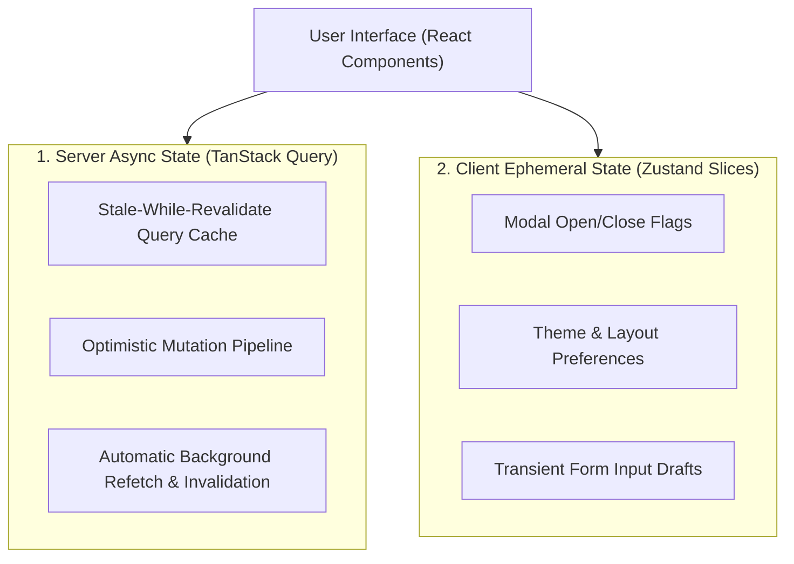

# Server Cache Invalidation & Optimistic UI State Protocol

สถาปัตยกรรมการจัดการ State ในระบบ Frontend และ Full-Stack ยุคใหม่ (ดัดแปลงจากโมเดลของ `TanStack Query` และ `Zustand`) โดยแบ่งแยกอย่างเด็ดขาดระหว่าง **Server Cache State (ข้อมูลจาก API/DB)** กับ **Client UI State (สถานะหน้าจอของผู้ใช้)** พร้อมเทคนิค Optimistic Updates เพื่อประสบการณ์ใช้งานที่ตอบสนองทันทีโดยไม่ต้องรอ Round-Trip Network

---

## 1. ปัญหาการปะปนกันของ State (State Pollution Anti-Pattern)

ข้อผิดพลาดที่พบบ่อยในการพัฒนาเว็บแอปพลิเคชัน:
1. **Redux / Global Store Bloat**: นำข้อมูลที่ดึงจาก API มาเก็บไว้ใน Global Store แล้วต้องเขียน Reducer จัดการ Loading, Error, Success เองทั้งหมด
2. **Stale Data Desynchronization**: ข้อมูลในเครื่องเก่า ไม่ตรงกับฐานข้อมูลจริงเพราะไม่มีระบบ Invalidation อัตโนมัติ
3. **UI Latency Friction**: ผู้ใช้กดปุ่มแล้วต้องรอ Network หมุนติ้ว 1–2 วินาที ก่อนที่หน้าจอจะอัปเดต

---

## 2. โมเดลการแบ่งแยก State 2 ชั้น (Two-Tier State Partitioning)

### 1. การดึงและแคชข้อมูลด้วย TanStack Query
- **Declarative Fetching**: ใช้ Query Key ที่มีเอกลักษณ์ในการระบุทรัพยากร (เช่น `['orders', orderId]`)
- **Stale-While-Revalidate (SWR)**: แสดงข้อมูลเก่าในแคชทันทีระหว่างที่ระบบแอบ Fetch ข้อมูลใหม่ในเบื้องหลัง
- **Automatic Garbage Collection**: ล้างข้อมูลในแคชที่ไม่ได้ใช้งานออกจากหน่วยความจำอัตโนมัติ

### 2. การอัปเดตแบบ Optimistic Updates
เมื่อผู้ใช้กด Action (เช่น กด Like, กดเปลี่ยนสถานะ Order):
1. **Cancel Outgoing Queries**: ยกเลิก Query ที่กำลังวิ่งอยู่เพื่อป้องกันข้อมูลตีกัน
2. **Snapshot Previous State**: บันทึกสถานะก่อนหน้าไว้ในตัวแปรย้อนคืน (Rollback Context)
3. **Optimistically Update Cache**: อัปเดต UI ให้เปลี่ยนทันทีใน 0 มิลลิวินาที
4. **Send API Request**: ส่ง Request ไปยังเซิร์ฟเวอร์
5. **OnError Rollback**: หากเซิร์ฟเวอร์ตอบกลับด้วย Error ให้ย้อนคืน UI กลับสู่ Snapshot เดิม
6. **OnSettled Invalidate**: สั่ง Invalidate Query Key นั้นเพื่อให้ได้ความจริงล่าสุดจาก DB

---

## 3. กฎเหล็กสำหรับนักพัฒนา (Developer Invariants)

1. **ห้ามเก็บ Server Data ใน Zustand**: Zustand มีไว้สำหรับ UI Ephemeral State (เช่น `isSidebarOpen`, `activeTab`) เท่านั้น
2. **Explicit Query Keys**: กำหนด Query Key ในรูปแบบ Hierarchy Tuple เสมอเพื่อให้อ้างอิงและสั่ง Invalidate เป็นกลุ่มได้ง่าย
3. **Always Return Rollback Context**: ทุกฟังก์ชัน Optimistic Mutation ต้องมีตรรกะคืนค่า Snapshot ในบล็อก `onError` เสมอ
