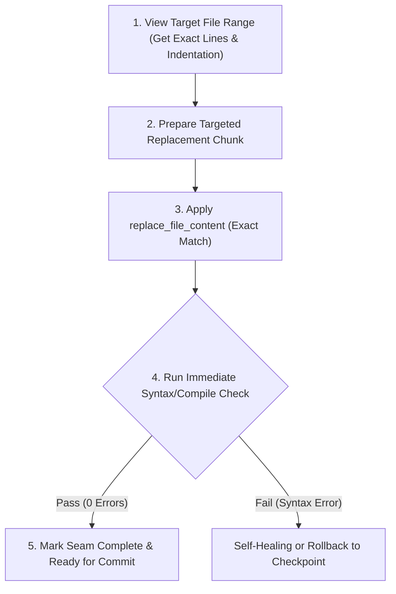

# Surgical Diff & Atomic Checkpoint Protocol

ระเบียบวิธีการแก้ไขโค้ดเฉพาะจุด (Surgical Code Mutation) ดัดแปลงจากสถาปัตยกรรมของ `Cline` และ `Pythagora (GPT-Pilot)` เพื่อป้องกันปัญหาการเขียนทับไฟล์ทั้งก้อน (Full-file Overwrite), ป้องกัน Whitespace/Encoding Corruption, และรับประกันว่าทุกการเปลี่ยนแปลงมีขอบเขต (Blast Radius) เล็กที่สุด

---

## 1. กฎเหล็กของการแก้ไขเฉพาะจุด (The 4 Invariants of Surgical Editing)

1. **Targeted Bounds Invariant**:
   - การแก้ไขไฟล์ต้องระบุบรรทัดเริ่มต้น (`StartLine`) และบรรทัดสิ้นสุด (`EndLine`) ที่ชัดเจน ครอบคลุมเฉพาะบล็อกที่ต้องการเปลี่ยนแปลง
   - **ห้าม** ใช้คำสั่งเขียนทับไฟล์ทั้งก้อน (`write_to_file` แบบ Overwrite) กับไฟล์โค้ดที่มีอยู่แล้ว เว้นแต่เป็นการสร้างไฟล์ใหม่จากศูนย์
2. **Exact String Match Invariant**:
   - ข้อความเดิมที่นำมาเทียบเพื่อแทนที่ (`TargetContent`) ต้องตรงกับเนื้อหาจริงในไฟล์แบบอักขระต่ออักขระ (รวม Indentation, Spaces, Tab, และ Newline)
   - หากตรวจพบว่า TargetContent ไม่ตรง ให้สั่งอ่านไฟล์สดอีกครั้ง ห้ามคาดเดาจากความจำ
3. **Single Mutable Surface Invariant**:
   - ทำการแก้ไขทีละจุดที่ต่อเนื่องกัน (Contiguous Block)
   - หากต้องแก้หลายจุดในไฟล์เดียวกัน ให้แบ่งเป็นคำสั่งแก้ไขแยกกันเป็นลำดับชัดเจน
4. **Immediate Syntax & Lint Gate**:
   - ทันทีที่แก้ไขเสร็จ ต้องรันตัวตรวจสอบไวยากรณ์ (เช่น `tsc --noEmit`, `python -m py_compile`, `ruff check`, `eslint`) ก่อนส่งมอบ
   - หากตรวจพบ Syntax Error ให้ทำ Epistemic Rollback ย้อนคืนการแก้ไขทันที ไม่ดันทุรังแก้ทับบนโค้ดที่พัง

---

## 2. เปรียบเทียบ: Full-File Rewrite vs Surgical Replacement

| มิติ | Full-File Overwrite (อันตราย) | Surgical Replacement (ปลอดภัยระดับ Cline) |
| :--- | :--- | :--- |
| **Token Cost** | มหาศาล (ส่งซ้ำทั้งไฟล์ 500+ บรรทัด) | ต่ำมาก (ส่งเฉพาะบล็อก 5–20 บรรทัด) |
| **ความเสี่ยงไฟล์พัง** | สูงมาก (เสี่ยงตัดโค้ดที่ไม่ได้ขอดูทิ้ง) | เป็นศูนย์ (ส่วนอื่นของไฟล์คงเดิม byte-for-byte) |
| **Git Diff Clarity** | รก มีการขยับ whitespace ทั้งไฟล์ | คลีน เห็นเฉพาะ Logic Diff ที่เพิ่ม/แก้จริง |
| **ความเข้ากันได้** | เสี่ยงทำลาย Encoding / Line Endings (CRLF/LF) | รักษา Line Endings เดิมของไฟล์อย่างสมบูรณ์ |

---

## 3. วงจรกระบวนการแก้ไข (Surgical Execution Loop)



---

## 4. Shortcut Tagging & Intentional Compromises

หากมีความจำเป็นต้องใช้แนวทางแบบย่อ (Shortcut) เพื่อแก้ปัญหาเฉพาะหน้า ให้ใส่ Tag กำกับบรรทัดโค้ดนั้นเสมอ:
```typescript
// shortcut: <ขีดจำกัดของโค้ดนี้>, <เงื่อนไขที่ควรกลับมา Upgrade>
```
*ตัวอย่าง:*
```python
# shortcut: In-memory dictionary cache (limit 10,000 items), upgrade to Redis when multi-process scaling
g_cache = {}
```
