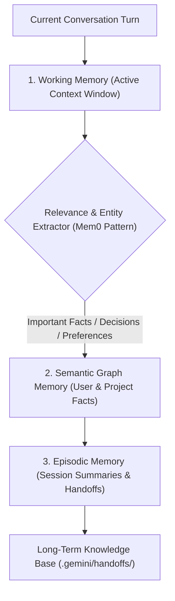

# Dynamic Memory & Long-Term Session Consolidation

สถาปัตยกรรมการจัดการความจำระยะยาวของ AI Agent (ดัดแปลงจากโมเดลของ `Mem0` และ `LlamaIndex`) เพื่อให้ระบบสามารถจดจำบริบทข้ามเซสชัน, สกัดข้อตกลงและสไตล์ความชอบของผู้ใช้ (User Preferences), และทำการสังเคราะห์ความจำ (Memory Consolidation) เพื่อป้องกันปัญหาความจำเสื่อมเมื่อเริ่มเซสชันใหม่

---

## 1. ลำดับชั้นความจำของ Agent (The 3-Tier Memory Architecture)

1. **Working Memory (ความจำระยะสั้นใน Context)**:
   - ข้อความสนทนาในรอบปัจจุบัน (`transcript.jsonl`)
   - มีข้อจำกัดด้าน Token และจะถูกบีบอัดเมื่อบทสนทนายาวขึ้น
2. **Semantic Graph Memory (ความจำสัญลักษณ์และข้อเท็จจริง)**:
   - ข้อเท็จจริงที่สกัดได้ เช่น "ผู้ใช้ใช้ Windows PowerShell", "โปรเจกต์นี้ห้ามเพิ่ม dependency เกินจำเป็น"
   - ถูกจัดเก็บเป็น Key-Value หรือ Knowledge Graph Nodes
3. **Episodic Memory (ประวัติเหตุการณ์และเหตุการณ์สำคัญ)**:
   - บันทึกการตัดสินใจในอดีต (ADR), เหตุการณ์ที่เคยล้มเหลว (Hindsight), และไฟล์ Handoff ประจำวัน

---

## 2. วงจรการสกัดและสังเคราะห์ความจำ (Consolidation Pipeline)

เมื่อมีการเรียกใช้คำสั่ง `/continue` หรือเมื่อเซสชันยาวเกินขอบเขต:
1. **Fact Extraction**: สกัดเฉพาะข้อมูลที่มีผลระยะยาว (ตัดคำทักทายและคำถามยิบย่อยออก)
2. **Conflict Resolution**: หากพบข้อเท็จจริงใหม่ที่ขัดแย้งกับข้อเท็จจริงเดิม ให้ยึดถือข้อมูลล่าสุดที่ผู้ใช้ยืนยันเป็นความจริงปัจจุบัน (Active Truth)
3. **Temporal Decay & Pruning**: ลดน้ำหนักความจำของบั๊กหรือสถานะชั่วคราวที่ได้รับการแก้ไขและปิดเคสไปแล้ว เพื่อไม่ให้รกพื้นที่ความจำ

---

## 3. กฎการกู้คืนบริบทอย่างราบรื่นสำหรับ Agent

1. **ตรวจสอบความจริงเชิงกายภาพก่อนความจำ**: แม้ความจำจะบอกว่า "กำลังแก้ไฟล์ X" Agent ต้องรัน `git status` เพื่อดูสถานะจริงของไฟล์บนดิสก์ก่อนเสมอ
2. **ห้ามถามข้อมูลเดิมซ้ำ**: หากความจำมีข้อมูลที่ยืนยันแล้ว (เช่น พอร์ตโฟลิโอ, สเปกกลยุทธ์, หรือแพ็กเกจที่ติดตั้ง) ให้ดึงมาใช้ทำงานต่อทันที
3. **สรุปความคืบหน้าแบบกระชับ**: เมื่อฟื้นคืนเซสชัน ให้รายงานสถานะล่าสุดใน 2–3 บรรทัด แล้วลงมือทำต่อทันทีโดยไม่ต้องรอให้ผู้ใช้สั่งซ้ำ
