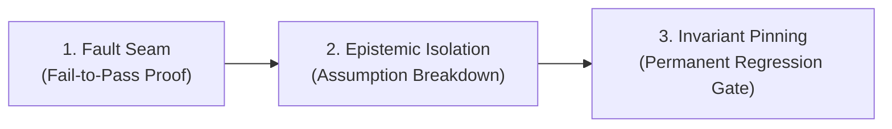

# Epistemic Postmortem & Evaluation Harness
*(สกัดจาก Hermes Agent Harness & Evals Architecture)*

## 1. ปรัชญาและเป้าหมาย (The Harness Invariant)
ความผิดพลาดหรือบั๊กที่เกิดขึ้นในระบบ จะต้องไม่ถูกมองเป็นเพียง "จุดที่ต้องแก้ให้รันผ่าน" แต่ต้องถูกเปลี่ยนให้เป็น **Regression Gate** ถาวร
ทุกครั้งที่แก้บั๊กหรือสถาปัตยกรรมล้มเหลวเกิน 1 รอบ ระบบจะต้องดำเนินกระบวนการ **Epistemic Postmortem** เพื่อขจัด Confirmation Bias และบันทึกข้อเท็จจริงลงใน Incident Ledger

---

## 2. ขั้นตอน 3-Phase Postmortem Workflow



### Phase 1: Fault Seam & Fail-to-Pass Proof
- **Deterministic Reproduction:** ระบุชุดข้อมูลหรือคำสั่งต่ำสุดที่ทำให้ระบบเกิดข้อผิดพลาด 100%
- **Pre-Fix Prediction:** เขียนบันทึกการทำนายก่อนลงมือแก้:
  - *Expected Failure:* ทำไมคำสั่งเดิมถึงพัง?
  - *Proposed Mechanism:* การแก้จุดนี้จะเปลี่ยน State ของระบบอย่างไร?
  - *Non-Regression Boundary:* ส่วนใดของระบบที่ต้องไม่ได้รับผลกระทบ?

### Phase 2: Epistemic Assumption Breakdown
แยกแยะข้อมูลออกเป็น 3 ระดับอย่างเด็ดขาด:
1. **Observed (ประจักษ์):** ข้อมูลที่มี Log, Hash, Test output ยืนยันจริง
2. **Inferred (อนุมาน):** ข้อสันนิษฐานที่ยังไม่ได้รันพิสูจน์
3. **Inherited (ตกทอด):** โค้ดเดิมหรือ Library ภายนอกที่เคยเชื่อว่าทำงานถูกต้อง

> [!CAUTION]
> หากพบว่าแก้บั๊กไปแล้ว 2 รอบแต่ยังพัง ให้ทำ **Epistemic Reset** ทันที: ย้อนโค้ดกลับทั้งหมด ($A \to B \to A$) และตรวจสอบชั้น "Inherited" ที่คิดว่าไม่มีทางพัง

### Phase 3: Invariant Pinning & Gate Enforcement
- สร้าง Automated Unit Test หรือ Invariant Checker ที่จะ **พังทันที** หากมีใครเขียนโค้ดกลับไปสู่บั๊กเดิม
- ห้ามใช้ Shallow Mock เพื่อหลอกให้เทสผ่าน (บังคับผ่าน Anti-Mock Drills)

---

## 3. แบบฟอร์มบันทึก Incident Ledger (Postmortem Template)

เมื่อพบข้อผิดพลาดระดับรากฐาน บันทึกลงใน Scratch หรือ Documentation ด้วยโครงสร้างนี้:

```markdown
### [Incident #ID] <ชื่ออาการที่พัง>
- **Date & Scope:** YYYY-MM-DD | <ไฟล์หรือโมดูลที่เกี่ยวข้อง>
- **Flawed Assumption (เคยคิดว่า):** <สมมติฐานที่ผิดพลาดในรอบแรก>
- **Root Causality (ความจริงคือ):** <สาเหตุเชิงโครงสร้างที่แท้จริง>
- **Fail-to-Pass Seam:** <ชุดคำสั่งหรือเทสที่ใช้ตรวจจับ>
- **Invariant Gate Added:** <กฎหรือ Assertion ใหม่ที่คอยคุ้มกัน>
```
