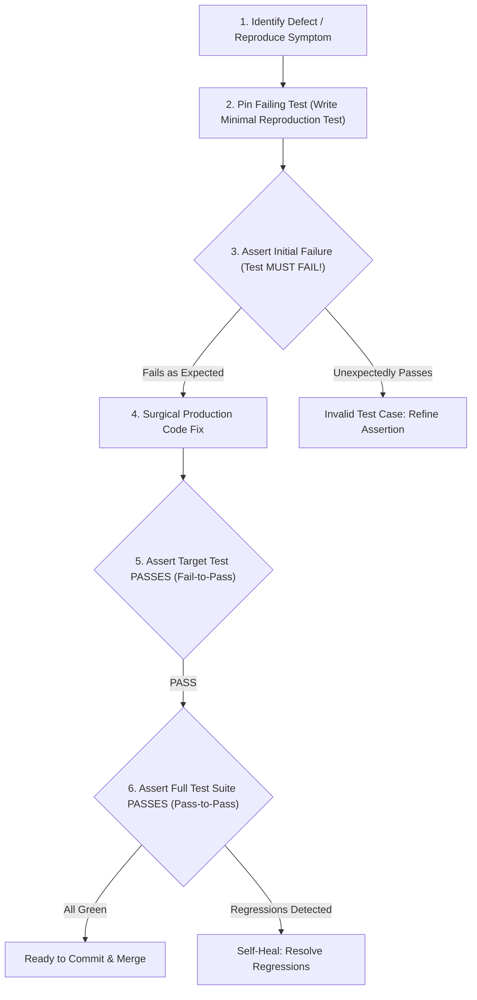

# Regression Pinning & Fail-to-Pass Verification Protocol

ระเบียบวิธีการดีบักและแก้ไขข้อบกพร่องตามมาตรฐานการประเมินผลระดับโลก (`SWE-bench` และ `Promptfoo`) มุ่งเน้นการสร้างชุดทดสอบที่ตรึงอาการพังไว้ก่อน (Pinning) เพื่อพิสูจน์ว่าบั๊กได้รับการแก้ไขอย่างแท้จริง และไม่มีการสร้างความเสียหายย้อนหลัง (Zero Regression) ต่อฟังก์ชันเดิมที่เคยทำงานได้

---

## 1. วงจรการแก้บั๊ก 5 สเต็ปแบบ SWE-Bench (Fail-to-Pass Discipline)

การแก้บั๊กที่ได้มาตรฐานทางวิศวกรรมระดับสูง ห้ามกระโดดไปแก้ไฟล์โค้ดทันที แต่ต้องปฏิบัติตามลำดับขั้นดังนี้:

---

## 2. นิยามของการเปลี่ยนผ่านสถานะ (State Transitions)

1. **Fail-to-Pass (F2P)**:
   - ชุดทดสอบที่สร้างขึ้นมาเพื่อจับบั๊กนี้โดยเฉพาะ **ต้องรันตก (FAIL) ก่อนเสมอ** เมื่อรันกับโค้ดเวอร์ชันเดิม
   - หลังการแก้โค้ด production ชุดทดสอบนี้ **ต้องเปลี่ยนเป็นผ่าน (PASS)** อย่างสมบูรณ์
   - *ประโยชน์:* เป็นหลักฐานเชิงประจักษ์ว่าโค้ดที่เราแก้ไปนั้น "แก้ตรงจุด" ไม่ใช่เทสต์ผ่านเพราะสภาพแวดล้อมบังเอิญ
2. **Pass-to-Pass (P2P)**:
   - ชุดทดสอบเดิมที่มีอยู่แล้วในโปรเจกต์ทั้งหมด **ต้องยังคงผ่าน (PASS) เหมือนเดิม 100%**
   - หากมีเทสต์เดิมแม้แต่ตัวเดียวที่เปลี่ยนจาก PASS กลายเป็น FAIL จะถือว่าเกิด **Regression** และห้ามส่งมอบงานเด็ดขาด

---

## 3. กฎการแยกพื้นที่ทดสอบ (Single Mutable Boundary)

ตามหลักการของ Karpathy และ SWE-Bench:
- **Test File & Assertion คือไม้บรรทัด (The Immutable Rule)**: ห้ามปรับเงื่อนไข `expect(...)` ให้อ่อนลง, ห้ามเปลี่ยนค่าตัวเลขที่คาดหวังเพียงเพื่อให้เทสต์ผ่าน, และห้ามใส่ Mock bypass หลอกตา
- **Production Code คือสิ่งที่ต้องปรับ (The Mutable Surface)**: ความถูกต้องต้องเกิดขึ้นจากการแก้ไขตรรกะภายใน Production Code จนกระทั่งทำงานได้ตรงตามสัญญาของ Test File

---

## 4. Epistemic Reset Protocol (วงจรล้างอคติเมื่อแก้ล้มเหลว 2 ครั้ง)

เมื่อพยายามแก้บั๊กด้วยวิธีใดก็ตามแล้วไม่สำเร็จติดต่อกัน **2 ครั้ง** ให้หยุดแก้โค้ดทันที แล้วรันตามเช็คลิสต์:
1. **Revert การแก้ไขทั้งหมด:** ลบ diff ที่พยายามแก้ทิ้งทั้งหมดเพื่อป้องกันไม่ให้โค้ดทดลองสร้าง noise บดบังอาการจริง
2. **คัดแยกพยานหลักฐาน 3 ระดับ:**
   - *Observed (ประจักษ์):* มี log หรือ stack trace ยืนยันจากรอบล่าสุด
   - *Inferred (อนุมาน):* สันนิษฐานตามตรรกะแต่ยังไม่มีหลักฐานตรง
   - *Inherited (สืบทอด):* คำบอกเล่าหรือคอมเมนต์เก่า (ถือว่าไม่น่าเชื่อถือจนกว่าจะพิสูจน์ซ้ำ)
3. **ตรวจสอบชั้นที่คิดว่าไม่มีวันพัง:** ตรวจสอบว่ากำลังรันโค้ดถูก Environment หรือไม่, Binary/Config ถูกตัวหรือไม่, สภาพแวดล้อมมีการ Cache ค่าเก่าไว้หรือไม่
4. **ตั้งสมมติฐานใหม่ด้วย Table of Hypotheses:** ลิสต์สมมติฐานทางเลือก พร้อมระบุเงื่อนไขการพิสูจน์ข้อผิดพลาด (Falsification Criteria) ก่อนลงมือแตะต้องโค้ดอีกครั้ง

---

## 5. Anti-Shotgun Rule & A/B/A Proof Invariant

- **ห้ามแก้โค้ดแบบสุ่ม (No Shotgun Debugging):** ทุกการแก้ไขเชิงพฤติกรรม ต้องเขียนคำทำนายล่วงหน้าได้เสมอว่า *"กำลังเปลี่ยน X เพราะเชื่อว่า Y และค่า Z ต้องเปลี่ยนจาก A เป็น B หากไม่เป็นไปตามนี้ถือว่าสมมติฐานตกไป"*
- **A/B/A Proof Standard:** เคสดีบักระดับ Critical จะถือว่าปิดสำเร็จสมบูรณ์ก็ต่อเมื่อพิสูจน์ได้ครบ 3 ขั้นตอน:
  1. **A (Failure Present):** แสดงอาการพังให้เห็นตามสั่ง
  2. **B (Cause Removed):** ปลดหรือแก้ไขจุดสงสัย แล้วอาการพังต้องหายไป 100%
  3. **A (Cause Reintroduced):** ใส่เงื่อนไขที่เป็นปัญหากลับเข้าไป แล้วอาการพังต้องฟื้นกลับมาทันที

---

## 6. รายการตรวจเช็คก่อนปิดเคสดีบัก (Debugger's Scorecard)

- [ ] มี Reproduction Script หรือ Minimal Unit Test ที่รันซ้ำได้ 100%
- [ ] ยืนยันผลการรันครั้งแรกว่า **Fails with Expected Error Trace**
- [ ] ทำการแก้โค้ดเฉพาะจุดที่ต้นตอ (Root Cause) ไม่ใช้ `try-catch` กลืนข้อผิดพลาด
- [ ] ยืนยันผลการรันหลังแก้ว่า **F2P Test Passes**
- [ ] รัน Full Test Suite ยืนยันว่า **0 P2P Regressions**
