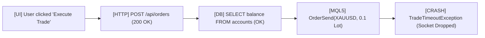

# Telemetry Spans & Production Error Breadcrumbs Protocol

ระเบียบวิธีการบันทึกและแกะรอยประวัติการทำงานของระบบ (ดัดแปลงจากโมเดลของ `OpenTelemetry` และ `Sentry`) เพื่อให้การดีบักปัญหาในระดับ Production และในรอบการทำงานของ AI Agent สามารถชี้ชัดจุดล้มเหลวได้อย่างรวดเร็ว โดยไม่สร้างขยะ Log ฟุ่มเฟือย

---

## 1. ปัญหาของ Print-Debugging และ Blind Errors

เมื่อระบบเกิดข้อผิดพลาดขึ้นใน Production:
1. **Blind Exception**: รู้อย่างเดียวว่าเกิด Error อะไร แต่ไม่รู้ว่าผู้ใช้หรือระบบได้ทำขั้นตอนใดมาก่อนหน้า (Missing Breadcrumbs)
2. **Log Flooding**: การพยายาม `print()` ทุกบรรทัดทำให้ Log บวม เปลือง Token และกลบข้อความสำคัญ
3. **Cross-Service Disconnect**: ไม่สามารถลากเส้นเชื่อมโยงระหว่าง Frontend Request $\to$ Backend API $\to$ Database Query ได้

---

## 2. โครงสร้างรอยแกะรอยแบบ Breadcrumbs (Sentry Pattern)

Breadcrumbs คือ "รอยเศษขนมปัง" ที่บันทึกการกระทำสำคัญ 5–10 ก้าวก่อนหน้าที่จะเกิดการระเบิดของโปรแกรม:



### ข้อมูลที่ต้องบันทึกใน Breadcrumb:
- **Timestamp**: เวลาที่เกิดเหตุการณ์
- **Category**: หมวดหมู่ เช่น `navigation`, `http`, `database`, `agent_tool`
- **Level**: ระดับความสำคัญ (`info`, `warning`, `error`)
- **Metadata**: พารามิเตอร์สำคัญ (ตัด Sensitive Data / Passwords ออก)

---

## 3. การสร้าง Telemetry Spans (OpenTelemetry Pattern)

เมื่อฟังก์ชันสำคัญเริ่มทำงาน ให้ครอบด้วย Span เพื่อวัดทั้งระยะเวลา (Duration) และสถานะความสำเร็จ:
```python
from contextlib import contextmanager
import time

@contextmanager
def trace_span(span_name: str, attributes: dict = None):
    start_time = time.perf_counter()
    status = "OK"
    error_detail = None
    try:
        yield
    except Exception as e:
        status = "ERROR"
        error_detail = str(e)
        raise
    finally:
        duration_ms = (time.perf_counter() - start_time) * 1000
        # บันทึกลง In-memory Ring Buffer สำหรับชันสูตรเมื่อล้มเหลว
        record_telemetry_span(span_name, duration_ms, status, attributes, error_detail)
```

---

## 4. กฎการชันสูตรข้อบกพร่องสำหรับ Agent

1. **ดึง Breadcrumbs 10 ก้าวล่าสุดก่อนเสมอ**: เมื่อเจอบั๊ก ให้ดูย้อนหลังว่าสถานะก่อนหน้าคืออะไร แทนที่จะเดาจากตัวโค้ดลอยๆ
2. **รักษาความลับ (Sanitize Inputs)**: ห้ามบันทึก API Keys, Auth Tokens, หรือรหัสผ่านลงใน Telemetry Attributes
3. **Trace-to-Code Pinning**: ทุก Span ที่เกิดข้อผิดพลาดต้องระบุ File Path และ Line Number ของ Seam นั้นอย่างชัดเจน
