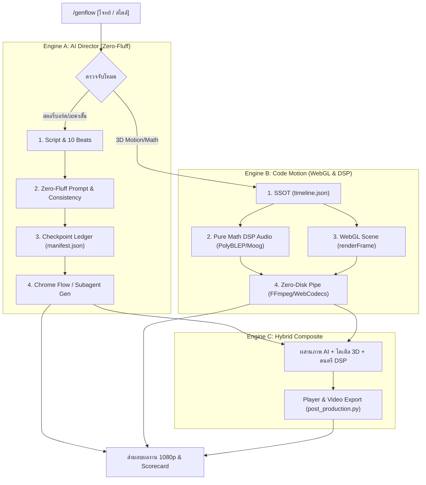

# Universal Media Studio (`/genflow`)

สตูดิโอผลิตสื่อมัลติมีเดียครบวงจร ผสาน 2 ขุมพลังเข้าด้วยกันในคำสั่งเดียว: **(1) Autonomous Generative AI Director** สำหรับงานละครสั้น สตอรี่บอร์ด พร้อมท่อ Zero-Fluff Prompting และ **(2) Deterministic Code Motion Graphics** สำหรับงาน 3D WebGL 60fps และดนตรีสังเคราะห์ Pure Math DSP

---

## 1. สถาปัตยกรรมสตูดิโอ (Studio Architecture)



---

## 2. ขั้นตอนการทำงานตามแต่ละโหมด

### โหมด A: Generative AI Director (`/genflow` หรือ `--mode ai`)
1. **Storyboard Breakdown**: วิเคราะห์พล็อต แตก 3-10 ฉากตามโครงสร้างสากล (ดู `references/storyboard_templates.md`)
2. **Zero-Fluff Prompt Engine**: เขียน Prompt ตามสูตร 8 ลำดับความสำคัญ แบนคำขยะคุณภาพ (`8k`, `masterpiece`, `smooth skin`) พร้อมใช้ Camera as Style Tokens (`ARRI Alexa 35`, `Hasselblad X2D`, `Leica M11`, `100mm macro f/4.0`)
3. **Engine-Specific Formatting**:
   - *Flux.1*: ใช้ Positive Substitutions ห้ามใส่ Negative Prompt
   - *Midjourney v6*: บังคับ `--style raw --s 75` หลีกเลี่ยง `--no`
   - *Stable Diffusion*: Comma-separated tags พร้อม Negative Baseline มาตรฐาน
4. **Checkpoint Ledger**: คุมสถานะฉากและ Timecode ผ่าน `scripts/orchestrator.py`
5. **Execution Route**: สั่งเจนผ่าน `image-generator` หรือ Chrome Google Flow (`scripts/chrome_flow_automator.py`)
6. **Post-Production**: ประกอบภาพเป็น Animatic MP4 หรือเปิด `storyboard_player.html`

### โหมด B: Deterministic Code Motion (`/genflow --mode code` หรือ `/code-video`)
1. **Timeline SSOT**: กำหนด BPM, คิวเหตุการณ์, มุมกล้องใน `timeline.json`
2. **Pure Math Audio DSP**: สังเคราะห์ Supersaw, Moog 24dB Ladder, Reverb ด้วย `scripts/dsp_audio_toolkit.py` (ดู `references/deterministic-av-pipeline.md`)
3. **Deterministic WebGL**: เขียนฉาก Three.js/GLSL ควบคุมด้วย `window.renderFrame(t)` ตามเวลาสัมบูรณ์
4. **Zero-Disk Headless Pipe**: เรนเดอร์ 1080p60 สตรีมตรงเข้า FFmpeg x264 หรือ WebCodecs GPU ด้วย `scripts/render_engine.py`

### โหมด C: Hybrid Composite (`/genflow --hybrid`)
ผสานภาพคีย์เฟรม AI เข้ากับการจัดวาง 3D Kinetic Card, Audio Spectrum, ไตเติล 3D และเพลงสังเคราะห์ที่จังหวะลงล็อก 100%

---

## 3. สคริปต์หลักในสตูดิโอ (Studio Tooling)

- **`scripts/orchestrator.py`**: คุม State Machine, ล็อกตัวละคร, ซิงก์ Timecode และตรวจแก้ Prompt (Lint & Build)
  - สร้างโปรเจกต์: `python scripts/orchestrator.py init --project "Title" --out ./proj --bpm 128`
  - ตรวจคุณภาพ Prompt: `python scripts/orchestrator.py lint-prompt --prompt "text"`
  - สร้าง Prompt Zero-Fluff: `python scripts/orchestrator.py build-prompt --subject "..." --engine flux`
  - ตรวจสอบสถานะ: `python scripts/orchestrator.py status --out ./proj`
- **`scripts/chrome_flow_automator.py`**: คุม Chrome เชื่อมต่อ Google Flow (`flow.google.com`) แบบอัตโนมัติ
  - เจนตาม Manifest: `python scripts/chrome_flow_automator.py --manifest manifest.json --force`
- **`scripts/dsp_audio_toolkit.py`**: สังเคราะห์เสียงบริสุทธิ์ PolyBLEP Supersaw, Moog Ladder, Drums
  - ซิงก์ไทม์ไลน์: `python scripts/dsp_audio_toolkit.py --timeline timeline.json --out audio_master.wav`
- **`scripts/render_engine.py`**: ท่อเรนเดอร์ WebGL 60fps (FFmpeg In-Memory Pipe & WebCodecs GPU)
  - เรนเดอร์ 60fps: `python scripts/render_engine.py --html scene.html --audio audio.wav --fps 60 --duration 15.0 --out out.mp4`
- **`scripts/post_production.py`**: ไดคัทสติกเกอร์, ประกอบ Animatic MP4, Hybrid 60fps และ Storyboard Player
  - สร้าง Player: `python scripts/post_production.py --manifest manifest.json --player --audio audio.wav`
  - คอมไพล์ Animatic: `python scripts/post_production.py --manifest manifest.json --animatic --audio audio.wav --out out.mp4`

---

## 4. เอกสารอ้างอิงและเทมเพลต (References)

- **`references/storyboard_templates.md`**: สูตร Zero-Fluff 8 ลำดับ, บัญชีคำแบน, Camera Tokens, กฎ 10 Beats
- **`references/deterministic-av-pipeline.md`**: ทฤษฎี DSP สังเคราะห์เสียงคณิตศาสตร์ และสัญญาเรนเดอร์ WebGL
- **`references/nextgen-dsp-and-webcodecs.md`**: สถาปัตยกรรม WebCodecs Zero-IPC และ PolyBLEP Supersaw
- **`references/hyperframes-code-video.md`**: สถาปัตยกรรมสร้างวิดีโอจากโค้ด HTML/CSS/GSAP ด้วย Headless Frame-by-Frame (HyperFrames Protocol)

---

## 5. ตัวอย่างคำสั่งใช้งาน

```markdown
# 1. ละครสั้นการ์ตูน AI 5 ตอน ด้วยสูตร Zero-Fluff
/genflow ทำคลิปละครสั้น 5 ตอน สไตล์ Stop-motion เรื่องนักสำรวจค้นพบถ้ำคริสตัลโบราณ

# 2. 3D Motion Graphics ด้วยโค้ด WebGL 60fps + ดนตรีสังเคราะห์
/genflow --mode code ทำโมชัน 3D Cyberpunk Neon Tunnel พร้อมเพลง Supersaw 128 BPM 15 วินาที

# 3. สั่งคุม Chrome เข้า Google Flow
/genflow --chrome-flow เจนฉากทั้ง 10 ฉากจาก manifest เข้าสู่ Google Flow

# 4. ประกอบ Animatic หรือ Hybrid 60fps
/genflow --hybrid รวมภาพสตอรี่บอร์ดเข้ากับ 3D Holographic Perspective และเสียง DSP
```
