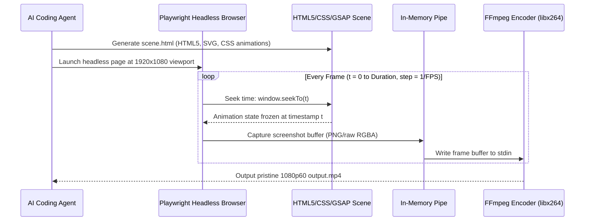

# HyperFrames: Agent-Native HTML/CSS Code-to-Video Architecture

> **Origin:** Grounded in `heygen-com/hyperframes` and HeyGen's agent-native video synthesis engine.
> **Philosophy:** Coding LLMs understand HTML, CSS, and JavaScript with near-perfection. Instead of wrestling with unstable video diffusion models (which hallucinate text, flicker, and require expensive GPUs), AI agents generate production-grade MP4 videos by writing declarative web code rendered frame-by-frame.

---

## 1. The Core Paradigm Shift

```
[ Traditional Generative AI Video ]
Prompt ──► Massive Neural Diffusion Model ──► Non-deterministic, blurry text, flickering pixels, high GPU cost

[ Agent-Native HyperFrames Video ]
Prompt ──► Coding Agent writes HTML/CSS/GSAP ──► Headless Browser (Virtual Clock) ──► Deterministic 1080p60 MP4
```

| Dimension | Generative AI Video (Kling/Sora/Runway) | WebGL / 3D Shaders (Three.js/GLSL) | HyperFrames (HTML/CSS Code-to-Video) |
| :--- | :--- | :--- | :--- |
| **Determinism** | ❌ Stochastic (Random every run) | ✅ 100% Deterministic | ✅ 100% Deterministic |
| **Typography & UI** | ❌ Blurry, distorted, unreadable text | ⚠️ Complex font textures / SDF | ✅ Crisp, pixel-perfect native web fonts |
| **Cost & Compute** | ❌ Heavy GPU cloud subscription | ⚠️ Client/headless GPU required | ✅ Runs on standard CPU headless browser |
| **Revisability** | ❌ Must re-generate entire prompt | ⚠️ Requires 3D math & matrix changes | ✅ Surgical CSS/DOM diff in seconds |
| **Agent Suitability** | ⚠️ High prompt friction | ⚠️ High mathematical complexity | 🟢 Native match for LLM coding capability |

---

## 2. Headless Frame-by-Frame Virtual Clock Pipeline

The core architectural requirement for rendering HTML/CSS to video without frame drops or timing jitter is the **Virtual Clock (Deterministic Seek)**:



---

## 3. The Declarative Scene Contract (`scene.html`)

Every HyperFrames scene implements a strict time-seeking contract via `window.seekTo(timeInSeconds)`:

```html
<!DOCTYPE html>
<html lang="en">
<head>
  <meta charset="UTF-8">
  <style>
    * { margin: 0; padding: 0; box-sizing: border-box; }
    body {
      width: 1920px;
      height: 1080px;
      overflow: hidden;
      background: #09090b;
      font-family: 'Inter', -apple-system, sans-serif;
      display: flex;
      align-items: center;
      justify-content: center;
    }
    .badge {
      padding: 8px 16px;
      border-radius: 9999px;
      background: rgba(99, 102, 241, 0.15);
      border: 1px solid rgba(99, 102, 241, 0.3);
      color: #818cf8;
      font-size: 18px;
      font-weight: 600;
      opacity: 0;
      transform: translateY(20px);
    }
    .headline {
      font-size: 64px;
      font-weight: 800;
      color: #f4f4f5;
      letter-spacing: -0.03em;
      opacity: 0;
      transform: scale(0.95);
    }
  </style>
  <script src="https://cdnjs.cloudflare.com/ajax/libs/gsap/3.12.2/gsap.min.js"></script>
</head>
<body>
  <div style="display: flex; flex-direction: column; align-items: center; gap: 24px;">
    <div id="badge" class="badge">ANTIGRAVITY MEDIA STUDIO</div>
    <div id="headline" class="headline">Deterministic Code-to-Video</div>
  </div>

  <script>
    // Create master GSAP timeline paused by default
    const tl = gsap.timeline({ paused: true });
    
    tl.to("#badge", { opacity: 1, y: 0, duration: 0.8, ease: "power3.out" }, 0.2)
      .to("#headline", { opacity: 1, scale: 1, duration: 1.0, ease: "back.out(1.7)" }, 0.5);

    // Global contract for headless renderer
    window.seekTo = function(t) {
      tl.seek(t);
    };

    window.TOTAL_DURATION = 3.0; // Seconds
    window.SCENE_READY = true;
  </script>
</body>
</html>
```

---

## 4. Headless In-Memory Render Engine (Python + Playwright + FFmpeg)

The capture script runs headless without disk I/O bottlenecks:

```python
import asyncio
import subprocess
from playwright.async_api import async_playwright

async def render_html_to_mp4(html_path: str, output_path: str, fps: int = 60, width: int = 1920, height: int = 1080):
    async with async_playwright() as p:
        browser = await p.chromium.launch(headless=True)
        page = await browser.new_page(viewport={"width": width, "height": height})
        await page.goto(f"file:///{html_path}")
        await page.wait_for_function("window.SCENE_READY === true")

        duration = await page.evaluate("window.TOTAL_DURATION || 5.0")
        total_frames = int(duration * fps)

        # Launch FFmpeg pipe
        ffmpeg_cmd = [
            "ffmpeg", "-y",
            "-f", "image2pipe",
            "-vcodec", "png",
            "-r", str(fps),
            "-i", "-",
            "-c:v", "libx264",
            "-pix_fmt", "yuv420p",
            "-preset", "fast",
            "-crf", "18",
            output_path
        ]
        proc = subprocess.Popen(ffmpeg_cmd, stdin=subprocess.PIPE)

        for frame_idx in range(total_frames):
            t = frame_idx / fps
            await page.evaluate(f"window.seekTo({t})")
            screenshot = await page.screenshot(type="png")
            proc.stdin.write(screenshot)

        proc.stdin.close()
        proc.wait()
        await browser.close()
        print(f"Rendered {total_frames} frames to {output_path}")

if __name__ == "__main__":
    asyncio.run(render_html_to_mp4("scene.html", "output.mp4"))
```

---

## 5. Use Cases for Coding Agents

1. **Product UI Demos & Walkthroughs:** Animate web screens, button clicks, and code diff highlights deterministically.
2. **Social Media Shorts & Infographics:** Render kinetic typography, statistics counters, and brand intros in 9:16 or 16:9.
3. **Trading & Quant Equity Visualizations:** Animate equity curves, drawdowns, and portfolio rebalancing step-by-step.
4. **Interactive Slides to Video:** Turn Reveal.js or HTML presentations into broadcast-ready MP4 lecture videos.
