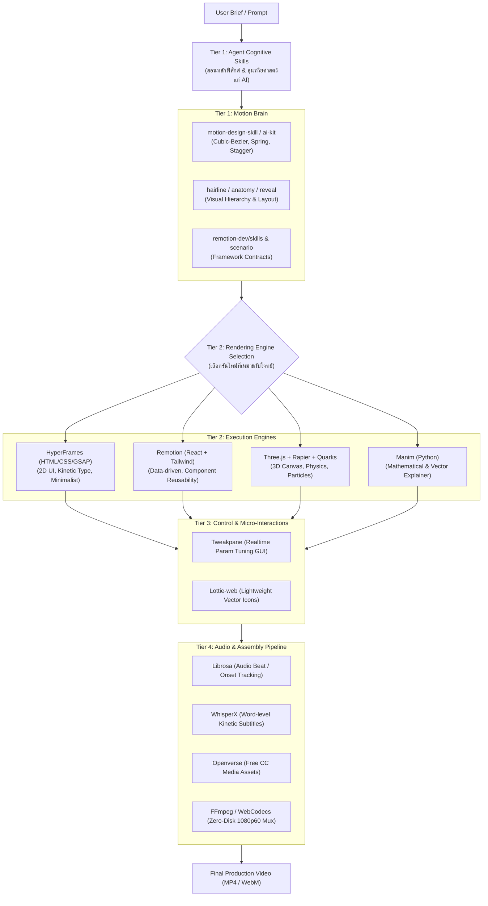
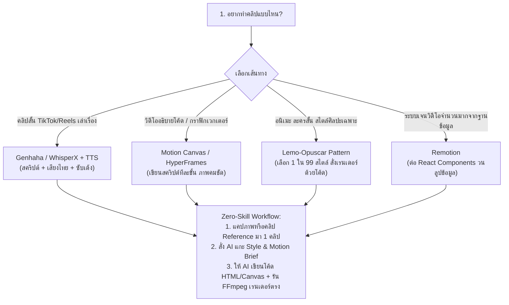

# The 20 Open-Source Repos Motion Graphics Architecture (Programmatic Motion Stack)

ถอดรหัสสถาปัตยกรรมการผลิต Motion Graphics, 3D และงานวิดีโอด้วย Code + AI Coding Agent จาก 20 Open-Source Repositories สกัดเป็นระบบไปป์ไลน์ 4 ชั้น (4-Tier Production Matrix)

---

## 1. ผังไปป์ไลน์ 4 ชั้น (4-Tier Production Architecture)

---

## 2. เจาะลึก 20 Repos จำแนกตาม 4 ชั้นทางวิศวกรรม

### Tier 1: Agent Cognitive Skills (สมองและกฎการเคลื่อนไหว)
*หน้าที่: กำกับให้ AI ไม่เขียนแอนิเมชันแบบมือสมัครเล่น (เช่น Linear Fade ทื่อๆ หรือระยะเวลาหน่วงเกินไป)*
1. **LottieFiles/motion-design-skill:** กฎฟิสิกส์แอนิเมชัน Easing curve (`ease-out-expo`, spring damping)
2. **motiondivision/ai-kit:** ชุดคิดตรรกะ Motion สำหรับ Cursor / AI Agents
3. **remotion-dev/skills:** สัญญาและกฎการเขียนโค้ด Remotion บน React
4. **lucasmarkes/hairline:** จัดการความคมชัดของเส้นขอบ (Sub-pixel rendering, border micro-details)
5. **wheresryan22/anatomy:** การแยกแยะเลเยอร์และโครงสร้างภาพก่อนขยับ
6. **annnguyentt/anatomy-reveal-skill:** เทคนิคการเปิดตัววัตถุ (Mask reveal, Clip-path animations)
7. **scenario-labs/skills:** การสั่งงาน 3D Pipeline และ Blender ผ่านคำสั่ง AI

### Tier 2: Visual & Physics Engines (เครื่องจักรเรนเดอร์ภาพและ 3D)
*หน้าที่: เรนเดอร์กราฟิกตามประเภทงานแบบ Pixel-Perfect*
8. **mrdoob/three.js:** เรนเดอร์ 3D WebGL / WebGPU บนเบราว์เซอร์
9. **pmndrs/react-three-rapier:** ระบบฟิสิกส์ 3D ความเร็วสูง (RigidBody, Collisions, Gravity)
10. **pmndrs/react-postprocessing:** ช็อตฟิลเตอร์ภาพยนตร์ (Unreal Bloom, Depth of Field, Chromatic Aberration)
11. **Alchemist0823/three.quarks:** ระบบอนุภาค 3D สำหรับควัน ไฟ ละออง แสงนีออน
12. **greensock/GSAP:** ไทม์ไลน์ 60fps ที่เสถียรที่สุดในโลกเว็บสำหรับ 2D/DOM
13. **remotion-dev/remotion:** แปลง React Components เป็นวิดีโอระดับ Production
14. **ManimCommunity/manim:** เวกเตอร์แอนิเมชันสำหรับกราฟ สมการคณิตศาสตร์ และแผนภูมิ

### Tier 3: Timeline, Tuning & Vector Assets (เครื่องมือควบคุมและตกแต่ง)
*หน้าที่: ปรับแต่งค่าแบบสดและใช้องค์ประกอบเวกเตอร์ขนาดเบา*
15. **cocopon/tweakpane:** GUI ควบคุมค่าตัวแปร (Speed, Color, Mass, Light) แบบ Realtime
16. **airbnb/lottie-web:** รันไฟล์เวกเตอร์ JSON น้ำหนักเบา คมชัดทุกความละเอียด

### Tier 4: Audio Intelligence & Final Assembly (เสียง คำบรรยาย และการเรนเดอร์)
*หน้าที่: ซิงก์จังหวะภาพเข้ากับเสียง และประกอบเป็นไฟล์ MP4*
17. **librosa/librosa:** วิเคราะห์ความถี่ จังหวะเพลง (BPM), Onset Detection เพื่อทำ Audio-Reactive Motion
18. **m-bain/whisperX:** ถอดเสียงพูดเป็นคำพร้อม Timecode ระดับมิลลิวินาที สำหรับทำ Animated Captions
19. **api.openverse.org:** คลังค้นหาเสียง Sound Effect (SFX) และรูปภาพ Creative Commons ปลอดลิขสิทธิ์
20. **FFmpeg/FFmpeg:** เอนจินตัดต่อ รวมภาพ-เสียง บีบอัด x264/ProRes และส่งออกวิดีโอ 1080p60

---

## 3. ตารางเลือกเอนจิน (Runtime Engine Decision Matrix)

| ประเภทชิ้นงาน | เอนจินที่แนะนำ | เหตุผลทางวิศวกรรม | เครื่องมือประกอบ |
| :--- | :--- | :--- | :--- |
| **SaaS Landing / Explainer** | **HyperFrames (DOM + GSAP)** | เบาที่สุด ไม่ต้องพึ่ง Node/React หนักๆ เรนเดอร์ตัวหนังสือคมชัด 100% | GSAP + Virtual Clock |
| **Data-Driven / Dynamic Video** | **Remotion (React)** | ต้องการ Loop ข้อมูลจาก API, Component ซ้ำๆ, จัดการ State ซับซ้อน | Remotion + Tailwind |
| **Interactive Tech / Vector Explainer** | **Motion Canvas (TypeScript)** | ใช้ Generator `yield*` คุมจังหวะทีละสเต็ป พร้อม Vite Live Editor คล้าย YouTube Dev Channels (MIT Free) | Motion Canvas + Canvas2D |
| **Artistic Code-Film (99 สไตล์)** | **Lemo-Opuscar Pattern** | สร้างภาพยนตร์สั้นด้วยโค้ด 100% (Pixel Art, 80s Anime, Watercolor) ไม่พึ่ง Neural Diffusion | HTML5 Canvas + WebGL + FFmpeg |
| **3D Sci-Fi / Kinetic Product** | **Three.js + Rapier** | ฟิสิกส์ 3D จริง, เงาสะท้อน, แสงกระทบวัตถุ | Three.js + Postprocessing |
| **คณิตศาสตร์ / อธิบายทฤษฎี** | **Manim (Python)** | พล็อตสมการเวกเตอร์ เรขาคณิต กราฟเส้นโค้งแม่นยำสูง | Manim + LaTeX |
| **TikTok / Reels Auto-Subtitle (Genhaha)** | **WhisperX + HyperFrames** | ตัวหนังสือภาษาไทยเด้งตามจังหวะพูดระดับคำต่อคำ (Word-level Sync 9:16) | WhisperX + FFmpeg |

---

## 4. กฎเหล็กฟิสิกส์การเคลื่อนไหว (Motion Design Invariants)

1. **ห้ามใช้ Linear Easing บนการเคลื่อนไหวของวัตถุธรรมชาติ:**
   - เข้าเร็ว-ออกนุ่ม: `cubic-bezier(0.16, 1, 0.3, 1)` (Ease Out Expo)
   - วัตถุมีมวลเด้ง: Spring Physics damping ratio $\zeta \in [0.7, 0.85]$ (ป้องกันการสั่นค้าง)
2. **Stagger Interval Guard:**
   - การแสดงผลรายการหรือตัวอักษรทีละตัว ต้องมี Delay เหลื่อมกันระหว่าง 40ms ถึง 80ms (ห้ามต่ำกว่า 20ms เพราะตามองไม่ทัน และห้ามเกิน 150ms เพราะจะดูช้า)
3. **Audio Beat Synchronization:**
   - เหตุการณ์สำคัญ (Scene Transition, Impact) ต้องล็อกกับ Timecode ของ Kick/Beat จาก `librosa` หรือ `timeline.json` ห้ามแอนิเมชันลอยแบบไม่ตรงจังหวะเพลง

---

## 5. เข็มทิศสำหรับมือใหม่: ไม่ต้องติดทุกสกิลให้รกสมอง (The Zero-Skill Mindset)

> [!TIP]
> **กฎแห่งความเรียบง่าย (สหโชค เพียรการ Law):**
> *"Skill ในโลกของ AI Agent มันคือแค่ 'คู่มือให้ AI อ่าน' อย่าบ้าติดตั้งทุกอย่างลงในเครื่องจน Context บวม ให้เริ่มต้นจากชิ้นงานและสไตล์ที่อยากได้ก่อนเสมอ"*

### เคล็ดลับการเริ่มสำหรับมือใหม่ (3 ขั้นตอนจบ):
1. **อย่าค้นมั่วใน GitHub:** เลือก 1 เครื่องมือหลักที่ตรงกับงาน (เช่น งานสอนเลือก `Motion Canvas`, งานเว็บเลือก `HyperFrames/GSAP`, งานคลิป TikTok เลือก `Genhaha/WhisperX`)
2. **ใช้ Reference Clip แทนการเขียนพรอมต์ลอยๆ:** แคปหน้าจอหรือแนบคลิปตัวอย่างที่ชอบ ให้ AI วิเคราะห์องค์ประกอบ (Layout, Spacing, Speed) ออกมาเป็นกฎ
3. **พึ่งพา FFmpeg เป็นกระดูกสันหลัง:** ไม่ว่าจะเขียนโค้ดด้วยภาษาใด สุดท้ายใช้ FFmpeg เป็นตัวรวมภาพและเสียงเข้าด้วยกันเสมอ
