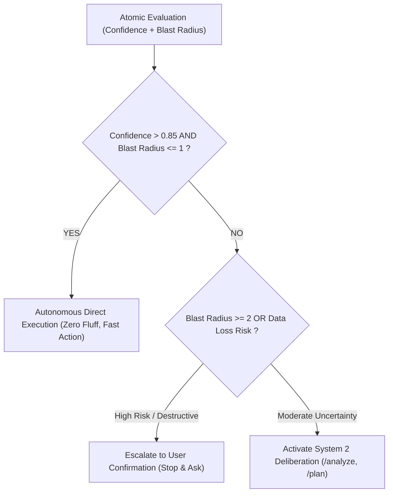

# /jev — High-Velocity Decision Triaging & Execution Gating

A high-velocity cognitive framework adapted from Daniel Kahneman's System 1 thinking and TypeSafe decision architecture. It replaces fuzzy, verbose reasoning loops with atomic, typed judgments and calibrated confidence gating—**operating 100% locally within Antigravity without requiring external APIs or tokens.**

Use for:
- Fast triage of tasks, bug reports, and pull requests
- Decomposing multi-factor architectural decisions into atomic checks
- Guarding execution with explicit confidence thresholds before destructive actions
- Speculative fan-out: parallel hypothesis evaluation against a single state

---

## 1. Cognitive Partitioning (System 1 vs System 2)

| Dimension | System 1 (/jev Fast Triaging) | System 2 (Deep Deliberation) |
| :--- | :--- | :--- |
| **When to Use** | Categorization, routing, safety gating, sanity checks | Novel architecture, elusive root causes, migrations |
| **Processing** | Snap atomic judgments, discrete bounded states | Multi-step reasoning loops (`/analyze --root-cause`, `/plan`) |
| **Output** | Strict typed values (`Choice`, `Score`, `Noul`) | In-depth trade-off analysis, RFCs, diffs |
| **Cognitive Cost** | Minimal, instant, deterministic | High cognitive load and execution depth |

*Rule:* Never spend System 2 deliberation on problems that can be reduced to an atomic System 1 decision matrix.

---

## 2. The Three Cognitive Primitives

Whenever evaluating code, bugs, or commands, structure judgments into three immutable primitives:

### Primitive A: `Choice` (Discrete Routing)
Select exactly one mutually exclusive action path from a bounded set:
```text
State: User request / terminal error / git diff
Target: Choice from [REPAIR_INLINE | EXTRACT_MODULE | REVERT_CHANGE | REQUEST_CLARIFICATION]
Selected: EXTRACT_MODULE (Confidence: 0.92)
```

### Primitive B: `Score` (Ordinal / Continuous Evaluation)
Measure dimensions on a defined numeric rubric (e.g. 0 to 3 scale) rather than subjective impressions:
- **Blast Radius:** `0` (Isolated) $\to$ `3` (Critical Infrastructure/Data)
- **Cognitive Complexity:** `0` (Trivial one-liner) $\to$ `3` (Interdependent architecture)
- **Reversibility:** `0` (Instant git revert) $\to$ `3` (Permanent database migration/data loss)

### Primitive C: `Noul` (Boolean Proposition with Calibrated Certainty)
Evaluate direct True/False assertions with an explicit subjective probability ($P \in [0.0, 1.0]$):
- `is_root_cause_isolated`: $P = 0.95$
- `has_breaking_api_change`: $P = 0.05$
- `introduces_regression`: $P = 0.10$

---

## 3. Speculative Fan-Out (Parallel Hypothesis Testing)

When isolating bugs or analyzing ambiguous system states:
1. **Freeze State:** Capture the exact error log, trace, or file content.
2. **Fan-Out (Multi-Probe):** Evaluate multiple orthogonal hypotheses simultaneously in one mental pass rather than sequential trial-and-error:
   - *Probe 1 (Noul):* Is this an environment/path misconfiguration?
   - *Probe 2 (Noul):* Is this a null-pointer / type mismatch at the boundary?
   - *Probe 3 (Noul):* Is this a concurrency / race condition?
   - *Probe 4 (Noul):* Is this a stale cache / build artifact?
3. **Weight & Execute:** Immediately isolate the highest probability probe and execute verification.

---

## 4. Confidence-Gated Execution Matrix

Determine autonomy vs user escalation using the Confidence/Risk Matrix:



- **Autonomous Fast-Path:** Confidence $> 0.85$ and Low Blast Radius $\to$ Execute immediately without conversational hesitation.
- **Deep Deliberation Path:** Confidence $< 0.85$ $\to$ Defer to `/analyze` (Deep Root-Cause & Epistemic Filtering) or `/plan`.
- **Human-in-the-Loop Gate:** Any risk of data destruction, schema mutation, or critical credentials $\to$ Stop and request explicit consent.

---

## 5. Output Protocol

When applying this skill (`/jev`), format triages with high density:
- **State Snapshot:** 1-2 sentence core condition.
- **Atomic Triaging Matrix:** Table of `Choice`, `Scores`, and `Nouls` with probabilities.
- **Action Gate Decision:** `FAST_PATH_EXECUTE` | `SYSTEM_2_DELIBERATE` | `ESCALATE_TO_USER`.

---

## Reference Map

| Component | Path | Description |
| :--- | :--- | :--- |
| **Local Kev Runner** | [local-kev-runner.md](references/local-kev-runner.md) | คู่มือรันโมเดล `jaredpalmer/kev` บนพอร์ต 8009 (MLX/CUDA) เพื่อทำ System 1 Triaging 100% Offline |

---

## 6. Parallel Swarm Dispatch

เมื่องานมีหลายโมดูลอิสระทำคู่ขนานได้ — ประเมินด้วย Jev แล้ว Dispatch Swarm ตาม **3-Tier Cognitive Budget Routing** (Flash Scout → Inherit Workhorse → Pro Deep Architect) พร้อม **Scope Manifest** ให้ทุก Subagent ก่อนเริ่ม และรับ Judge Scorecard กลับมาก่อน Merge เสมอ

ดูรายละเอียด Scope Invariant, Routing Table, และตัวอย่าง Dispatch: [swarm-dispatch.md](references/swarm-dispatch.md)
