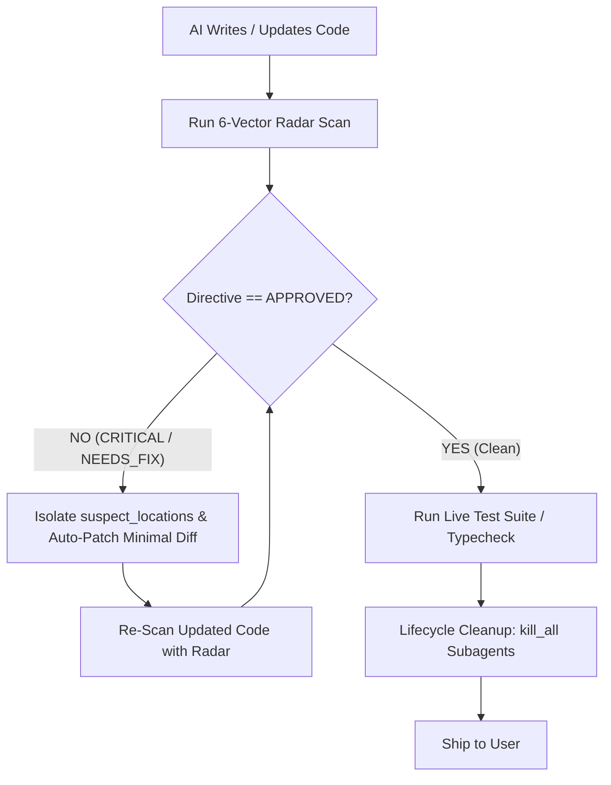

# 6-Vector Pre-Flight Bug Radar & Closed-Loop Autonomous Repair Gate

A high-velocity, deterministic defect detection engine designed to inspect code before executing heavyweight test suites or deploying to production. Instead of slow, verbose conversational audits, it calculates calibrated risk probabilities across 6 critical software defect dimensions in ~1 second.

---

## 1. The 6 Defect Vectors (The Detection Radar)

| Vector Key | Domain | Detection Target & Invariant | Rejection Threshold |
| :--- | :--- | :--- | :--- |
| **`bug_logic_edge`** | Logic & Bounds | Off-by-one errors, infinite loops, mathematical edge cases (e.g., division by zero), inverted boolean conditions. | $> 25\%$ |
| **`bug_null_exception`** | Null & Type Safety | Null/undefined pointer dereferences, missing optional chaining (`?.`), uncaught exceptions, unhandled Promise rejections. | $> 20\%$ |
| **`bug_memory_resource`** | Resource Management | Unclosed file handles, database connection leaks, missing `clearTimeout`/`removeEventListener`, unbounded array accumulation. | $> 25\%$ |
| **`bug_concurrency_race`**| State Synchronization | Non-atomic shared state mutations, race conditions across async tasks, dirty reads without locks/mutex. | $> 20\%$ |
| **`bug_security`** | OWASP & Validation | SQL/Command injection, unescaped HTML/XSS, path traversal, lack of schema validation on external inputs (`safeParse`). | $> 15\%$ |
| **`bug_regression`** | Seam Compatibility | Breaking public method signatures, interface contract violations, unintended side-effects outside declared blast radius. | $> 20\%$ |

---

## 2. Quantitative Scorecard & Decision Gating

Every radar scan evaluates the file or diff and returns an atomic evaluation block:

```json
{
  "antigravity_directive": "CRITICAL_FIX_REQUIRED",
  "bug_severity_score": 2.26,
  "vectors": {
    "bug_logic_edge": 0.72,
    "bug_null_exception": 0.81,
    "bug_memory_resource": 0.16,
    "bug_concurrency_race": 0.35,
    "bug_security": 0.71,
    "bug_regression": 0.27
  },
  "suspect_locations": [
    { "line": 42, "reason": "Unchecked division by zero when divisor array is empty" },
    { "line": 88, "reason": "Missing null check before reading obj.user.profile.id" }
  ]
}
```

### Directive Decision Matrix
- **`CRITICAL_FIX_REQUIRED`**: `bug_severity_score >= 1.50` OR any single vector $> 50\%$ OR `suspect_locations.length > 0`.  
  *Action:* Halt downstream execution. Main agent must immediately apply minimal working repair in-place.
- **`NEEDS_FIX`**: `0.80 <= bug_severity_score < 1.50` with minor warnings.  
  *Action:* Auto-patch non-breaking guards and re-evaluate.
- **`APPROVED (clean)`**: `bug_severity_score < 0.80` AND all 6 vectors $< 20\%$ AND `suspect_locations.length == 0`.  
  *Action:* Green-light for live compilation, unit test suites, or git commit.

---

## 3. Closed-Loop Autonomous Repair Protocol (The Self-Healing Loop)



1. **Scan on Mutation:** As soon as code is generated or refactored, the radar scans the isolated target seam.
2. **Auto-Remediation:** If `CRITICAL_FIX_REQUIRED`, the agent does not ask the user for permission. It reads `suspect_locations` and applies targeted surgical fixes.
3. **Re-Evaluation:** A second radar pass confirms that `bug_severity_score` drops to `< 0.80` and all vectors reach safe thresholds.
4. **Lifecycle Cleanup Invariant:** Once approved, invoke `manage_subagents(Action='kill_all')` to ensure zero lingering background processes or orphaned tokens.

---

## 4. Dual-Execution Modes

### Mode A: In-Session Subagent Radar (Default — 100% Free & Local)
Launch an adversarial subagent within Antigravity (`Role: "Defect Radar"`, `Model: "flash"` or `inherit`) configured with the 6-vector prompt contract. Runs completely offline within your existing model quota without third-party API dependencies.

### Mode B: External / Specialized Model (`typesafe/jev-1.14`)
If configured with OpenRouter (`typesafe/jev-1.14`) or Local Kev Server (`http://localhost:8009/v1`):
Send raw code payload directly to the specialized decision model for sub-second, calibrated probability evaluation at ~$0.0001 per file.
