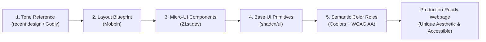

# Vibe Coding Design Pipeline (5-Vector Semantic Architecture)

แนวทางการผลิตหน้าเว็บด้วย AI ให้มีเอกลักษณ์เฉพาะตัว ไร้ปัญหา "AI Slop / Generic Look" (พื้นขาว, การ์ด 3 ใบเหมือนกัน, ปุ่มสีม่วง) ด้วยการล็อก 5 มิติทางวิศวกรรม UI/UX

---

## 1. ผังไปป์ไลน์ 5 มิติ (The 5-Vector Pipeline)

| เวกเตอร์ | แหล่งอ้างอิง | หน้าที่เชิงวิศวกรรม | สิ่งที่ป้อนให้ AI |
| :--- | :--- | :--- | :--- |
| **1. Tone & Aesthetic** | [recent.design](https://recent.design/) *(Godly เดิม)* | กำหนดสุนทรียภาพ ช่องไฟ และอารมณ์รวม | ภาพแคป + พรอมต์แกะสไตล์ (Density, Mood, Hierarchy) |
| **2. Layout Blueprint** | [Mobbin](https://mobbin.com/) | โครงสร้างและลำดับความสำคัญของ UX จริง | Layout Pattern จริง (เช่น 3-Tier Pricing, Onboarding flow) |
| **3. Micro-UI Components** | [21st.dev](https://21st.dev/) | คอมโพเนนต์อนิเมชันและ Hero เฉพาะทาง | Copy prompt จาก 21st.dev ฉีดเข้าส่วนสำคัญ |
| **4. UI Primitives** | [shadcn/ui](https://ui.shadcn.com/) | ฐานปุ่ม ฟอร์ม การ์ด ที่เข้าถึงได้ (A11y) | คำสั่งบังคับ: `"ใช้ shadcn/ui primitives"` |
| **5. Semantic Color Roles** | [Coolors](https://coolors.co/) | ชุดสีแบบผูกบทบาทหน้าที่ 5 ระดับ | Palette 5 สี ระบุบทบาทชัดเจน + บังคับ WCAG AA |

---

## 2. กฎเหล็กการกำหนดสี 5 บทบาท (Semantic Color Roles Invariant)

> [!WARNING]
> **Anti-Pattern:** การส่งรหัสสี 5 ตัวให้ AI โดยไม่ระบุบทบาท จะทำให้ AI สุ่มตำแหน่งสี ส่งผลให้ Contrast พังและอ่านยากทันที

ต้องระบุบทบาทหน้าที่ให้ครบทั้ง 5 ตำแหน่งเสมอ:
1. **Background:** สีพื้นหลังหลักของทั้งหน้า
2. **Surface / Container:** สีพื้นหลังของการ์ด, กล่องเนื้อหา, Navbar, Dialog
3. **Primary:** สีหัวข้อหลัก, เส้นเน้น (Borders), หรือไอคอนนำทาง
4. **Text:** สีข้อความเนื้อหา (บังคับทดสอบ Contrast Ratio กับ Background $\ge 4.5:1$ ตาม WCAG AA)
5. **Accent / CTA:** สีปุ่มหรือจุดเน้นที่ต้องการให้ผู้ใช้คลิกมากที่สุด (ใช้เพียง 1-2 จุดเพื่อความโดดเด่นจริง)

---

## 3. กฎวิศวกรรม UI และ Typography (Universal Standards)

- **Thai-Latin Typography Stack:** ฟอนต์ละตินต้องมาก่อนฟอนต์ไทยเสมอ เช่น `"Inter", "IBM Plex Sans Thai", sans-serif` โดยกำหนด `line-height >= 1.7` สำหรับภาษาไทย
- **44px Touch Target Rule:** ปุ่มและพื้นที่คลิกต้องมี Hitbox อย่างน้อย `44x44px` แยกชั้นความสวยงามออกจากกล่องการกด
- **Mobile-First 375px Guard:** ต้องรองรับ Viewport กว้าง 375px โดยไม่มีการเลื่อนในแกนนอน (Zero horizontal scroll)

---

## 4. วงรอบการปรับปรุงรอบสอง (2nd Stage Refinement)

| อาการที่พบ | พรอมต์แก้เฉพาะจุด (Direct Remediation) |
| :--- | :--- |
| **ตัวหนังสืออ่านยาก / คอนทราสต์ต่ำ** | `"ตรวจเช็ค Contrast Ratio ของ Text และ Background ทั้งหมดให้ได้ระดับ WCAG AA (≥ 4.5:1)"` |
| **เลย์เอาต์บนมือถือแตก** | `"เช็ค Viewport 375px: ให้แน่ใจว่าไม่มี element ใดหลุดแกน x และ Flex/Grid ตัดลงแถวใหม่อย่างถูกต้อง"` |
| **หน้าตาแข็งทื่อ ขาดมิติ** | `"เพิ่ม Micro-interaction: ให้ปุ่มและ Card มี Hover scale เล็กน้อย และเพิ่ม subtle border สี Surface อ่อนลง 10%"` |
| **สเปซแน่นหรือเบียดเกินไป** | `"เพิ่ม Negative space ระหว่าง section อย่างน้อย 64px และขยาย padding ภายในการ์ดเป็น 24px"` |
