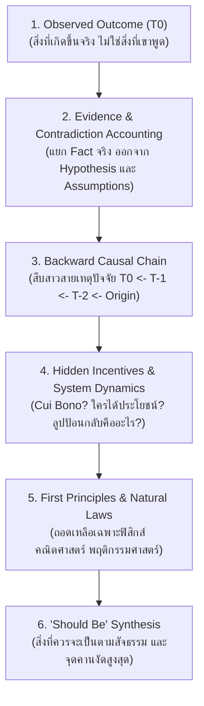

# Conceptual & System Reverse Engineering
> คู่มือการคิดย้อนรอยเพื่อถอดรหัสระบบนามธรรม แนวคิดที่ซับซ้อน โมเดลธุรกิจ ปรัชญา และปรากฏการณ์ที่สับสน สู่ First Principles และสิ่งที่เป็นความจริงตามธรรมชาติ

---

## 🧭 1. แก่นปรัชญา & วงจรคิดย้อนรอย (The Inversion Framework)

เมื่อเผชิญกับแนวคิด ทฤษฎี ปัญหาระดับมหภาค หรือระบบที่ดูสับสนซับซ้อน อย่าพยายามทำความเข้าใจจากคำศัพท์หรูหรา (Jargon) แต่ให้ใช้การ **"คว่ำระบบลงแล้วคิดย้อนทาง" (Invert, Always Invert)**:

---

## 🔬 2. ระเบียบวิธีถอดรหัส 5 ขั้นตอน (5-Step Conceptual Deconstruction)

### ขั้นที่ 1: Empirical Phenomenon Isolation (สกัดข้อเท็จจริงปลายทาง $T_0$)
- ยึดหลัก **กาลามสูตร (Kalāma Sutta)**: ตัดความเชื่อ ความคุ้นเคย หรือคำกล่าวอ้างของบุคคลออก
- บันทึกเฉพาะสภาพความเป็นจริงที่สังเกตได้ (Observable Reality) เช่น ตัวเลข ผลลัพธ์ พฤติกรรมจริง หรือ Output ที่เกิดขึ้น

### ขั้นที่ 2: Causal Backward Chaining (ปฏิจจสมุปบาทเชิงระบบ)
- สาวสายเหตุและปัจจัยย้อนหลัง:
  $$\text{เพราะสิ่งนี้มี สิ่งนี้จึงมี; เพราะสิ่งนี้ดับ สิ่งนี้จึงดับ}$$
- ตั้งคำถามย้อนกลับ: *"ก่อนที่สิ่งนี้จะเกิดขึ้น $T_{-1}$ ต้องมีสภาพแวดล้อมอะไร? และอะไรเป็นเชื้อต้นเหตุให้เกิด $T_{-1}$?"*

### ขั้นที่ 3: Hidden Incentives & Game Theory (ถอดรหัสแรงจูงใจที่ซ่อนอยู่)
- ถามคำถามสำคัญที่สุด: **"Cui bono?" (ใครเป็นผู้ได้รับผลประโยชน์จากระบบนี้?)*
- วิเคราะห์ Feedback Loops:
  - **Reinforcing Loop (ลูปทวีคูณ)**: วงจรอุบาทว์หรือการเติบโตแบบ Snowball ที่ระบบเลี้ยงตัวเอง
  - **Balancing Loop (ลูปดุลยภาพ)**: แรงต้านที่ทำให้ระบบไม่ยอมเปลี่ยนแปลง

### ขั้นที่ 4: First Principles Decomposition (ย่อยสลายสู่กฎพื้นฐาน)
- ขจัดคำศัพท์ทางเทคนิค (Jargon) และกรอบความคิดแบบอุปมาอุปไมย (Analogy)
- ลดรูประบบลงเหลือเฉพาะสัจธรรมที่พิสูจน์แล้ว:
  1. กฎทางฟิสิกส์และพลังงาน (Conservation of Energy, Entropy)
  2. กฎทางคณิตศาสตร์และสถิติ (Bayesian Probability, Normal/Power Law Distributions)
  3. จิตวิทยาและพฤติกรรมมนุษย์ (Loss Aversion, Dopamine Loops, Status Seeking)

### ขั้นที่ 5: "Should Be" Verdict & Highest Leverage Point (เคาะจุดคานงัด)
- เปรียบเทียบระหว่าง:
  - **สิ่งที่ระบบกำลังเป็นอยู่ (As-Is)**: เต็มไปด้วย Friction, ความซับซ้อนเทียม, และการสูญเสียพลังงาน
  - **สิ่งที่ควรจะเป็น (Should-Be)**: สภาพที่เรียบง่ายที่สุด สอดคล้องกับ First Principles และใช้พลังงานต่ำสุด
- ระบุ **High-Leverage Point (จุดคานงัดสูงสุด)**: เปลี่ยนแปลงเพียง 1 จุด แต่ปลดล็อกผลลัพธ์ทั้งระบบ
