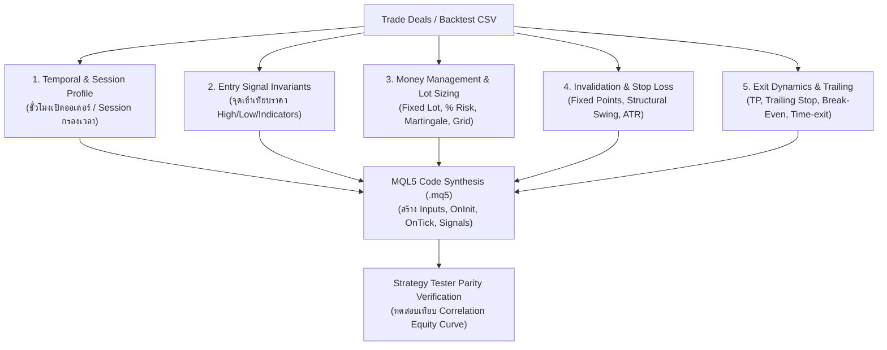

# Quantitative EA & Trading Strategy Reverse Engineering
> คู่มือการแกะรอยระบบเทรดและ Expert Advisors (EA) จากผลการทดสอบ (Backtest Reports) และประวัติการเทรด (Trade History) เพื่อสังเคราะห์เป็นตรรกะและโค้ด MQL5 (`.mq5`) ที่ใช้งานได้จริง

---

## 🎯 1. วัตถุประสงค์ & แหล่งข้อมูลนำเข้า (Ingestion Sources)

เมื่อได้รับผลการทดสอบหรือประวัติการเทรดของระบบที่เราไม่เห็น Source Code ให้ใช้กระบวนการ Black-Box Behavioral Reconstruction ผ่านแหล่งข้อมูล:
1. **Strategy Tester Report (MT5/MT4 HTML/XML)**: รายงานสรุปผล Backtest ที่มีตารางประวัติ Orders/Deals พร้อม Equity Curve
2. **Trade History CSV / MT5 Journal**: ข้อมูล `Time`, `Type` (Buy/Sell), `Volume`, `Price`, `S/L`, `T/P`, `Profit`, `Comment`
3. **Historical OHLCV Market Data**: กราฟราคาแท่งเทียนย้อนหลัง (M1, M5, M15, H1) ในช่วงเวลาเดียวกันสำหรับเทียบพฤติกรรมราคา

---

## 🔬 2. ระเบียบวิธีสกัดพฤติกรรม 5 มิติ (5-Vector Behavioral Extraction)



### Vector 1: Temporal & Session Profiling (พฤติกรรมด้านเวลา)
- **สกัดเวลาเปิดออเดอร์ (Server Hour & Minute)**:
  - กรอง Histogram ความถี่เวลาเข้าเทรด:
    - กระจุกตัวช่วง `00:00 - 06:00 GMT` $\rightarrow$ **Asian Range Scalper / Night Grid**
    - กระจุกตัวช่วง `07:00 - 09:00 GMT` $\rightarrow$ **London Open Breakout**
    - กระจุกตัวช่วง `12:00 - 15:00 GMT` $\rightarrow$ **New York Sweep / US Open Session**
    - กระจุกตัวช่วง `14:50 - 15:15 GMT` $\rightarrow$ **LBMA PM Gold Auction Fixing**
- **Trade Duration**:
  - ถือเฉลี่ย $< 15$ นาที $\rightarrow$ Scalping (สเปรดต่ำ, TP สั้น)
  - ถือเฉลี่ย $2 - 8$ ชั่วโมง $\rightarrow$ Intraday Swing / Session Momentum
  - ถือข้ามวัน/สัปดาห์ $\rightarrow$ Trend Following / Macro Positioning

### Vector 2: Entry Signal Invariants (ตรรกะสัญญาณเข้าออเดอร์)
เทียบเวลาและราคาเปิดออเดอร์กับแท่งเทียน OHLCV ย้อนหลัง:
- **Price Action Signatures**:
  - เปิด Buy เมื่อราคาหลุด Low ของช่วงเวลาก่อนหน้าแล้วเด้งกลับ $\rightarrow$ **Liquidity Sweep & Reclaim**
  - เปิดออเดอร์เฉพาะเมื่อมีแท่งเทียนแทงยาวผิดปกติ (High Volume / Displacement) $\rightarrow$ **FVG / Order Block Retest**
  - เปิดตามทิศทาง Breakout ทะลุ High/Low ของรอบ $N$ แท่ง $\rightarrow$ **Donchian / High-Low Channel Breakout**
- **Indicator Estimation (หาค่าพารามิเตอร์ของอินดิเคเตอร์)**:
  - นำราคาเข้าเทียบกับค่า MA (EMA 20, 50, 200), RSI (14), หรือ Bollinger Bands (20, 2)
  - หาก Buy เกิดขึ้นเสมอเมื่อราคาแตะ Lower Band หรือ RSI $< 30$ $\rightarrow$ **Mean Reversion**

### Vector 3: Money Management & Lot Sizing (การบริหารเงินทุน)
- **Lot Behavior Analysis**:
  - ล็อตคงที่ตลอดเวลา (เช่น `0.10, 0.10, 0.10`) $\rightarrow$ `Fixed Lot`
  - ล็อตขยายตามยอด Balance (เช่น $1,000 \rightarrow 0.01$, $10,000 \rightarrow 0.10$) $\rightarrow$ `Dynamic Risk % Lot`
  - ออเดอร์แพ้แล้วออเดอร์ถัดไปล็อตเบิ้ล ($0.01 \rightarrow 0.02 \rightarrow 0.04$) $\rightarrow$ **Martingale (High Risk)**
  - มีหลายไม้เปิดสวนทางราคาในระยะห่างคงที่ (Grid Step $N$ pips) $\rightarrow$ **Grid Trading**

### Vector 4: Stop Loss & Risk Invalidation (จุดตัดขาดทุน)
- ตรวจสอบคอลัมน์ `S/L` ในประวัติ:
  - ระยะห่างระหว่าง `Open Price` กับ `S/L` คงที่เป๊ะ (เช่น 300 points) $\rightarrow$ `Fixed Points Stop Loss`
  - ระยะห่างแปรผันตามความผันผวนของตลาด $\rightarrow$ `ATR Multiple Stop Loss`
  - S/L วางไว้ที่จุดต่ำสุด/สูงสุดของแท่งเทียนก่อนหน้า $\rightarrow$ `Swing Structural Stop Loss`
  - `S/L = 0` (ไม่ตั้ง Stop Loss หรือคัตด้วยตรรกะซ่อน) $\rightarrow$ **Mental SL / Basket Close Guard**

### Vector 5: Exit Dynamics & Take Profit (จุดทำกำไรและปิดออเดอร์)
- **TP Behavior**: Fixed Points, Risk:Reward Ratio (เช่น 1:2, 1:3), หรือปิดที่ High/Low เดิม
- **Trailing & Break-Even**:
  - เมื่อกำไรวิ่งไปถึงระดับหนึ่ง มีการขยับ S/L มาที่ทุนหรือไม่ $\rightarrow$ `Break-Even Trigger`
  - S/L ขยับตามราคาทีละ Step หรือลอยตามเส้น Moving Average $\rightarrow$ `Trailing Stop`
  - ปิดออเดอร์เมื่อหมดวัน (Friday Close / Session End) $\rightarrow$ `Time-based Invalidation`

---

## 💻 3. MQL5 Synthetic Code Generation Template

เมื่อสกัดตัวแปรทั้ง 5 มิติได้ ให้จัดทำโค้ดภาษา MQL5 ที่พร้อมนำไปใช้งานในโครงสร้างมาตรฐาน:

```mql5
//+------------------------------------------------------------------+
//|                                     Reconstructed_EA_Strategy.mq5|
//|               Synthesized via /merea Universal Reverse Engine    |
//+------------------------------------------------------------------+
#property copyright "Synthesized via /merea"
#property version   "1.00"
#property strict

#include <Trade\Trade.mqh>
CTrade trade;

//--- 1. Reconstructed Inputs
input group "=== Trading Sessions ==="
input int    InpStartHour   = 8;       // Session Start Hour (GMT)
input int    InpEndHour     = 16;      // Session End Hour (GMT)

input group "=== Strategy Logic Inputs ==="
input int    InpLookbackBars = 20;     // Channel / Swing Lookback
input double InpDeviation    = 2.0;    // Standard Deviation / Multiple

input group "=== Risk & Money Management ==="
input double InpFixedLot     = 0.10;   // Lot Size
input int    InpStopLossPts  = 300;    // Stop Loss (Points)
input int    InpTakeProfitPts= 600;    // Take Profit (Points)
input int    InpMagicNumber  = 888123; // EA Magic ID

//--- 2. State & Bar Tracking
datetime last_bar_time = 0;

bool IsNewBar() {
   datetime current_bar = iTime(_Symbol, _Period, 0);
   if (current_bar != last_bar_time) {
      last_bar_time = current_bar;
      return true;
   }
   return false;
}

//+------------------------------------------------------------------+
//| Expert initialization function                                   |
//+------------------------------------------------------------------+
int OnInit() {
   trade.SetExpertMagicNumber(InpMagicNumber);
   return(INIT_SUCCEEDED);
}

//+------------------------------------------------------------------+
//| Expert tick function                                             |
//+------------------------------------------------------------------+
void OnTick() {
   // Bar Guard: Run only on new candle open
   if (!IsNewBar()) return;
   
   // Session Filter
   MqlDateTime dt;
   TimeCurrent(dt);
   if (dt.hour < InpStartHour || dt.hour >= InpEndHour) return;
   
   // Entry Condition Check & Order Execution
   // (Synthesized logic placed here)
}
```

---

## 🛡️ 4. Parity & Correlation Verification

ก่อนยืนยันว่าการแกะระบบสมบูรณ์ ให้รันการทดสอบเทียบเคียง:
1. นำโค้ด MQL5 ที่สร้างขึ้นไปรัน Backtest บน Strategy Tester ด้วยชุดข้อมูลเดียวกัน
2. คำนวณค่าสัมประสิทธิ์สหสัมพันธ์ (Correlation Coefficient $R^2$) ของ Equity Curve ระหว่างของเดิมกับที่สังเคราะห์ขึ้นมา
3. เกณฑ์มาตรฐานความแม่นยำ:
   - $R^2 \ge 0.90$ และ Trade Count เบี่ยงเบนไม่เกิน $\pm 10\%$ $\rightarrow$ **Validated Reverse Parity**
