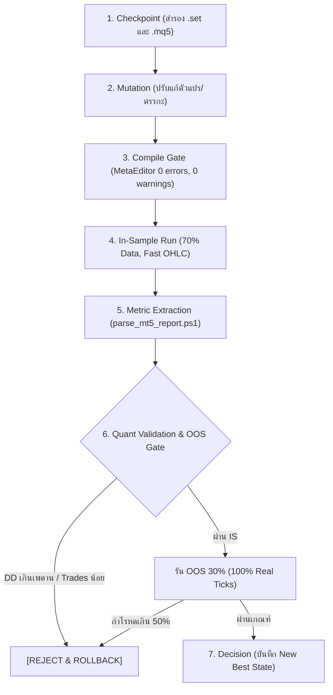

# MQL5 Autonomous Optimization Loop Engine

คู่มือและขั้นตอนการรันลูปปรับแต่ง EA อัตโนมัติ (Autonomous EA Optimization & Backtest Feedback Loop) ผ่าน MetaTrader 5 Headless CLI Strategy Tester ควบคู่กับการคัดกรองความทนทานเชิงปริมาณ (Quant Edge Validation)

---

## 1. ผังโครงสร้างระบบ (Engine Architecture)

เครื่องยนต์ของระบบจัดเก็บอยู่ที่:
`%APPDATA%\MetaQuotes\Terminal\D0E8209F77C8CF37AD8BF550E51FF075\MQL5\Experts\METHA EA\loop_engine\`

ประกอบด้วย 3 ส่วนประกอบหลัก:
1. `mql5_loop_config.json`: ควบคุมสัญลักษณ์ ทุน เลเวอเรจ ขอบเขตเวลา In-Sample / Out-of-Sample และเพดาน Drawdown
2. `parse_mt5_report.ps1`: สกัดตัวเลขสถิติจากรายงาน HTML/Unicode ของ MT5 ออกมาเป็น JSON (Net Profit, Equity DD%, Profit Factor, Recovery Factor, Sharpe Ratio, Total Trades)
3. `mql5_loop_runner.ps1`: ตัวคุมกระบวนการสั่งงาน Strategy Tester, เฝ้าระวัง Timeout Watchdog และจัดการ State

---

## 2. ขั้นตอนการรันลูป 7 สเต็ป (Execution Lifecycle)



---

## 3. รูปแบบคำสั่งใช้งาน (PowerShell CLI)

### ทดสอบความพร้อมระบบก่อนรัน (Dry Run):
```powershell
& powershell -ExecutionPolicy Bypass -File "$env:APPDATA\MetaQuotes\Terminal\D0E8209F77C8CF37AD8BF550E51FF075\MQL5\Experts\METHA EA\loop_engine\mql5_loop_runner.ps1" -DryRun
```

### สั่งรันเทสต์จริง 1 รอบ (Single Iteration Verification):
```powershell
& powershell -ExecutionPolicy Bypass -File "$env:APPDATA\MetaQuotes\Terminal\D0E8209F77C8CF37AD8BF550E51FF075\MQL5\Experts\METHA EA\loop_engine\mql5_loop_runner.ps1" -SingleRunOnly
```

### สกัดผลรายงานจากไฟล์ HTML:
```powershell
& powershell -ExecutionPolicy Bypass -File "$env:APPDATA\MetaQuotes\Terminal\D0E8209F77C8CF37AD8BF550E51FF075\MQL5\Experts\METHA EA\loop_engine\parse_mt5_report.ps1" -ReportPath "<path_to_report.htm>"
```
