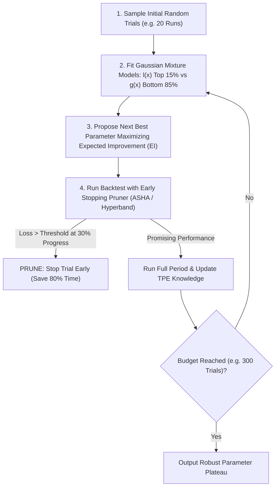

# Bayesian Parameter Optimization & Hyperband Pruning (TPE Protocol)

สถาปัตยกรรมการค้นหาพารามิเตอร์ของระบบเทรดและ Expert Advisor (MQL5) ให้ได้จุดที่ทนทานสูงสุด (ดัดแปลงจากโมเดลของ `Optuna` และ `Ray Tune`) โดยก้าวข้ามการสุ่มแบบ Grid Search หรือ Random Search ที่เสียเวลา สู่การเรียนรู้แบบ **Bayesian Optimization (TPE)** ควบคู่กับระบบตัดตอนรอบแบ็กเทสต์ที่ไร้แววทิ้งล่วงหน้า (Early Stopping Pruning)

---

## 1. วิกฤตของการสุ่มแบบ Grid Search

เมื่อ EA มีตัวแปร 5–8 ตัว (เช่น SL, TP, EMA Period, RSI Threshold, Filter Bands):
1. **Curse of Dimensionality**: การค้นหาแบบทุกความเป็นไปได้ต้องรันนับล้านรอบ กินเวลาหลายสัปดาห์
2. **Computational Waste**: เสียเวลารันแบ็กเทสต์รอบที่ตัวแปรพังตั้งแต่สัปดาห์แรกจนจบประวัติ 5 ปี
3. **Overfitting Peak Traps**: มักได้พารามิเตอร์ที่กำไรสูงเฉพาะจุดแคบๆ (Spike Peak) แต่ไม่ทนทานในตลาดจริง

---

## 2. เสาหลักการค้นหาแบบ Optuna TPE (The 3 Optimization Pillars)

### 1. Tree-structured Parzen Estimator (TPE)
แทนที่จะสร้างโมเดลความน่าจะเป็นของผลลัพธ์ $p(y \mid x)$ ตรงๆ TPE จะแบ่งผลลัพธ์ออกเป็น 2 กลุ่ม:
- $l(x)$: การแจกแจงของตัวแปรที่ให้ผลตอบแทนยอดเยี่ยม (Top 15–20%)
- $g(x)$: การแจกแจงของตัวแปรที่เหลือทั้งหมด

จากนั้นเลือกค่า $x$ ถัดไปที่เพิ่มค่าอัตราส่วน $\frac{l(x)}{g(x)}$ สูงสุด (Expected Improvement) ทำให้ระบบโฟกัสเฉพาะพื้นที่ที่น่าจะมีผลกำไรสูง

### 2. Hyperband / ASHA Early Stopping Pruning
- เมื่อรัน Backtest ไปได้เพียง 20–30% ของข้อมูลย้อนหลัง หากพบว่าค่า Drawdown หลุดเกิน 10% หรือ Sharpe ต่ำกว่าเกณฑ์ ให้สั่ง **Abort / Prune** ทันที
- ช่วยประหยัดเวลาการประมวลผลรวมได้มากกว่า 70–80%

### 3. Parameter Plateau Selection (ค้นหาที่ราบ ไม่ใช่ยอดแหลม)
- เลือกชุดตัวแปรที่อยู่ใน **พื้นที่ราบ (Plateau)** ซึ่งแม้ค่าตัวแปรจะคลาดเคลื่อนไป $\pm 10\%$ ผลกำไรและค่า Drawdown ยังคงรักษาเสถียรภาพไว้ได้
- ปฏิเสธชุดตัวแปรที่เป็น **ยอดเขาสูงชัน (Isolated Spike)** เพราะเป็นสัญญาณของการ Overfitting 100%

---

## 3. เกณฑ์ชี้ขาดก่อนนำพารามิเตอร์ไปรัน Forward Run

1. **Deflated Sharpe Ratio (DSR $\ge 0.95$)**: หักลบผลกระทบจากการทดลองซ้ำ (Data Snooping Penalty)
2. **Out-of-Sample (OOS) Retention $\ge 70\%$**: ผลการทดสอบบนข้อมูลที่ไม่เคยเห็น ต้องคงประสิทธิภาพไว้ได้อย่างน้อย 70% ของ In-Sample
3. **Low Parameter Sensitivity**: เส้นกราฟ Sensitivity Curve ต้องมีความลาดชันต่ำ
