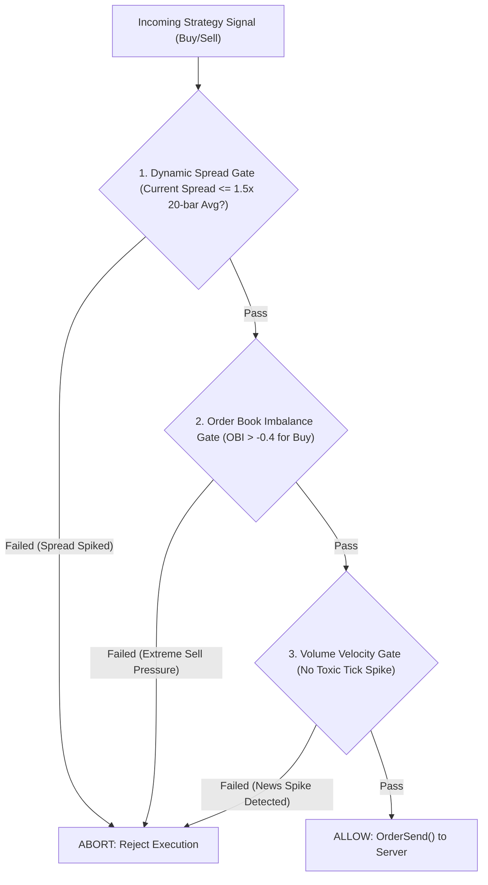

# Order Book Microstructure & Toxic Flow Guard

คู่มือมาตรฐานการออกแบบเกราะป้องกันความเสี่ยงระดับจุลภาคของตลาด (Market Microstructure & Order Book Analytics) สำหรับ Expert Advisor (MQL5) (ดัดแปลงจากโมเดลของ `Hummingbot` และ `Freqtrade`) เพื่อป้องกันปัญหา Adverse Selection และการถูกกวาดสภาพคล่อง (Toxic Flow / Institutional Liquidity Sweep)

---

## 1. วิกฤตของการส่งคำสั่งแบบไม่ดูสภาพคล่อง (The Adverse Selection Problem)

EA ทั่วไปที่ส่งคำสั่งตาม Indicator บนแท่งเทียนปิด มักประสบปัญหาหนัก:
1. **Spread Expansion Trap**: ส่งคำสั่งในช่วงข่าวแรงหรือ Rollover Hours ที่ค่า Spread ถ่างกว้าง 5–10 เท่า ทำให้ต้นทุนพุ่งสูงทันที
2. **Toxic Flow / Adverse Selection**: คำสั่งถูก Fill ได้ง่ายเฉพาะในจังหวะที่ราคากำลังพุ่งทะลุแนวรับแนวต้านอย่างรุนแรง (ส่งผลให้ติดลบทันทีที่เข้า)
3. **Ghost Liquidity**: สภาพคล่องที่เห็นใน Order Book หายไปในเสี้ยววินาทีก่อนที่คำสั่งจะไปถึง Server ก่อให้เกิด Extreme Slippage

---

## 2. เสาหลักการป้องกันระดับ Microstructure (The 3 Microstructure Guards)



### 1. Dynamic Spread Expansion Gate
ห้ามฮาร์ดโค้ดค่า Spread สูงสุดเป็นตัวเลขตายตัว (เช่น ห้ามเกิน 20 points) เพราะความผันผวนของแต่ละช่วงเวลาไม่เท่ากัน แต่ให้ใช้ **Relative Spread Ratio**:
```mql5
double currentSpread = (double)SymbolInfoInteger(_Symbol, SYMBOL_SPREAD);
double avgSpread = GetAverageSpread(20); // ค่าเฉลี่ย 20 แท่งล่าสุด

if(currentSpread > avgSpread * 1.5) {
   Print("GUARD: Spread spike detected. Current: ", currentSpread, " Avg: ", avgSpread);
   return false; // ระงับการยิงออเดอร์
}
```

### 2. Order Book Imbalance (OBI)
คำนวณสัดส่วนปริมาณ Volume ระหว่างฝั่ง Bid และ Ask ในระดับ Best 5–10 Levels:

$$\text{OBI} = \frac{V_{\text{bid}} - V_{\text{ask}}}{V_{\text{bid}} + V_{\text{ask}}}$$

- $\text{OBI} \in [-1.0, +1.0]$
- หากสัญญาณเป็น **BUY** แต่ค่า $\text{OBI} < -0.4$ (มีแรงขายกดดันมหาศาลใน Book) ให้ระงับการเข้าเพื่อป้องกัน Adverse Selection

### 3. Volume & Tick Velocity Spike Guard
- ติดตามความเร็วในการเกิด Tick (`TickCount / Second`)
- หากพบความเร็วของ Tick พุ่งเกิน 3 เท่าของค่าเฉลี่ยปกติพร้อมราคาแกว่งแรง (มักเป็นจังหวะข่าวตัวเลขเศรษฐกิจออก) ให้สั่งปิดรับคำสั่งใหม่ 60 วินาที

---

## 3. กฎเหล็กการรวมเข้ากับ MQL5 EA

1. ทุก EA ต้องเรียกฟังก์ชันตรวจจับสภาพคล่องนี้ก่อนฟังก์ชัน `OrderSend()` เสมอ
2. บันทึกเหตุผลการปฏิเสธคำสั่งลงใน Journal เพื่อให้ AI ทราบว่าสัญญาณถูกกรองทิ้งเพราะ Microstructure ไม่เอื้ออำนวย
