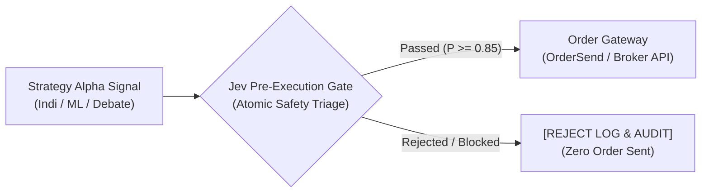

# Institutional Pre-Execution Gate Architecture (Jev Gate Pattern)

สถาปัตยกรรมตัวกรองความปลอดภัยระดับอะตอมก่อนส่งคำสั่งซื้อขาย (Pre-Execution Gatekeeper) ถอดรหัสจาก **QuantDinger v5** และ **TypeSafe Jev System 1** เพื่อป้องกันปัญหา Overtrading, Slippage Skew, และความเสียหายจากสภาวะ Microstructure ผิดปกติ

---

## 1. ปรัชญาการออกแบบ: แยกสัญญาณออกจากการยิงออเดอร์ (Decoupled Execution)

ในระบบเทรดระดับสถาบัน โมเดลทำนาย (Strategy Signal Generator) จะ**ไม่มีสิทธิ์ส่งออเดอร์เข้าตลาดโดยตรง** แต่ต้องส่ง Intent ผ่านชั้นตรวจสอบความปลอดภัย (Execution Gatekeeper) เสมอ:



---

## 2. เสาหลักการตรวจสอบความปลอดภัย 5 มิติ (The 5 Gating Dimensions)

### ก. การคุม Spread ขยายตัวผิดปกติ (Spread Spike Guard)
- **ปัญหา:** ช่วงเปลี่ยนวัน (Rollover), ข่าวรุนแรง, หรือสภาพคล่องเหือดแห้ง Spread จะถ่างกว้าง $3\times - 10\times$ ทำให้กำไรตามทฤษฎีกลายเป็นขาดทุนทันที
- **เกณฑ์การกรอง:**
  $$\text{Current Spread} \le \text{InpMaxSpreadPips} \quad \text{และ} \quad \text{Current Spread} \le 1.8 \times \text{MA(Spread, 50)}$$

### ข. การล็อกแท่งเทียนเดี่ยว (Bar-Level Execution Lock)
- **ปัญหา:** กลยุทธ์ที่ตรวจเงื่อนไขบนแท่งเปิด อาจเจอปัญหา False Trigger ซ้ำๆ หลายสิบรอบในแท่งเดียวกันหากตลาดมีความผันผวนสูง
- **เกณฑ์การกรอง:** บันทึก `datetime lastOrderBarTime` และอนุญาตให้เข้าออเดอร์ได้สูงสุดเพียง 1 ออเดอร์ต่อ 1 Bar Timestamp

### ค. ช่วงเวลาอันตรายและสภาพคล่องต่ำ (Session & Rollover Cut)
- **ช่วงเวลางดเทรด:**
  - ช่วง Rollover ข้ามวัน: `23:55 - 00:05` (Server Time)
  - วันจันทร์เปิดตลาดเช้าตรู่ (Monday Morning Gap): ก่อน `02:00`
  - วันศุกร์ก่อนปิดตลาด (Friday Weekend Close): หลัง `21:30`

### ง. การตรวจสอบส่วนต่างราคาและ Slippage (Asymmetric Slippage Guard)
- หลีกเลี่ยง Market Order ในสภาวะ Fast Market
- กำหนดค่า `deviation` ใน `MqlTradeRequest` อย่างรัดกุม (เช่น ไม่เกิน 10-20 points สำหรับ Forex/Gold)

### จ. ความปลอดภัยของเงินทุนและ Margin (Capital & Margin Buffer)
- ตรวจสอบ `AccountInfoDouble(ACCOUNT_MARGIN_FREE)` ล่วงหน้า
- บังคับ `Equity Drawdown` ปัจจุบันต้องไม่ทะลุเพดาน Maximum Daily Loss Limit

---

## 3. ตัวอย่างการนำไปใช้งานใน MQL5

รวมไฟล์ Header เข้าสู่โค้ด EA หลัก:
```mql5
#include <JevExecutionGate.mqh>

CJevExecutionGate gate;

void OnInit()
{
   gate.Init(_Symbol, InpMaxSpreadPips, InpMaxRiskPercent);
}

void OnTick()
{
   if(!IsNewBar()) return;
   
   int signal = GetStrategySignal(); // 1 = Buy, -1 = Sell, 0 = None
   
   if(signal != 0)
   {
      ENUM_ORDER_TYPE orderType = (signal > 0) ? ORDER_TYPE_BUY : ORDER_TYPE_SELL;
      double lots = CalculateLotSize();
      
      // Atomic Pre-Execution Gate:
      if(gate.CheckGate(_Symbol, orderType, lots))
      {
         ExecuteOrder(orderType, lots);
      }
      else
      {
         PrintFormat("[GATE BLOCKED] Symbol: %s | Reason: %s", _Symbol, gate.GetLastError());
      }
   }
}
```
