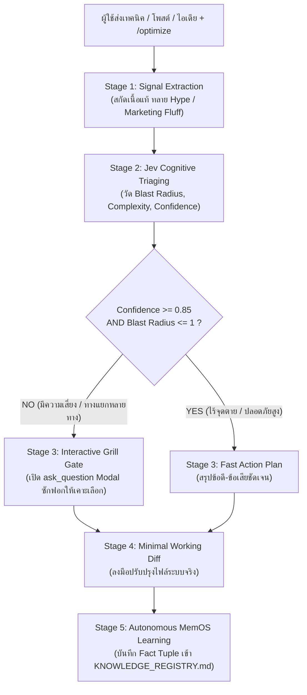

# /optimize — ศูนย์ปรับแต่งสถาปัตยกรรม AGY แบบครบวงจร (Unified Evolution Engine)

รวบยอดกระบวนการสกัดความรู้ วิเคราะห์ความเสี่ยง ซักฟอกข้อจำกัด ดัดแปลงระบบ และบันทึกเข้าสมอง (แทนที่การเรียก `/analyze` $\to$ `/jev` $\to$ `/grill-me` $\to$ `/review` $\to$ `/learn` หลายรอบ) ให้จบครบวงจรในคำสั่งเดียว

---

## 1. ลูปการทำงาน 5 ขั้นตอน (The 5-Stage Evolution Pipeline)

เมื่อผู้ใช้ส่งเทคนิค โพสต์บทความ ไอเดียปรับแต่ง หรือสั่งแก้พฤติกรรมของ AGY แล้วระบุ `/optimize`:

---

## 2. รายละเอียดขั้นตอนเชิงลึก

### Stage 1: Signal Extraction & Deconstruction (ผ่าตัดสกัดสาระ)
- แยกแยะ "น้ำ (Hype/Marketing)" ออกจาก "เนื้อ (Engineering Primitives)" จากข้อมูลที่ผู้ใช้ป้อนเข้ามา
- สกัด Invariant สำคัญ และตั้งสมมติฐานว่าเทคนิคนี้พยายามแก้ปัญหาอะไรใน First Principles

### Stage 2: Jev Cognitive Triaging (ประเมินความเสี่ยงด้วย System 1)
ประเมิน 3 มิติทางความคิดของ `/jev`:
- **Primitive Choice:** `[FAST_ABSORB | GRILL_INTERROGATE | REJECT_ANTIPATTERN | ARCHITECT_REFACTOR]`
- **Primitive Score (0 ถึง 3):**
  - **Blast Radius:** `0` (Isolated) $\to$ `3` (Critical Infrastructure/Data)
  - **Cognitive Complexity:** `0` (Trivial one-liner) $\to$ `3` (Interdependent architecture)
  - **Reversibility:** `0` (Instant git revert) $\to$ `3` (Permanent loss)
- **Primitive Noul (Boolean Probability):**
  - `has_edge_case_risk`: ประเมินความเสี่ยงจุดตาย
  - `causes_token_bloat`: ประเมินภาระโทเค็นว่าบวมขึ้นหรือไม่
  - `conflicts_with_existing_rules`: ขัดแย้งกับกฎหลักใน `AGENTS.md` ไหม

### Stage 3: Decision Cockpit & Interactive Grill Gate (ซักฟอกก่อนลงมือ)
> [!IMPORTANT]
> **Anti-Blind Obedience Invariant:** ห้ามเออออตามผู้ใช้ 100% เด็ดขาด! หน้าที่ของเอเจนต์คือ Senior Partner ที่ช่วยคิดดักคอและชี้จุดตาย
- **กรณี High Confidence ($\ge 0.85$) & Low Risk:** อธิบายข้อดี-ข้อเสียอย่างตรงไปตรงมา แล้วเตรียมแผนลงมือทันที
- **กรณี Ambiguous หรือ High Risk ($< 0.85$ หรือ Blast Radius $\ge 2$):** **ห้ามเดาหรือตัดสินใจแทนผู้ใช้** ให้เรียกใช้เครื่องมือ `ask_question` เด้ง Modal ซักฟอก (Grill) เพื่อให้ผู้ใช้เคาะทางเลือกที่ชัดเจนก่อนเสมอ

### Stage 4: Minimal Working Diff Mutation (ลงมือปรับระบบ)
- ปรับปรุงแก้ไขไฟล์สคิล กฎ หรือคอนฟิก (`SKILL.md`, `AGENTS.md`, `GEMINI.md`) ด้วย Smaller Working Diff
- ตรวจสอบความถูกต้องของไวยากรณ์และ Token Budget หลังแก้ไขเสมอ

### Stage 5: Autonomous MemOS Learning Closure (การซึมซับความรู้แบบ 3 ขอบเขต อัตโนมัติแทน /learn)
ทำหน้าที่เป็น Superset ของ `/learn` อัตโนมัติ โดยประเมินขอบเขตการใช้งาน (Tri-Scope Decision Gate) แล้วบันทึกลงไฟล์ `.md` ที่ถูกต้องทันทีโดยผู้ใช้ไม่ต้องสั่ง `/learn` ซ้ำ:
1. **Workspace Scope (เฉพาะงาน/โฟลเดอร์นั้น):** หากเป็นกฎเฉพาะโดเมน สเปก UI โปรเจกต์ หรือค่าพารามิเตอร์เฉพาะทาง ให้บันทึกลง `<workspace>/.agents/rules/*.md` หรือ `<workspace>/AGENTS.md`
2. **Global System Scope (ทั้งระบบทุกงาน):** หากเป็นหลักการวิศวกรรมสากล เทคนิคระดับแกนกลาง หรือการปรับพฤติกรรม AI สากล ให้บันทึกลง `~\AGENTS.md`, `~\.gemini\GEMINI.md`, หรือ `config/skills/<skill>/SKILL.md`
3. **Dual-Write Scope (บันทึกควบคู่ทั้งสองระดับ):** หากเทคนิคมีทั้งหลักคิดสากลและข้อบังคับระดับโปรเจกต์ ให้บันทึกคู่ขนาน:
   - บันทึก Fact Tuple 4 คอลัมน์ลงใน [KNOWLEDGE_REGISTRY.md](file:///~/.gemini/KNOWLEDGE_REGISTRY.md) กลาง
   - บันทึก Invariant Rule ลงในกฎของ Workspace เพื่อบังคับใช้จริงในโปรเจกต์
- สรุปผล 1 บรรทัดให้ผู้ใช้ทราบเสมอว่าบทเรียนถูกจำกัดขอบเขตและบันทึกไว้ที่ใด

---

## 3. สรุปความแตกต่างระหว่าง `/tokens` และ `/optimize`

| คำสั่ง | ประเภทงาน | สไตล์การทำงาน | ความเร็ว |
| :--- | :--- | :--- | :---: |
| **`/tokens`** | Read-Only Telemetry | ตรวจวัด Input, Output, Cache Hit จริงจาก Log | ทันที (0.1 วินาที) |
| **`/optimize`** | System 2 Evolution | สกัดเทคนิค $\to$ คิดดักคอ $\to$ ซักฟอก $\to$ ปรับระบบ $\to$ จำถาวร | ละเอียด รอบคอบ ไร้จุดตาย |
