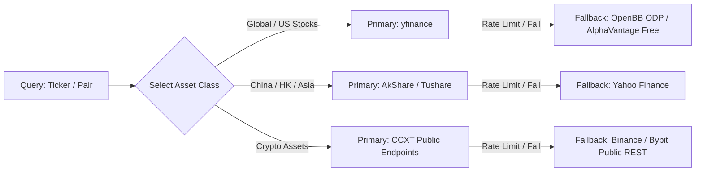

# Data Ingestion Pipelines & Zero-Cost Automation Playbook

Data engineering workflows and zero-cost automation architecture adapted from **ZhuLinsen/daily_stock_analysis**, **openbq-org/OpenBB**, and **CCXT**.

---

## 1. Multi-Source Redundancy Engine (Zero-Cost Data Ingestion)

Never depend on a single financial data provider. Enforce automatic fallback cascades:



### Python Multi-Source Extraction Pattern:
```python
def fetch_ticker_data(ticker: str, period: str = "1y"):
    """Fetch price data with automatic provider redundancy."""
    try:
        import yfinance as yf
        df = yf.download(ticker, period=period, progress=False)
        if not df.empty:
            return df
    except Exception as e:
        pass
    
    # Secondary Fallback: CCXT for Crypto or AkShare for Asian equities
    if "/" in ticker or ticker.endswith("USDT"):
        import ccxt
        exchange = ccxt.binance()
        ohlcv = exchange.fetch_ohlcv(ticker, timeframe="1d", limit=250)
        import pandas as pd
        df = pd.DataFrame(ohlcv, columns=["timestamp", "open", "high", "low", "close", "volume"])
        df["timestamp"] = pd.to_datetime(df["timestamp"], unit="ms")
        return df.set_index("timestamp")
        
    raise RuntimeError(f"All data providers exhausted for ticker: {ticker}")
```

---

## 2. GitHub Actions Zero-Cost Automation (.github/workflows)

Run scheduled daily stock / crypto scans 100% free without maintaining a dedicated VPS server:

```yaml
name: Daily Quant Market Intelligence
on:
  schedule:
    - cron: '30 1 * * 1-5' # 08:30 AM Bangkok Time (UTC+7) on weekdays
  workflow_dispatch:        # Manual trigger

jobs:
  run-analysis:
    runs-on: ubuntu-latest
    steps:
      - uses: actions/checkout@v4
      - uses: actions/setup-python@v5
        with:
          python-version: '3.11'
          cache: 'pip'

      - name: Install Dependencies
        run: |
          pip install yfinance pandas numpy ccxt requests

      - name: Execute Quant Analysis
        env:
          TELEGRAM_BOT_TOKEN: ${{ secrets.TELEGRAM_BOT_TOKEN }}
          TELEGRAM_CHAT_ID: ${{ secrets.TELEGRAM_CHAT_ID }}
        run: |
          python scripts/run_daily_quant.py
```

---

## 3. Standard Daily Report Structure (Markdown Output)

When producing a complete quantitative market teardown, format according to this blueprint:

```markdown
# 📈 Quantitative Market Intelligence: [TICKER / ASSET]

## 1. Executive Snapshot & Multi-Agent Verdict
- **Ticker / Pair**: [TICKER] | **Current Price**: $[PRICE] ([CHANGE]%)
- **Quantitative Score**: `[SCORE] / 100` (`[ACTION]`)
- **Market Regime**: `[REGIME]` (Confidence: `[CONFIDENCE]`)
- **Executive Verdict**: [1-2 sentences summarizing consensus between Bullish, Bearish, and Risk Arbiter]

## 2. Multi-Agent Adversarial Debate
| Agent Persona | Stance & Arguments | Evidence / Key Metrics |
| :--- | :--- | :--- |
| 🟢 **Bullish Advocate** | [Top 3 growth drivers / breakout catalysts] | [Metrics: Margin growth, MA Golden Cross, Volume] |
| 🔴 **Bearish Skeptic** | [Top 3 risks / valuation traps / distribution signs] | [Metrics: Debt ratio, RSI Bearish Div, P/E multiple] |
| ⚖️ **Risk Arbiter** | [Weighted resolution and sizing recommendation] | [Risk/Reward: >= 1:2, Invalidation boundary] |

## 3. Technical & Quantitative Indicator Matrix
| Indicator | Current Value | Signal Status | Tactical Interpretation |
| :--- | :--- | :--- | :--- |
| **Trend (EMA 20/50/200)** | ... | Bullish / Bearish | Primary trend alignment |
| **RSI (14)** | ... | Neutral / Divergence | Momentum exhaustion check |
| **MACD (12, 26, 9)** | ... | Histogram Cross | Momentum acceleration |
| **Bollinger Bands** | ... | Squeeze / Expansion | Volatility expansion readiness |
| **Volume & OBV** | ... | Institutional Footprint | Accumulation vs Distribution |

## 4. Execution Gameplan & Risk Budget
- **Actionable Setup**: `[BUY_LIMIT / WAIT_PULLBACK / AVOID]`
- **Suggested Entry Zone**: `[RANGE]`
- **Take-Profit Targets**: `T1: [PRICE]` | `T2: [PRICE]`
- **Invalidation Level (Hard Stop)**: `[PRICE]` (Risk: `[RISK]%`)
- **Risk / Reward Ratio**: `1 : [R_R_RATIO]`
```
