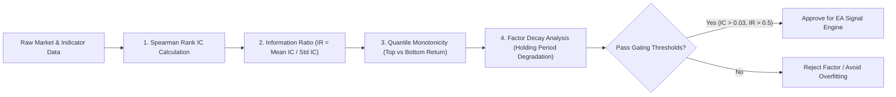

# Predictive Factor Evaluation & Information Coefficient (IC/IR Protocol)

ระเบียบวิธีการประเมินความสามารถในการทำนายของอินดิเคเตอร์หรือปัจจัยเชิงปริมาณ (Alpha Factors) (ดัดแปลงจากโมเดลของ `Alphalens` และ `Microsoft Qlib`) เพื่อพิสูจน์ว่าสัญญาณเทรดมีนัยสำคัญทางสถิติ (Statistical Edge) หรือเป็นเพียงสัญญาณหลอก (Noise / Data Snooping) ก่อนเริ่มต้นเขียนโค้ดและทดสอบแบ็กเทสต์

---

## 1. ปัญหาของการทำ Data Snooping และ Overfitting

นักเทรดทั่วไปมักนำ Indicator หลายตัวมาประกอบกันแล้วสุ่มปรับ Parameter จนกราฟในอดีตสวยงาม (Curve Fitting) แต่เมื่อนำไปรันจริงกลับขาดทุนทันที:
- สาเหตุเกิดจากการ **ไม่เคยประเมิน Predictive Power ของสัญญาณแยกเดี่ยว**
- การคำนวณ Information Coefficient (IC) คือมาตรฐานสากลในการคัดกรอง Factor ขยะทิ้งตั้งแต่ด่านแรก

---

## 2. เสาหลักการประเมิน Factor (The 4 Evaluation Pillars)

### 1. Spearman Rank Information Coefficient (Rank IC)
วัดความสัมพันธ์แบบไม่เชิงเส้นระหว่าง **คะแนนของ Factor ในปัจจุบัน ($F_t$)** กับ **ผลตอบแทนในอนาคต ($R_{t+k}$)**:

$$\text{Rank IC}_t = \text{Corr}\big(\text{rank}(F_t), \, \text{rank}(R_{t+k})\big)$$

- คำนวณข้ามทุกสินทรัพย์ (Cross-Sectional) ในแต่ละช่วงเวลา
- *เกณฑ์ผ่าน:* $|\text{Mean Rank IC}| \ge 0.03$ (ถือว่ามีพลังในการทำนายอย่างมีนัยสำคัญ)

### 2. Information Ratio (IR / ICIR)
วัดความคงเส้นคงวาของพลังการทำนายตลอดช่วงเวลา (Consistency of Edge):

$$\text{ICIR} = \frac{\mu(\text{Rank IC})}{\sigma(\text{Rank IC})}$$

- *เกณฑ์ผ่าน:* $\text{ICIR} \ge 0.5$ (แสดงว่า Factor สร้างกำไรสม่ำเสมอ ไม่ใช่ทำกำไรได้แค่ไม่กี่วันแล้วเงียบ)

### 3. Quantile Monotonicity (ความเป็นระเบียบของพอร์ตย่อย)
- แบ่งสินทรัพย์หรือจุดเข้าเทรดออกเป็น 5 Quantiles ตามคะแนนของ Factor (Q1 = ต่ำสุด, Q5 = สูงสุด)
- ผลตอบแทนต้องเรียงลำดับอย่างเป็นระเบียบ: $R(Q5) > R(Q4) > R(Q3) > R(Q2) > R(Q1)$
- หากผลตอบแทนกระโดดสลับไปมา แสดงว่า Factor นั้นไม่มีความสัมพันธ์เชิงเหตุผลที่แท้จริง

### 4. Factor Decay Horizon (การเสื่อมค่าตามเวลา)
- วัดค่า IC ที่กรอบเวลาล่วงหน้าต่างกัน: $t+1, t+5, t+15, t+60$ แท่งเทียน
- สัญญาณประเภท Momentum มักเสื่อมค่าช้า (Decay นานหลายชั่วโมง) ส่วนสัญญาณประเภท Order Flow / Liquidity Sweep มักเสื่อมค่าเร็ว (มีผลเพียง 1–5 แท่งเทียน)

---

## 3. เกณฑ์ชี้ขาดก่อนนำสัญญาณเข้าสู่ EA

- [ ] $\text{Mean Rank IC} \ge 0.03$ บนข้อมูล In-Sample
- [ ] $\text{ICIR} \ge 0.50$ (ค่า $t\text{-stat} > 2.0$)
- [ ] ความชันของ Quantile Return เป็นเส้นตรง monotonic
- [ ] สัญญาณไม่เสื่อมค่าก่อนที่ระบบจะส่ง Order ทัน (Execution Delay Tolerance)
