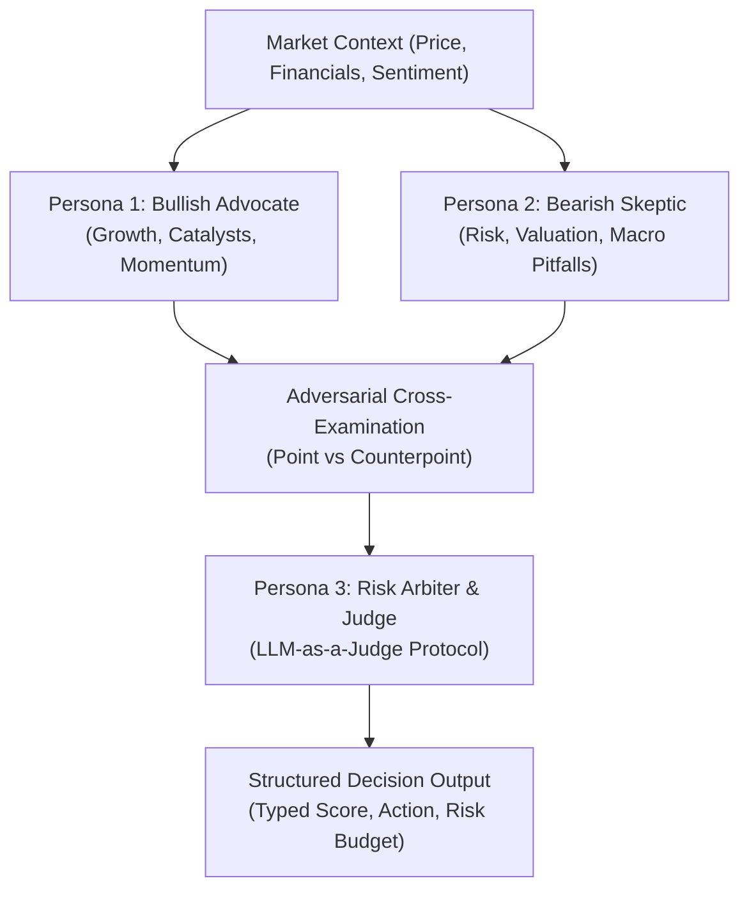

# Multi-Agent Debate Protocol (TradingAgents Architecture)

A decoupled multi-agent adversarial deliberation framework adapted from **TauricResearch/TradingAgents** and Antigravity's **Structured Decision Gating**. It replaces single-perspective LLM hallucination with role-specialized debate between opposing market theses.

---

## 1. The 3-Persona Adversarial Architecture



### Persona 1: Bullish Advocate (The Growth & Momentum Catalyst)
- **Primary Mandate:** Uncover upside potential, structural market tailwinds, and non-consensus growth drivers.
- **Key Probes:**
  - Revenue/Earnings Acceleration, margin expansion, product moat.
  - Institutional accumulation (OBV, volume spikes, Dark Pool footprint).
  - Technical momentum: Trend continuation, MA alignment, higher swing lows.
- **Output:** Top 3 Bullish Arguments with supporting quantitative evidence.

### Persona 2: Bearish Skeptic (The Short-Seller & Risk Inquisitor)
- **Primary Mandate:** Challenge the consensus thesis, seek balance sheet weaknesses, valuation stress, and macro headwinds.
- **Key Probes:**
  - Debt maturity wall, dilution risk, free cash flow deterioration.
  - Overvaluation relative to industry peers and historical multiples.
  - Technical distribution: Bearish divergences (RSI/MACD), double-tops, failed breakouts.
- **Output:** Top 3 Bearish Vulnerabilities and catastrophic failure scenarios.

### Persona 3: Risk Arbiter & Execution Judge (LLM-as-a-Judge)
- **Primary Mandate:** Weigh opposing arguments impartially without emotion; enforce risk-first portfolio constraints.
- **Invariant:** Must reject emotional narratives and evaluate purely on verifiable data weight and risk/reward asymmetry.

---

## 2. Structured Decision Gating Schema

The Risk Arbiter outputs a strictly formatted typed decision object:

```typescript
interface QuantDecision {
  ticker: string;
  market_regime: "BULL_TREND" | "BEAR_TREND" | "SIDEWAY_CHOP" | "HIGH_VOL_CRISIS";
  quantitative_score: number; // -100 (Extreme Bearish) to +100 (Extreme Bullish)
  action: "STRONG_BUY" | "ACCUMULATE" | "NEUTRAL_HOLD" | "TRIM_POSITION" | "STRONG_SELL";
  confidence: number;         // 0.0 to 1.0
  key_catalyst: string;       // 1-sentence primary driver
  primary_risk: string;       // 1-sentence catastrophic invalidation
  invalidation_level: number; // Stop-loss / invalidation price
  target_levels: number[];    // Take-profit target levels [T1, T2]
  risk_reward_ratio: number;  // Must be >= 2.0 for actionable trade entry
}
```

---

## 3. Deliberation Rules & Cognitive Discipline

1. **Zero Unfalsifiable Claims:** Every argument by Bullish or Bearish agents must cite specific numbers (P/E, revenue growth %, RSI value, support level).
2. **Asymmetric Invalidation:** A trade setup with a 70% win probability but 5:1 downside tail risk must be rejected by the Risk Arbiter (`action: NEUTRAL_HOLD`).
3. **Regime Gating:** In a `HIGH_VOL_CRISIS` or `SIDEWAY_CHOP` regime, the Risk Arbiter automatically halves position sizes or raises the entry threshold.
