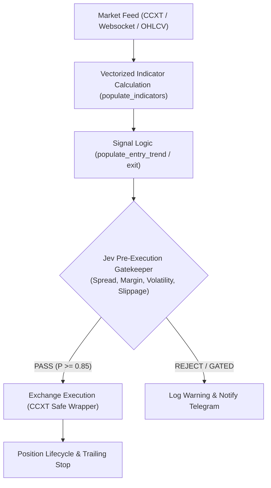

# Python Algorithmic Trading Architecture (Freqtrade + CCXT + QuantDinger V2)

สถาปัตยกรรมสร้างระบบเทรดอัตโนมัติด้วย Python สำหรับ Cryptocurrency และ Global Equities โดยผสานแบบแผนการออกแบบที่ดีที่สุดจาก **Freqtrade** (Vectorized Strategy & Risk Lifecycle), **CCXT** (Exchange Agnostic Execution), และ **QuantDinger Strategy V2** (Signal Gating & Real-Time Telemetry)

---

## 1. Core Architecture Overview



---

## 2. Standard Institutional Strategy Template (`BaseQuantStrategy`)

```python
"""
Institutional Python Strategy Base Template
Compatible with Freqtrade lifecycle and direct CCXT bot execution.
"""
import logging
from typing import Dict, Any, Optional
import pandas as pd
import numpy as np

logger = logging.getLogger("QuantStrategy")

class BaseQuantStrategy:
    # 1. Strategy Hyperparameters (Optimizable via TPE / Optuna)
    timeframe: str = "1h"
    minimal_roi: Dict[str, float] = {"0": 0.05, "30": 0.03, "60": 0.01}
    stoploss: float = -0.04
    trailing_stop: bool = True
    trailing_stop_positive: float = 0.015
    trailing_stop_positive_offset: float = 0.025
    
    # Pre-Execution Gate Thresholds
    max_spread_pct: float = 0.0015     # Max 0.15% spread
    max_slippage_pct: float = 0.0020   # Max 0.20% slippage tolerance
    min_volume_usd: float = 500_000.0  # Min 24h rolling volume

    def populate_indicators(self, dataframe: pd.DataFrame, metadata: Dict[str, Any]) -> pd.DataFrame:
        """Vectorized indicator calculation (Pandas / TA-Lib / VectorBT)"""
        # Exponential Moving Averages
        dataframe["ema_fast"] = dataframe["close"].ewm(span=20, adjust=False).mean()
        dataframe["ema_slow"] = dataframe["close"].ewm(span=50, adjust=False).mean()
        dataframe["ema_trend"] = dataframe["close"].ewm(span=200, adjust=False).mean()

        # Relative Strength Index
        delta = dataframe["close"].diff()
        gain = (delta.where(delta > 0, 0)).rolling(window=14).mean()
        loss = (-delta.where(delta < 0, 0)).rolling(window=14).mean()
        rs = gain / loss.replace(0, np.nan)
        dataframe["rsi"] = 100 - (100 / (1 + rs))

        # Average True Range (ATR)
        high_low = dataframe["high"] - dataframe["low"]
        high_close = (dataframe["high"] - dataframe["close"].shift()).abs()
        low_close = (dataframe["low"] - dataframe["close"].shift()).abs()
        ranges = pd.concat([high_low, high_close, low_close], axis=1)
        dataframe["atr"] = ranges.max(axis=1).rolling(14).mean()

        return dataframe

    def populate_entry_trend(self, dataframe: pd.DataFrame, metadata: Dict[str, Any]) -> pd.DataFrame:
        """Vectorized entry signal generation"""
        dataframe["enter_long"] = 0
        dataframe["enter_tag"] = ""

        conditions = (
            (dataframe["close"] > dataframe["ema_trend"]) &
            (dataframe["ema_fast"] > dataframe["ema_slow"]) &
            (dataframe["rsi"] > 50) &
            (dataframe["rsi"] < 70) &
            (dataframe["volume"] > 0)
        )
        dataframe.loc[conditions, "enter_long"] = 1
        dataframe.loc[conditions, "enter_tag"] = "trend_continuation_long"
        return dataframe

    def pre_execution_gate(self, ticker_data: Dict[str, Any], balance_usd: float, order_size_usd: float) -> tuple[bool, str]:
        """
        Atomic Pre-Execution Gate (Ported from JevExecutionGate concept)
        Verifies spread, slippage, liquidity, and margin before sending order to exchange.
        """
        bid = ticker_data.get("bid", 0.0)
        ask = ticker_data.get("ask", 0.0)
        if bid <= 0 or ask <= 0:
            return False, "INVALID_TICKER_DATA"

        # 1. Spread Check
        spread_pct = (ask - bid) / ask
        if spread_pct > self.max_spread_pct:
            return False, f"SPREAD_TOO_WIDE: {spread_pct*100:.3f}% > {self.max_spread_pct*100:.3f}%"

        # 2. Capital & Margin Check
        if order_size_usd > balance_usd * 0.95:
            return False, f"INSUFFICIENT_MARGIN: order={order_size_usd} > avail={balance_usd*0.95}"

        # 3. Liquidity Depth Check
        quote_volume = ticker_data.get("quoteVolume", 0.0)
        if quote_volume > 0 and quote_volume < self.min_volume_usd:
            return False, f"LOW_LIQUIDITY: 24h vol={quote_volume} < min={self.min_volume_usd}"

        return True, "PASSED"

    def execute_order(self, exchange, symbol: str, side: str, amount: float, price: Optional[float] = None) -> Dict[str, Any]:
        """Safe Exchange Order Dispatch with Fenced Error Handling"""
        try:
            if side == "buy":
                return exchange.create_market_buy_order(symbol, amount)
            else:
                return exchange.create_market_sell_order(symbol, amount)
        except Exception as e:
            logger.error(f"Execution Error on {symbol}: {str(e)}")
            raise
```

---

## 3. Parameter Optimization via TPE (Tree-structured Parzen Estimator)

ใช้ Optuna / Hyperopt เพื่อค้นหาพารามิเตอร์แบบ Bayesian แทน Grid Search ที่สิ้นเปลือง:

```python
import optuna

def objective(trial):
    # Optimize Fast/Slow EMA spans and RSI thresholds
    fast_span = trial.suggest_int("fast_span", 10, 30)
    slow_span = trial.suggest_int("slow_span", 40, 80)
    rsi_lower = trial.suggest_int("rsi_lower", 40, 55)

    # Run backtest against out-of-sample data
    profit, max_drawdown, sharpe = run_vector_backtest(fast_span, slow_span, rsi_lower)

    # Multi-Objective Optimization: Maximize Sharpe ratio while penalizing Drawdown
    if max_drawdown > 0.15:  # Hard penalty for drawdown > 15%
        return -999.0
    return sharpe

study = optuna.create_study(direction="maximize", sampler=optuna.samplers.TPESampler(seed=42))
study.optimize(objective, n_trials=200)
```

---

## 4. Telemetry and Alerting Integration

ผสานรวมแจ้งเตือนผ่าน Telegram หรือ Discord Webhook:
- แจ้งเตือนเมื่อเกิด Order Execution (`ENTRY_SIGNAL`, `EXIT_SIGNAL`)
- แจ้งเตือนเมื่อ Pre-Execution Gate ปฏิเสธคำสั่ง (`GATE_REJECTED` พร้อมสาเหตุเช่น Spread Spike หรือ Margin Deficit)
- ตรวจสอบสถานะการเชื่อมต่อ Heartbeat ทุกชั่วโมง
