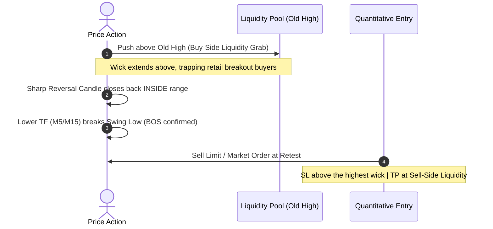

# 6-Strategy Quantitative Trading Playbook

คู่มือมาตรฐานสเปกกลยุทธ์การเทรดเชิงปริมาณ 6 รูปแบบสำหรับทองคำ (XAUUSD), ดัชนี และฟอเร็กซ์ สังเคราะห์จากระบบสากลพร้อมสูตรคำนวณ ตรรกะ Invalidation และเกณฑ์การเข้าออเดอร์เชิงตัวเลข

---

## 0. กฎเหล็กควบคุมความเสี่ยง (Execution Gating Invariants)

1. **Asymmetric Risk/Reward Ratio (RRR):** อัตราส่วนผลตอบแทนต่อความเสี่ยงต้อง $\ge 1:2.0$ เสมอ (ห้ามเข้าเทรดหาก SL กว้างกว่า TP)
2. **Hard Invalidation Level:** ทุกไม้ต้องมีจุดตัดขาดทุน (Stop-Loss) อิงตามโครงสร้างราคา (Structural Swing) ห้ามใช้ Fixed Pips แบบสุ่มสี่สุ่มห้า
3. **Lot Sizing Formula:**
   $$\text{Lot Size} = \frac{\text{Account Equity} \times \text{Risk \%}}{\text{Stop-Loss Distance (Points)} \times \text{Tick Value}}$$
   *(จำกัดความเสี่ยงไม่เกิน 1.0% - 2.0% ต่อไม้เด็ดขาด)*

---

## 1. Strategy 1: SMC Liquidity Sweep + BOS (Break of Structure)

กลยุทธ์ตามรอย Smart Money เข้าเทรดเมื่อรายใหญ่กวาดสภาพคล่อง (Stop Hunt)

- **เงื่อนไข Sell (Bearish Sweep):**
  1. ราคาวิ่งทะลุยอด High เดิมของ Session หรือ Previous Day High (PDH)
  2. แท่งเทียนทิ้งไส้ยาวด้านบน และราคาปิด (Close) ดึงกลับมาต่ำกว่าแนวต้านเดิม
  3. เกิดการเบรก Swing Low ล่าสุดใน Timeframe M5/M15 (BOS)
  4. **Stop Loss:** วางเหนือยอดไส้เทียนที่กวาด Liquidity $+ 1.5 \times \text{Spread}$
  5. **Take Profit:** จุด Swing Low ฝั่งตรงข้าม (Sell-Side Liquidity - SSL)

---

## 2. Strategy 2: Supply / Demand Retest (Fair Value Gap - FVG)

เทรดตามรอยแท่งเทียนที่เกิดความไม่สมดุลของราคา (Imbalance)

- **สูตรคำนวณ Fair Value Gap (3-Candle Pattern):**
  - **Bullish FVG:** เมื่อ $\text{Low}_{\text{bar}[0]} > \text{High}_{\text{bar}[2]}$ (เกิดช่องว่างราคาระหว่างแท่งที่ 1 กับ 3)
  - **Bearish FVG:** เมื่อ $\text{High}_{\text{bar}[0]} < \text{Low}_{\text{bar}[2]}$
- **การเข้าออเดอร์:**
  1. รอราคาย่อตัวกลับมาทดสอบโซน FVG (Consequent Encroachment: จุดกึ่งกลาง 50% ของ Gap)
  2. เกิดแท่งเทียน Rejection (เช่น Bullish Pin Bar หรือ Engulfing) ใน Timeframe ย่อย
  3. **Stop Loss:** วางหลังขอบล่างของ Order Block ที่เป็นจุดเริ่มของแรงส่ง
  4. **Take Profit:** Target High เดิม หรือ FVG ฝั่งตรงข้าม

---

## 3. Strategy 3: Asian Range Breakout (London Open Expansion)

กลยุทธ์ดักจับการขยายตัวของ Volatility เมื่อตลาดยุโรปเปิด

- **กรอบเวลา (Session Definition):**
  - Asian Range: 00:00 - 08:00 GMT (07:00 - 15:00 น. เวลาไทย)
  - คำนวณค่า: $\text{Asian High} = \max(\text{High})$, $\text{Asian Low} = \min(\text{Low})$
- **เกณฑ์การเข้าออเดอร์:**
  1. รอช่วงเวลา London Open (08:00 - 10:00 GMT / 15:00 - 17:00 น. เวลาไทย)
  2. **Breakout Trigger:** ราคาปิดของแท่งเทียน M15 ทะลุเหนือ Asian High (Buy) หรือหลุด Asian Low (Sell)
  3. **Volatility Filter:** ขนาดของแท่ง Breakout ต้องมีค่า $\ge 1.2 \times \text{ATR}(14)$ ป้องกัน False Break
  4. **Stop Loss:** วางที่เส้นกึ่งกลาง (Midpoint) ของ Asian Range
  5. **Take Profit:** $1.5 \times$ ถึง $2.0 \times$ ของระยะความกว้างกรอบเอเชีย

---

## 4. Strategy 4: EMA Trend Pullback (Triple Dynamic Support/Resistance)

กลยุทธ์ตามแนวโน้มใหญ่ (Trend-Following) เข้าเมื่อเกิดการย่อตัว

- **อินดิเคเตอร์:** EMA 20, EMA 50, EMA 200
- **เกณฑ์พิจารณาฝั่ง Buy (Uptrend Regime):**
  1. การเรียงตัวสมบูรณ์: $\text{EMA}_{20} > \text{EMA}_{50} > \text{EMA}_{200}$
  2. ราคาย่อตัวลงมาแตะ "Value Pocket" (โซนระหว่าง EMA 20 และ EMA 50)
  3. สัญญาณ Momentum: $\text{RSI}(14) > 50$ (ยังคงอยู่ในแดนกระทิง)
  4. **Trigger:** แท่งเทียนเกิด Bullish Reversal ปิดข้ามเส้น EMA 20 อีกครั้ง
  5. **Stop Loss:** ต่ำกว่าเส้น EMA 50 หรือ Swing Low ล่าสุด

---

## 5. Strategy 5: Bollinger Bands Squeeze & Mean-Reversion

กลยุทธ์เก็บกำไรช่วงตลาดไซด์เวย์ (Range-Bound & Mean Reversion)

- **สูตรคำนวณ BandWidth:**
  $$\text{BandWidth} = \frac{\text{Upper Band} - \text{Lower Band}}{\text{Middle Band (SMA 20)}}$$
- **ขั้นตอนการเทรด:**
  1. **Squeeze Detection:** BandWidth หดแคบลงต่ำกว่าค่าเฉลี่ย 100 แท่งล่าสุด (ตลาดพักตัวสะสมพลัง)
  2. **Reversal Trigger:** ราคาพุ่งหลุดออกนอก Upper Band (2.0 SD) หรือ Lower Band แล้วเกิดแท่งเทียน Pin Bar ดีดกลับ
  3. **Target Entry:** เข้าออเดอร์สวนทางกลับเข้าหากึ่งกลาง (Mean Reversion)
  4. **Take Profit:** เส้น Middle Band (SMA 20)
  5. **Stop Loss:** 1.5 เท่าของ ATR เหนือยอดไส้เทียนที่หลุดออกไป

---

## 6. Strategy 6: Multi-Timeframe AI Confirmation Playbook

โครงสร้างการวิเคราะห์และตัดสินใจร่วมกันของ AI ใน 3 Timeframes:

| ระดับ | Timeframe | หน้าที่รับผิดชอบ | เงื่อนไขที่ต้องผ่าน |
| :---: | :---: | :--- | :--- |
| **HTF** | **H4 / D1** | กำหนด Directional Bias และ Major Key Levels | ตรวจสอบแนวรับ-ต้านหลัก และ Market Trend |
| **MTF** | **M15 / H1** | ค้นหาโครงสร้างตลาดและ Momentum Divergence | สแกนหา FVG, Liquidity Pool, และ RSI Divergence |
| **LTF** | **M1 / M5** | หาจุดซุ่มเข้า (Precision Entry) และคำนวณ RRR | แท่งเทียน Reject + Bar Guard + RRR $\ge 1:2.0$ |
