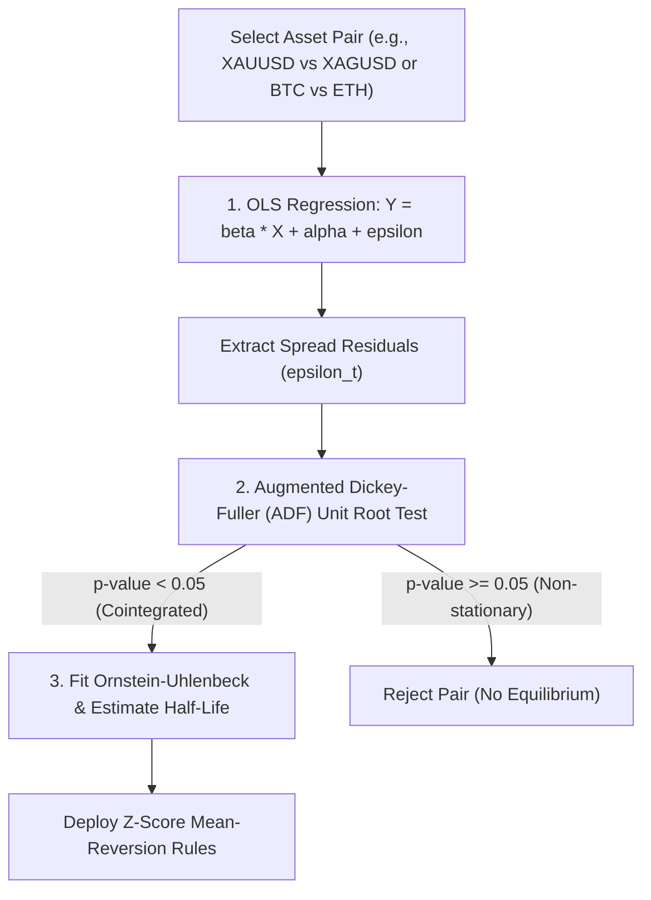

# Statistical Arbitrage & Cointegration Pairs Trading

คู่มือคณิตศาสตร์และการคำนวณเชิงปริมาณสำหรับกลยุทธ์ **Statistical Arbitrage & Pairs Trading** (ดัดแปลงจากโมเดลของ `Statsmodels` และ `Darts`) เพื่อค้นหาคู่สินทรัพย์ที่มีความสัมพันธ์เชิงดุลยภาพระยะยาว (Cointegration) และเข้าทำกำไรจากการดีดกลับของ Spread (Mean Reversion)

---

## 1. Correlation vs Cointegration (ทำไม Correlation ถึงไม่พอ)

ความแตกต่างสำคัญในเชิงสถิติ:
- **Correlation (สหสัมพันธ์)**: วัดเพียงว่าราคาสองสินทรัพย์ขยับขึ้นลงไปในทิศทางเดียวกันในระยะสั้นหรือไม่ แต่ราคาอาจแยกห่างจากกันไปเรื่อยๆ (Diverge) จนขาดทุนมหาศาล
- **Cointegration (การร่วมบูรณาการ)**: รับประกันว่าแม้ราคาสองสินทรัพย์จะผันผวนแบบ Non-stationary แต่ **ผลต่างเชิงเส้น (Spread) จะมีคุณสมบัติ Stationary เสมอ** กล่าวคือ ไม่ว่าจะแยกห่างกันเท่าใด ในที่สุดจะต้องดีดกลับเข้าหาค่าเฉลี่ยระยะยาว

---

## 2. ขั้นตอนการทดสอบ 3 สเต็ป (Engle-Granger Two-Step Method)

### 1. Ordinary Least Squares (OLS) Regression
หาค่า Hedge Ratio ($\beta$) ที่ทำให้ Spread มีเสถียรภาพสูงสุด:

$$\ln(P_A) = \alpha + \beta \ln(P_B) + \epsilon_t$$

$$\text{Spread}_t = \ln(P_A) - \beta \ln(P_B) - \alpha$$

### 2. การทดสอบ Stationary ด้วย ADF Test
ตรวจสอบว่า $\epsilon_t$ เป็น Stationary Series หรือไม่:
- หากค่า $p\text{-value} < 0.05$ แสดงว่าคู่สินทรัพย์นี้มี Cointegration จริงในระดับนัยสำคัญ 95%

### 3. การคำนวณ Half-Life of Mean Reversion (Ornstein-Uhlenbeck Process)
คำนวณระยะเวลาเฉลี่ยที่ Spread จะใช้ในการดีดกลับครึ่งหนึ่งของระยะทาง:

$$\Delta \text{Spread}_t = -\theta (\text{Spread}_{t-1} - \mu) \Delta t + \sigma \, dW_t$$

$$\text{Half-Life} = \frac{\ln(2)}{\theta}$$

- *เกณฑ์คัดกรอง:* Half-Life ควรอยู่ระหว่าง **5 ถึง 30 วัน** (หากสั้นเกินไปจะโดนค่าคอมมิชชันกินหมด, หากยาวเกินไปเงินทุนจะจม)

---

## 3. ตรรกะการส่งคำสั่งด้วย Spread Z-Score

คำนวณค่า Normalized Spread:

$$Z_t = \frac{\text{Spread}_t - \text{Mean}_{60}(\text{Spread})}{\text{Std}_{60}(\text{Spread})}$$

| เงื่อนไข Z-Score | การตัดสินใจ (Action) | Position Allocation |
| :---: | :---: | :--- |
| **$Z_t \ge +2.0$** | **Open Short Spread** | Sell Asset A / Buy $\beta \times$ Asset B |
| **$Z_t \le -2.0$** | **Open Long Spread** | Buy Asset A / Sell $\beta \times$ Asset B |
| **$|Z_t| \le 0.5$** | **Take Profit / Exit** | ปิดสถานะทั้งสองขาเมื่อ Spread กลับสู่สมดุล |
| **$|Z_t| \ge 3.5$** | **Stop Loss / Invalidation** | ตัดขาดทุนทันทีเมื่อสมมติฐาน Cointegration หลุด |
