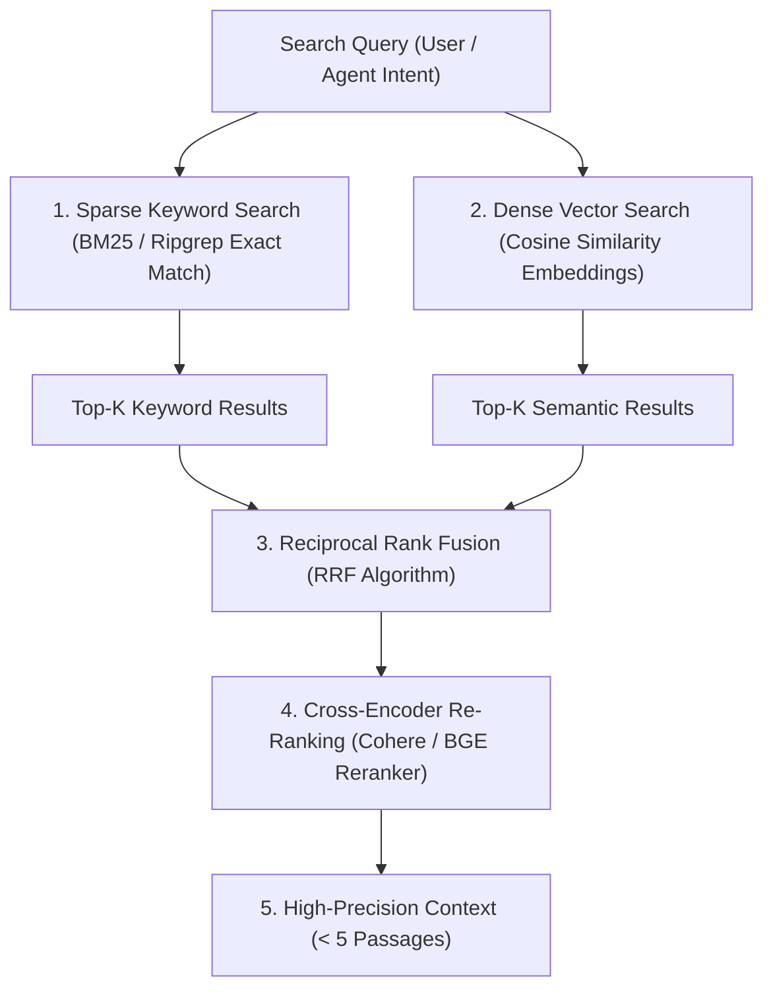

# Hybrid Retrieval & Reciprocal Rank Fusion (RRF) Protocol

ระเบียบวิธีการค้นหาและสกัดข้อมูลความแม่นยำสูง (ดัดแปลงจากโมเดลของ `RAGFlow`, `Weaviate`, และ `BGE Reranker`) โดยผสานจุดแข็งของการค้นหาแบบคำตรงตัว (Sparse Keyword Search) เข้ากับการค้นหาเชิงความหมาย (Dense Vector Semantic Search) เพื่อกำจัดจุดบอดของระบบค้นหาแบบเดิม

---

## 1. จุดบอดของการค้นหาแบบเดี่ยว (Single-Mode Retrieval Pitfalls)

1. **Keyword / BM25 Search เพียงอย่างเดียว**:
   - มองข้ามคำพ้องความหมาย (Synonyms) เช่น ค้นหา "error rate" แต่ไม่เจอเอกสารที่เขียนว่า "failure frequency"
2. **Dense Vector Search เพียงอย่างเดียว**:
   - อ่อนไหวต่อรหัสเฉพาะทาง, รหัสโมเดลอุปกรณ์, ชื่อฟังก์ชันโค้ด, หรือตัวเลขเฉพาะ เช่น ค้นหา `STM32F401` เวกเตอร์อาจดึงเอกสารของ `STM32F407` มาแทนเพราะความหมายใกล้เคียงกัน

---

## 2. โครงสร้างการค้นหาแบบ Hybrid Pipeline

---

## 3. อัลกอริทึม Reciprocal Rank Fusion (RRF)

RRF เป็นวิธีทางคณิตศาสตร์ที่ไม่ขึ้นอยู่กับ Scale ของคะแนนแต่ละระบบ (Score-Agnostic) โดยจัดอันดับจากลำดับที่ (Rank) ของแต่ละรายการ:

$$\text{RRF Score}(d) = \sum_{m \in M} \frac{1}{k + r_m(d)}$$

- $M$: ชุดของเครื่องมือค้นหา (เช่น $\{ \text{BM25}, \text{Vector} \}$)
- $r_m(d)$: อันดับของเอกสาร $d$ ในระบบค้นหา $m$ (1, 2, 3, ...)
- $k$: ค่าคงที่ปรับสมดุล (โดยทั่วไปกำหนด $k = 60$)

### จุดเด่นของ RRF:
- เอกสารที่ติดอันดับสูงในทั้งสองระบบจะได้รับคะแนนกระโดดขึ้นมาเป็นอันดับแรกทันที
- ป้องกันปัญหาระบบใดระบบหนึ่งให้คะแนนเบี่ยงเบน (Score Bias)

---

## 4. แนวปฏิบัติสำหรับ Agent เมื่อค้นหาข้อมูลในโปรเจกต์

1. **ค้นหาแบบ 2 ด่าน (Exact then Semantic)**:
   - สแกนหาคำเฉพาะทาง (Function name, Error code) ด้วย `ripgrep` / `grep` ก่อนเสมอ
   - หากไม่พบ หรือต้องการภาพรวมเชิงแนวคิด ให้ใช้ Vector/Semantic Search หรืออ่านบทสรุปภาพรวม
2. **Re-Ranking เพื่อประหยัด Token**:
   - ตัดข้อมูลส่วนเกินที่ไม่เกี่ยวข้องทิ้งทันที เหลือเฉพาะ 3–5 ย่อหน้าที่ได้คะแนน RRF สูงสุด
   - ห้ามนำผลการค้นหาดิบ 20–30 รายการเทลงใน Prompt
