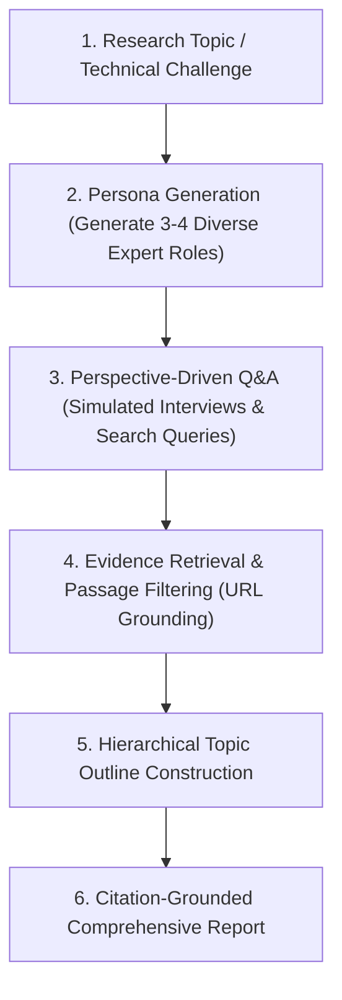

# Multi-Perspective Research & Citation Grounding (STORM Protocol)

สถาปัตยกรรมการวิจัยและสังเคราะห์องค์ความรู้เชิงลึกแบบอัตโนมัติ (ดัดแปลงจากโมเดลของ `STORM` โดย Stanford University และ `AnythingLLM`) เพื่อให้ AI Agent สามารถเจาะลึกหัวข้อที่ซับซ้อนได้อย่างรอบด้าน โดยการจำลองผู้เชี่ยวชาญจากหลายสาขามาตั้งคำถามโต้แย้ง และตรึงหลักฐานเชิงประจักษ์ (Citation Grounding) ในทุกข้อสรุป

---

## 1. จุดอ่อนของการค้นคว้าแบบมุมมองเดี่ยว (Single-Perspective Bias)

เมื่อ AI ค้นคว้าข้อมูลด้วยตัวเองแบบทั่วไป:
1. **Confirmation Bias**: โมเดลมีแนวโน้มค้นหาเฉพาะข้อมูลที่สนับสนุนสมมติฐานเริ่มต้น
2. **Superficial Overview**: ได้ข้อมูลแบบกว้างแต่ตื้น ขาดการเจาะลึกในแง่มุมเฉพาะทาง (เช่น มุมมองกฎหมาย, ประสิทธิภาพทางวิศวกรรม, หรือต้นทุน)
3. **Unanchored Claims**: สรุปข้อมูลโดยไม่มีที่มาอ้างอิงชัดเจน ก่อให้เกิดภาพหลอน (Hallucinations)

---

## 2. กระบวนการวิจัย 4 ขั้นตอนตามมาตรฐาน STORM

### 1. การสร้าง Persona ผู้เชี่ยวชาญหลากมิติ (Diverse Personas)
สำหรับหัวข้อวิจัยทางเทคนิค ให้จำลองมุมมองอย่างน้อย 3 ด้านเสมอ:
- **Core Domain Engineer**: ถามถึงกลไกการทำงานทางฟิสิกส์/คณิตศาสตร์ และอัลกอริทึม
- **Practitioner / Field Operator**: ถามถึงขั้นตอนการปฏิบัติงานจริง, ข้อจำกัดหน้างาน, และปัญหาที่พบบ่อย
- **Skeptic / Quality Auditor**: ถามถึงจุดที่อาจผิดพลาด, ข้อจำกัดด้านความคลาดเคลื่อน (Tolerance), และจุดบอดของระบบ

### 2. การตั้งคำถามเชิงรุกและการค้นหาหลักฐาน (Information Seeking)
- แต่ละ Persona จะสร้าง Query การค้นหาที่แตกต่างกันไปสืบค้นจากคู่มือทางการและมาตรฐานวิศวกรรม
- ข้อมูลที่ได้กลับมาต้องผ่านการกรองตัดความซ้ำซ้อนและจัดลำดับตามความน่าเชื่อถือ

### 3. การตรึงหลักฐานแบบคำต่อคำ (Strict Citation Grounding)
- ทุกประโยคที่เป็นข้อเท็จจริง ตัวเลขสเปก หรือมาตรฐาน ต้องมีลิงก์อ้างอิงกำกับ `[source](url)`
- หากข้อความใดไม่มีหลักฐานรองรับในเอกสารที่สกัดได้ ให้ระบุว่าเป็น "ข้อสันนิษฐานทางทฤษฎี" อย่างชัดเจน
