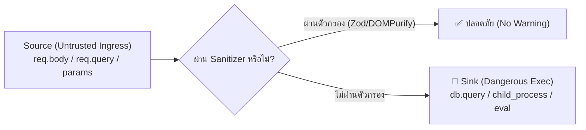

# AST-Pattern Taint Analysis & Custom SAST Rules

> [!NOTE]
> มาตรฐานระดับสูงสำหรับการตรวจจับช่องโหว่ความปลอดภัยด้วยการวิเคราะห์โครงสร้างต้นไม้ของโค้ด (Abstract Syntax Tree - AST Pattern Matching) และการแกะรอยข้อมูลอันตราย (Taint Tracking) ถอดแบบองค์ความรู้จาก **Semgrep**, **Semgrep Rules**, และ **Facebook Infer**

---

## 1. จุดจบของ Regex สู่การวิเคราะห์ AST (The Semantic Advantage)

การใช้ Regular Expression ตรวจจับโค้ดมักเกิด False Positives สูงมาก เพราะ Regex ไม่เข้าใจขอบเขตตัวแปร (Scope), การเปลี่ยนชื่อตัวแปร (Aliasing), หรือการจัดช่องไฟ (Whitespace/Formatting):

```javascript
// Regex ทั่วไปตรวจไม่พบ:
const query = "SELECT * FROM users WHERE id = " +
              userId; // ถูกตัดขึ้นบรรทัดใหม่
db.raw(query);

// AST-Pattern เข้าใจโครงสร้างไวยากรณ์:
// pattern: db.raw("..." + $VAR)  --> ตรวจจับได้ 100% แม้จะขึ้นบรรทัดใหม่หรือเว้นวรรคกี่เคาะ
```

---

## 2. โครงสร้างกฎ SAST โหมด Taint Analysis (Source-to-Sink)

ในโหมด Taint Analysis ระบบจะลากสายข้อมูลจากจุดรับเข้า (Source) ผ่านตัวกรองความปลอดภัย (Sanitizer) ไปยังจุดเกิดเหตุอันตราย (Sink):



---

## 3. ตัวอย่างกฎ Semgrep YAML สำหรับ Production Audit

### กฎที่ 1: ตรวจจับ SQL Injection ใน Raw Queries
```yaml
rules:
  - id: node-raw-sql-injection-taint
    mode: taint
    languages: [javascript, typescript]
    severity: ERROR
    message: |
      พบการนำข้อมูลผู้ใช้ (Untrusted Ingress) ไปต่อ String เข้าสู่ Raw SQL Query โดยตรง
      ซึ่งนำไปสู่ช่องโหว่ SQL Injection ให้ใช้ Parameterized Query หรือ ORM Query Builder แทน
    pattern-sources:
      - pattern: req.query.$PROP
      - pattern: req.body.$PROP
      - pattern: req.params.$PROP
    pattern-sanitizers:
      - pattern: validator.escape(...)
      - pattern: Number(...)
      - pattern: parseInt(...)
    pattern-sinks:
      - pattern: db.raw(...)
      - pattern: sequelize.query(...)
      - pattern: connection.query(...)
```

### กฎที่ 2: ตรวจจับ Remote Code / Command Injection
```yaml
rules:
  - id: node-command-injection
    mode: taint
    languages: [javascript, typescript]
    severity: CRITICAL
    message: |
      ห้ามส่งตัวแปรที่รับจากภายนอกเข้าสู่ child_process.exec หรือ shell ตรงๆ
    pattern-sources:
      - pattern: req.body
      - pattern: req.query
    pattern-sinks:
      - pattern: child_process.exec($CMD, ...)
      - pattern: execSync($CMD, ...)
```

---

## 4. มาตรฐานการตรวจรับงานด้าน SAST (Verification Matrix)

| หมวดหมู่ช่องโหว่ (OWASP) | แหล่งกำเนิด (Source) | จุดปลายทางอันตราย (Sink) | ตัวกรองที่บังคับใช้ (Required Sanitizer) |
| :--- | :--- | :--- | :--- |
| **SQL Injection** | `req.body`, `req.params` | `db.query()`, `db.raw()` | Parameterized inputs (`$1`, `?`), Zod schema coercion |
| **Command Injection** | CLI inputs, webhook payloads | `exec()`, `spawn({ shell: true })` | `execFile()` พร้อม Argument Array แบบแยกอิสระ |
| **Path Traversal** | File upload names, path params | `fs.readFile()`, `path.join()` | `path.basename()`, Canonical path verification (`startsWith(BASE)`) |
| **Stored/Reflected XSS** | Database inputs, User text | `dangerouslySetInnerHTML`, `.innerHTML` | `DOMPurify.sanitize()`, Safe JSX encoding |
